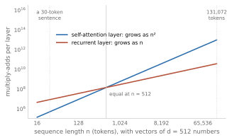

# Attention without recurrence (2017) {#attention}

<!-- D-002: intuition only; one formula (attention for one query), every symbol explained. D-003: no code. D-008: the two threads meet here. D-009: numbers from code/checks/attention.py. D-014: figures from figures/attention.py. -->

[The previous chapter](#seq2seq) ended with a translation decoder that, before writing each word, looks back over every word of the source sentence and takes a weighted average of their vectors. It also ended with a problem: the recurrent networks underneath still had to read a sentence one word at a time, which limited how much a GPU could do at once. This chapter is about the paper that removed the recurrence and kept the looking back, used everywhere. In June 2017, eight researchers at Google posted "Attention Is All You Need", which proposed "a new simple network architecture, the Transformer, based solely on attention mechanisms, dispensing with recurrence and convolutions entirely" [@vaswani2017attention, p. 1]. Every LLM in this book is built from its parts.

The mechanism at the center is **self-attention**: every token in a sequence gathers information from every other token in the same sequence, all at once. By the end of this chapter the reader should be able to follow one attention head by hand, say why it needs extra information about word order, and say what it costs.

## A word that looks at its neighbors

[The embeddings chapter](#embeddings) ended with a weakness. In a table of static word vectors, "bank" has one vector, and its nearest neighbors are all financial: the riverbank is nowhere. Jakob Uszkoreit, one of the paper's authors, used the same word to explain the new model. In "I arrived at the bank after crossing the river", a recurrent network "could only determine that 'bank' is likely to refer to the bank of a river after reading each word between 'bank' and 'river' step by step" [@uszkoreit2017transformer]. The transformer instead "compares it to every other word in the sentence. The result of these comparisons is an attention score for every other word in the sentence. These attention scores determine how much each of the other words should contribute to the next representation of 'bank'" [@uszkoreit2017transformer].

That is Bahdanau's attention from [the previous chapter](#seq2seq), with one change: the decoder looking at the source is replaced by each word looking at the words of its own sentence. The 2017 paper defines it: "Self-attention, sometimes called intra-attention is an attention mechanism relating different positions of a single sequence in order to compute a representation of the sequence" [@vaswani2017attention, p. 2]. After one such step, the vector for "bank" is no longer the same in every sentence: it has absorbed something from "river" or from "money". A vector that depends on the surrounding words is a **contextual embedding**, in a current textbook's words a representation built "by integrating the meaning of these helpful contextual words" [@jurafsky2026transformers, p. 4].

## Queries, keys, and values

The paper describes attention in terms borrowed from looking things up. "An attention function can be described as mapping a query and a set of key-value pairs to an output, where the query, keys, values, and output are all vectors. The output is computed as a weighted sum of the values, where the weight assigned to each value is computed by a compatibility function of the query with the corresponding key" [@vaswani2017attention, pp. 3-4].

Think of a database table of keys and values. An exact lookup compares the query with every key and returns the one value whose key matches. Attention does the same lookup softly: every row answers, loudly or quietly, and the result is a weighted mix of all the values, with weights set by how well each key matches the query. One textbook makes the comparison explicitly, and notes that an ordinary lookup is the special case in which one weight is 1 and the rest are 0 [@zhang2023dive, sec. 11.1].

In self-attention, each token plays all three roles. Its vector is turned into a **query** (what this token is looking for), a **key** (what this token offers to others looking), and a **value** (what this token passes on if it is looked at). The three are made by three separate learned maps of the same vector, multiplications by three weight matrices that are trained with everything else [@vaswani2017attention, p. 5]. Each token's query is compared with every token's key, the scores are turned into weights by a softmax, and the token's new vector is the weighted average of every token's value.

The paper's formula, written for one query $q$, reads

$$\text{output} = \sum_{j} \text{softmax}_j\!\left(\frac{q \cdot k_j}{\sqrt{d_k}}\right) v_j$$

where $k_j$ and $v_j$ are the key and value of token $j$, $q \cdot k_j$ is their dot product (the similarity score of [the embeddings chapter](#embeddings), without dividing by the lengths), $d_k$ is the number of numbers in each key, and the softmax of [the destination chapter](#destination) turns the scores into positive weights that sum to one [@vaswani2017attention, p. 4]. The authors call it **scaled dot-product attention**. The division by $\sqrt{d_k}$ is explained below.

{#fig:attention-kernel}

The reader has met this pattern before, in statistics. Kernel regression, proposed by Nadaraya and by Watson, both in 1964, predicts the value at a new point as an average of observed values, each weighted by how close its observation lies to the new point [@nadaraya1964estimating, p. 158; @zhang2023dive, sec. 11.1]. *The Elements of Statistical Learning* calls it "the so-called Nadaraya-Watson kernel-weighted average" [@hastie2009elements, p. 192]. <!-- D-009: code/checks/attention.py, Example 6 --> In the figure, five observations are weighted by a bell-shaped kernel centered on the query point 2.4. The two nearest get weights of 0.48 and 0.40, the farthest almost nothing, and the estimate is 2.53. Read the new point as the query, the observed points as keys, and the observed values as values, and this is attention. One textbook calls kernel regression "an early precursor of the current attention mechanisms" [@zhang2023dive, sec. 11.2], and a 2019 paper analyzed attention as "applying kernel smoother over the inputs with the kernel scores being the similarities between inputs" [@tsai2019transformer, p. 4344]. With keys of equal length, a bell-shaped (Gaussian) kernel of the right width gives exactly the same weights as the softmax of scaled dot products. The differences matter, though. In attention the queries, keys, and values are learned from data, and the "observations" are the other words of the sentence being read. The transformer's authors did not cite kernel regression; the link was drawn by later writers.

## One head, worked through

<!-- D-009: code/checks/attention.py, Examples 1 and 2 -->

A small example makes the mechanism concrete. Take the five words "the bank of the river" and give each a vector of four numbers. Real models learn hundreds to thousands of numbers per token, with no labels attached; here the four numbers are made up and labelled so the reader can follow them: how much the word is a function word, how much it is about money, how much about water, and how much it is a thing. "Bank" gets 0.3 for money and 0.3 for water, because on its own it could be either. "River" gets 1 for water. (A real tokenizer would also treat the two "the"s as different tokens, one with a leading space; this example treats them as one word.)

An **attention head** is one set of learned maps that make the queries, keys, and values. Here, one head with keys of two numbers ($d_k = 2$) is set up by hand. A thing asks "what topic is near me?", and a function word asks "where is a thing?" Every word's key advertises its topic and whether it is a thing. The values are the word vectors themselves.

For "bank", the query meets the five keys and the scaled scores are 0, 1.27, 0, 0, and 2.12. The softmax turns them into weights of 0.07, 0.24, 0.07, 0.07, and 0.56: more than half of the attention goes to "river". The new vector for "bank" is the weighted average of the five values: its water number rises from 0.30 to 0.63 and its money number falls from 0.30 to 0.07.

{#fig:attention-head}

Now run the same head, with the same learned maps, on "the bank lent us money". This time "bank" puts 0.53 of its attention on "money", and its new vector has 0.63 for money and 0.07 for water. Nothing about the head changed. The sentence did. This is what a static embedding could not do. In a real transformer, the head's output is added to the token's existing vector by a residual connection ([the chapter on deep networks](#depth)), and dozens of layers repeat the process, so that the vector for each token gathers more context at each layer.

## Why divide by the square root

<!-- D-009: code/checks/attention.py, Example 5 -->

The scores are divided by $\sqrt{d_k}$ before the softmax. The authors' reason was a suspicion: for large $d_k$, "the dot products grow large in magnitude, pushing the softmax function into regions where it has extremely small gradients" [@vaswani2017attention, p. 4]. A footnote gives the arithmetic. If the numbers in a query and a key are independent, with mean 0 and variance 1, their dot product has mean 0 and variance $d_k$ [@vaswani2017attention, p. 4]. A simulation shows it: with 64 numbers per vector, the dot products of random vectors have a variance of about 65, a spread (standard deviation) of about 8. Fed raw to a softmax over ten keys, such scores give the largest weight on average 0.86, so the softmax nearly always picks one key and ignores the rest. Divided by 8, the scores give an average largest weight of 0.33. The gradient of a softmax weight $p$ with respect to its own score is $p(1 - p)$: 0.25 at $p = 0.5$, but 0.001 at $p = 0.999$, which is why a saturated softmax learns slowly. The paper did not report a run without the scaling, so this is a reasoned fix rather than a measured one; the reader may recognize the familiar move of rescaling a quantity to unit variance.

## Many heads

One head asks one kind of question. The 2017 model ran eight at once. Instead of one attention over vectors of 512 numbers, "we found it beneficial to linearly project the queries, keys and values h times with different, learned linear projections", run attention on each projection "in parallel", and join the results [@vaswani2017attention, pp. 4-5]. Each of the eight heads works with keys of 64 numbers, and "due to the reduced dimension of each head, the total computational cost is similar to that of single-head attention with full dimensionality" [@vaswani2017attention, p. 5]. <!-- D-009: code/checks/attention.py, Example 8 --> The arithmetic checks out: the projections for eight heads of 64 numbers have exactly as many weights as for one head of 512. The stated reason: "Multi-head attention allows the model to jointly attend to information from different representation subspaces at different positions. With a single attention head, averaging inhibits this" [@vaswani2017attention, p. 5].

The paper's first author later taught it, with Anna Huang, using a picture. In the sentence "I kicked the ball", the word "kicked" might want to know who did it, what was done, and to whom; one head averages all three together, while separate heads can each ask one question [@vaswani2019self, slides 21-29]. That is a teaching picture, not a description of what trained heads do. In the paper's own tests on a development set, a single head was 0.9 BLEU worse than the best setting, and "quality also drops off with too many heads" [@vaswani2017attention, p. 9].

## Order must be added back

<!-- D-009: code/checks/attention.py, Example 3 -->

Self-attention has a blind spot. Each word's output depends on the queries, keys, and values of the other words, but not on where they are. Swap the words of "the bank of the river" into "the river of the bank", and every word gets exactly the same output as before, only in a different place: the toy head gives "bank" the vector it gave it in the original order. On its own, attention sees a bag of words, and "dog bites man" means the same as "man bites dog". As a later paper put it, the model "is otherwise entirely invariant to sequence ordering" [@shaw2018self, p. 464].

The 2017 paper's fix was to add a **positional encoding** to each token's vector before the first layer: "in order for the model to make use of the order of the sequence, we must inject some information about the relative or absolute position of the tokens in the sequence" [@vaswani2017attention, p. 6]. It used fixed patterns of sine and cosine waves, a different pattern for each position, with fast waves that tell neighboring positions apart and slow ones that tell distant positions apart [@vaswani2017attention, p. 6]. Add such a pattern to the toy example, and "bank" no longer gets the same output in the two orders. The authors also tried a learned table of position vectors and "found that the two versions produced nearly identical results"; they kept the waves because they "may allow the model to extrapolate to sequence lengths longer than the ones encountered during training", a hope the paper did not test [@vaswani2017attention, p. 6].

Later models chose differently. GPT (2018) "used learned position embeddings instead of the sinusoidal version" [@radford2018improving, p. 5], the position table of [the destination chapter](#destination), and so did BERT [@devlin2019bert, pp. 4174, 4183]. In 2018, Peter Shaw and colleagues, including two of the 2017 authors, let attention use the distance between tokens instead of their absolute positions, and reported gains in translation [@shaw2018self, p. 464]. As of a 2026-08 textbook draft, the most popular of the schemes that build relative position into attention itself is rotary position embeddings (2021), which rotate queries and keys by an angle that depends on position [@jurafsky2026transformers, p. 17; @su2021roformer, p. 1], used by Meta's LLaMA (2023) and Llama 3 [@touvron2023llama, p. 3; @grattafiori2024llama, p. 7].

## Why it trained fast

In a self-attention layer, every token's new vector depends only on the previous layer's vectors, not on the new vector of the token before it. So all positions can be computed at once, as a few large matrix multiplications, the operation GPUs do best ([the chapter on the deep learning turn](#deep-turn)). The authors put it as "the minimum number of sequential operations required": for a recurrent layer it grows with the length of the sequence, for self-attention it is constant [@vaswani2017attention, pp. 6-7]. <!-- D-009: code/checks/attention.py, Example 10 --> For a 30-token sentence, a recurrent layer needs 30 steps one after another, and information from the first token reaches the last through 29 steps; a self-attention layer needs one step, and every token reaches every other directly. The authors cite the second point as a learning advantage too: "The shorter these paths between any combination of positions in the input and output sequences, the easier it is to learn long-range dependencies" [@vaswani2017attention, p. 6], the vanishing-gradient lesson of [the structure chapter](#structure).

Training a translation decoder in parallel needs one more trick, because each output word may only depend on the words before it. The decoder's self-attention masks out later positions by setting their scores to minus infinity, so their softmax weights are exactly zero [@vaswani2017attention, p. 5]. <!-- D-009: code/checks/attention.py, Example 4 --> In the toy example, with such a mask, "bank" can see only "the" and itself, and its money and water numbers stay equal at 0.23: reading left to right, it cannot yet know which bank is meant. [The next chapter](#anatomy) shows how this mask turns into the decoder-only models behind GPT. Training is parallel because the whole target sentence is known in advance. Generating new text is still one token at a time, and the authors listed "making generation less sequential" as future work [@vaswani2017attention, p. 10].

{#fig:attention-cost}

There is a price. Every token compares itself with every other token, so the work per layer grows with the square of the length. The paper's Table 1 gives the cost of a self-attention layer as proportional to $n^2 d$, for $n$ tokens of $d$ numbers each, against $n d^2$ for a recurrent layer [@vaswani2017attention, p. 6]. <!-- D-009: code/checks/attention.py, Example 7 --> With $d = 512$, self-attention is cheaper below 512 tokens: for a 30-token sentence, counting as the table does only the comparisons between tokens, it costs 0.06 of a recurrent layer. Above 512 tokens it is dearer: 4 times at 2,048 tokens, and 256 times at 131,072, the context length of Llama 3.1 in [the destination chapter](#destination). The authors noted the trade-off: self-attention is faster "when the sequence length n is smaller than the representation dimensionality d, which is most often the case with sentence representations" [@vaswani2017attention, pp. 6-7]. For translation in 2017 that was true. For the long inputs of today's models (as of 2026), it is a central cost, and [the next chapter](#anatomy) returns to it.

## The 2017 model and its results

The model in the paper was a translation system, an encoder and a decoder like those of [the previous chapter](#seq2seq), but built of attention layers. It used attention three ways: self-attention in the encoder, masked self-attention in the decoder, and the decoder attending to the encoder's output, which "mimics the typical encoder-decoder attention mechanisms" of earlier translation models [@vaswani2017attention, p. 5]. Each layer also contained a small feed-forward network, residual connections, and layer normalization [@vaswani2017attention, pp. 3, 5], so attention was not literally all it needed. [The next chapter](#anatomy) takes the block apart.

The base model had six layers in the encoder and six in the decoder, vectors of 512 numbers, and 65 million parameters [@vaswani2017attention, pp. 3, 9]. "We trained our models on one machine with 8 NVIDIA P100 GPUs", the base model "for a total of 100,000 steps or 12 hours", and a big model of 213 million parameters for 3.5 days [@vaswani2017attention, pp. 7, 9]. On the standard English-to-German test, the big model scored 28.4 BLEU, "improving over the existing best results, including ensembles, by over 2 BLEU" [@vaswani2017attention, p. 1]; even the base model, at 27.3, beat every earlier system [@vaswani2017attention, p. 8]. (The English-to-French score differs between versions of the paper, so it is not quoted here.)

How much cheaper was it? The paper estimated each model's training cost in **FLOPs**, floating-point operations, by multiplying training time, number of GPUs, and an assumed speed per GPU, and found the base model trained "at a fraction of the training cost of any of the competitive models" [@vaswani2017attention, p. 8]. <!-- D-009: code/checks/attention.py, Example 9 --> By its own estimates, Google's 2016 recurrent translation system used about seven times the base model's training computation on English to German. The authors' later statements of the speed-up vary, from "up to an order of magnitude" in a blog post of August 2017 [@uszkoreit2017transformer] to "trained >3x faster than the others" in a 2019 lecture [@vaswani2019self, slide 35]; the paper itself gives estimates rather than a single factor.

Who did what is recorded in the paper. Its footnote says "Listing order is random" and then credits individuals: "Jakob proposed replacing RNNs with self-attention and started the effort to evaluate this idea. Ashish, with Illia, designed and implemented the first Transformer models and has been crucially involved in every aspect of this work. Noam proposed scaled dot-product attention, multi-head attention and the parameter-free position representation" [@vaswani2017attention, p. 1]. The other authors are credited with model variants, the code base, and the software that made the later results possible.

## Every ingredient had a predecessor

The 2017 paper's claim was precise: "the first transduction model relying entirely on self-attention to compute representations of its input and output without using sequence-aligned RNNs or convolution", qualified "To the best of our knowledge" [@vaswani2017attention, p. 2]. (A transduction model turns one sequence into another, as a translator does.) Its ingredients were older.

Statisticians had averaged stored values, weighted by similarity, since the 1960s. Neural networks had read from memories softly: the 2014 Neural Turing Machine read its memory with "'blurry' read and write operations" weighted by similarity [@graves2014neural, p. 5], and the end-to-end memory networks of 2015 compared a question's vector with each stored memory vector by a dot product followed by a softmax, then summed a second set of memory vectors with those weights [@sukhbaatar2015end, p. 2]: a query, keys, values, and a softmax over dot products. A 2016 paper used the names "key" and "value" for the two halves of such a memory [@miller2016key, p. 1401]. Several papers in 2016 and 2017 had used attention within a single sentence, weighting its words, usually inside or on top of a recurrent network [@cheng2016long, p. 551; @lin2017structured, p. 1; @paulus2017deep, p. 1]. One, by Ankur Parikh and colleagues with Uszkoreit as a co-author, used attention without recurrence on a task of comparing two sentences, and noted that this made it "trivially parallelizable" [@parikh2016decomposable, p. 2249]. And Bahdanau's attention, from [the previous chapter](#seq2seq), connected two sequences. The step taken in 2017 was to build a whole sequence-to-sequence model from attention alone, with no recurrence and no convolution, and to show that it was both better and cheaper to train.

## What do the heads learn?

Attention weights are numbers between 0 and 1 for every pair of tokens, so they can be drawn, and the drawings are tempting to read. The 2017 authors suggested that "self-attention could yield more interpretable models", and that many heads "appear to exhibit behavior related to the syntactic and semantic structure of the sentences" [@vaswani2017attention, p. 7]. A 2019 study of BERT, a model of [the chapter on pretraining](#pretraining), found heads that "find direct objects of verbs, determiners of nouns, objects of prepositions, and objects of possesive pronouns with >75% accuracy", but also that "over half of BERT's attention in layers 6-10 focuses on" a separator token, perhaps as "a sort of 'no-op'" [@clark2019does, pp. 276, 278-279].

Whether the weights explain what a model does is disputed. Sarthak Jain and Byron Wallace found that attention weights "are frequently uncorrelated with gradient-based measures of feature importance, and one can identify very different attention distributions that nonetheless yield equivalent predictions" [@jain2019attention, p. 3543]. Sarah Wiegreffe and Yuval Pinter replied that the claim "depends on one's definition of explanation" [@wiegreffe2019attention, p. 11]. Both studied attention mainly on top of recurrent networks, on classification and similar tasks, not transformer heads. A fair reading for now: the pictures often look sensible, and some heads line up with grammar, but a picture of attention is not a proof of why a model gave its answer.

## What to carry forward

- Self-attention lets every token gather information from every other token in the same sequence. Each token makes a query, a key, and a value; its new vector is a weighted average of all the values, with softmax weights from query-key dot products.
- It is a soft, learned lookup, and a relative of 1960s kernel regression, where the weights also come from similarity and sum to one.
- Scores are divided by the square root of the key length so that the softmax does not saturate as vectors grow.
- Several heads run in parallel, each with its own small projections, at about the cost of one large head.
- Attention ignores order, so position information is added: sine waves in 2017, learned tables in GPT and BERT, and rotations (rotary embeddings) in LLaMA, Llama 3, and many later models.
- With no recurrence, every position in a layer is computed at once, which suited GPUs. The price is work that grows with the square of the sequence length.
- The 2017 transformer beat the best translation systems at a fraction of their training cost. Its ingredients were older; building a whole model from attention alone was new.
- Attention pictures are easy to draw and hard to interpret.
