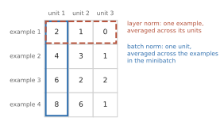
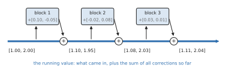

# Making deep networks trainable (2010-2016) {#depth}

<!-- D-002: intuition only; the residual formula is the one standard form. D-003: no code. D-009: numbers from code/checks/depth.py. D-014: figures from figures/depth.py. D-017: the model half of the former toolkit chapter; the training loop is `toolkit`. -->

The 2012 image network of [the chapter on the deep learning turn](#deep-turn) had eight layers. The winner of the same competition three years later was built from networks of up to 152. [The previous chapter](#toolkit) covered how training proceeds step by step. This one covers four changes to the network itself that made such depth possible. Each answers a specific way that deep networks failed:

- **Signals shrank or grew as they passed through the layers** at the start of training. The answer was starting weights scaled to the size of each layer.
- **Large networks memorized their training data.** The answer was dropout.
- **Training was slow and fragile.** The answer was normalization inside the network.
- **Adding layers made networks worse, even on their training data.** The answer was residual connections.

The last two reappear, in some form, in every transformer, the design at the heart of every LLM in this book. The chapter ends by reading the model half of two real training recipes.

## Starting weights scaled to the layer

[The chapter on learning in layers](#backprop) showed that starting weights must be random, to break the symmetry between units. It left open how large they should be. In 2010, Xavier Glorot and Yoshua Bengio set out "to understand better why standard gradient descent from random initialization is doing so poorly with deep neural networks" [@glorot2010understanding, p. 249]. Part of the answer was the units: "the logistic sigmoid activation is unsuited for deep networks with random initialization", because it can push the top layers into saturation [@glorot2010understanding, p. 249]. Another part was the size of the starting weights.

The common rule at the time drew each starting weight uniformly between $-1/\sqrt{n}$ and $+1/\sqrt{n}$, where $n$ is the number of inputs to the unit [@glorot2010understanding, p. 251]. Glorot and Bengio showed that this rule shrinks the signal at every layer: it gives each layer weights whose variance, multiplied by the number of inputs, is one third [@glorot2010understanding, p. 253]. Through ten such layers, the signal's variance is multiplied by one third ten times, and the gradient flowing back shrinks layer by layer too.

<!-- D-009: code/checks/depth.py, Example 1 -->

{#fig:depth-init}

The figure shows ten layers of 256 units (with the nonlinearity left out, to isolate the effect). With the old rule, the signal's variance falls from 1 to 0.332 after one layer, 0.0123 after four, and 0.0000156 after ten, close to the theoretical one third to the tenth power. The backward signal suffers the same way. Glorot and Bengio's proposal was to choose the spread so that the signal keeps its size in both directions, forward and backward. As a compromise between the two, they set the variance of each layer's weights to 2 divided by the sum of the layer's numbers of inputs and outputs [@glorot2010understanding, p. 253]. With that rule, the variance stays between 0.92 and 1.02 for all ten layers. The rule is also called "Xavier" initialization [@he2015delving, p. 3].

The derivation assumed units without a nonlinearity [@goodfellow2016deep, p. 299]. Kaiming He and colleagues redid it in 2015 for rectified linear units, which zero out half of their inputs on average, and arrived at a larger spread, twice the variance of Glorot's rule for a layer with equal numbers of inputs and outputs: a normal distribution with standard deviation $\sqrt{2/n}$ [@he2015delving, p. 4]. With it, they reported, "extremely deep models (e.g., 30 conv/fc layers)" converged where Glorot's rule could not [@he2015delving, p. 3]. In both cases the principle is the same: the more inputs a unit has, the smaller each starting weight must be, so that the weighted sum keeps a steady size from layer to layer.

## Dropout

Large networks can memorize their training sets. In 2012, Geoffrey Hinton and colleagues proposed a remedy that sounds like sabotage. "On each presentation of each training case, each hidden unit is randomly omitted from the network with a probability of 0.5, so a hidden unit cannot rely on other hidden units being present" [@hinton2012improving, p. 1]. This is dropout, met in [the chapter on the deep learning turn](#deep-turn). The authors' explanation is that it prevents "complex co-adaptations in which a feature detector is only helpful in the context of several other specific feature detectors" [@hinton2012improving, p. 1]: each unit must learn something useful on its own.

At test time, no units are dropped. Instead, each unit's outgoing weights are scaled down to match what the next layer saw on average during training. In the original version, the test network uses all the hidden units "but with their outgoing weights halved to compensate for the fact that twice as many of them are active" [@hinton2012improving, p. 2].

<!-- D-009: code/checks/depth.py, Example 2 -->

A unit that outputs 2.0 and is kept half the time sends 0 or 2.0 during training, 1.0 on average; at test time its output is multiplied by one half, giving the same 1.0. Software can do the same thing the other way round, scaling the kept outputs up during training and leaving test time alone. As of its version 2.5 documentation, the PyTorch framework zeroes each element "with probability p" and scales the survivors "by a factor of 1/(1-p) during training" [@pytorch2024dropout]. With a drop probability of 0.5, the unit sends 0 or 4.0, again 2.0 on average, and at test time it sends 2.0. Both conventions keep the average the same between training and testing.

The two conventions also disagree about what $p$ means. The 2014 journal paper by Nitish Srivastava and colleagues uses it for the probability of *keeping* a unit, with 0.5 for hidden units and 0.8 for input units [@srivastava2014dropout, pp. 1930, 1937]. PyTorch and the 2017 transformer paper use it for the probability of *dropping*: the transformer's dropout rate of 0.1 (for its base model) keeps 90% of its units [@vaswani2017attention, p. 8]. A recipe that says "dropout 0.8" needs to say which it means.

Another way to see dropout is as averaging many models. A network with $n$ units that can be dropped is "a collection of 2^n possible thinned neural networks" [@srivastava2014dropout, p. 1931], each trained "very rarely, if at all", all sharing weights [@srivastava2014dropout, p. 1931]. With 100 such units, that is about $1.27 \times 10^{30}$ networks. The scaled-down test network is a cheap approximation to averaging all of them [@srivastava2014dropout, p. 1929].

The most useful view here is a third one, from classical statistics. Srivastava and colleagues showed that applying dropout to the inputs of a linear regression is, on average, the same as ridge regression: "dropout with linear regression is equivalent, in expectation, to ridge regression with a particular form for Γ" [@srivastava2014dropout, p. 1950]. Here Γ is a scaling that penalizes each weight in proportion to the spread of its input. Dropout is a regularizer, like the L2 penalty, built into the training process. The equivalence can be checked by brute force. For a small regression with three examples, two inputs each, and a keep probability of 0.8, the expected loss, weighting each of the 64 possible patterns of kept and dropped inputs by its probability, is 4.9044, and the ridge-style formula gives exactly 4.9044.

Dropout worked. On the MNIST digits, a standard network made 1.60% errors and an SVM with a Gaussian kernel 1.40%; the best dropout network without pretraining reached 0.95% [@srivastava2014dropout, p. 1936]. The cost is time: "A dropout network typically takes 2-3 times longer to train than a standard neural network of the same architecture" [@srivastava2014dropout, p. 1952].

## Normalization inside the network

Standardizing features before fitting a model is routine in statistics: subtract each feature's mean, divide by its standard deviation. In 2015, Sergey Ioffe and Christian Szegedy did the same thing inside the network, at every layer, during training.

Their stated motivation was a problem they named. "Training Deep Neural Networks is complicated by the fact that the distribution of each layer's inputs changes during training, as the parameters of the previous layers change. ... We refer to this phenomenon as internal covariate shift, and address the problem by normalizing layer inputs" [@ioffe2015batch, p. 448]. **Batch normalization** takes each unit's values across the examples in a minibatch, subtracts their mean, and divides by their standard deviation. Then it applies a learned scale and shift, so that the network can undo the normalization if that turns out to be better: the authors wanted the inserted step to be able to "represent the identity transform" [@ioffe2015batch, p. 450].

<!-- D-009: code/checks/depth.py, Example 3 -->

{#fig:depth-norm}

In numbers: suppose one unit produces 2, 4, 6, and 8 on the four examples of a minibatch. Their mean is 5 and their variance is 5, so batch normalization turns them into -1.342, -0.447, 0.447, and 1.342. With a learned scale of 2 and shift of 1, they become -1.683, 0.106, 1.894, and 3.683. If the network learns a scale equal to the original standard deviation and a shift equal to the original mean, it gets 2, 4, 6, and 8 back. After training, the authors wanted "the output to depend only on the input, deterministically", so the network uses averages collected over the training data instead of minibatch averages [@ioffe2015batch, p. 451].

The results were dramatic. On an image network, batch normalization alone matched the original accuracy "in less than half the number of training steps". Together with changes it made possible, such as a learning rate five times higher, it reached the same accuracy in 2.1 million steps instead of 31 million, "14 times fewer" [@ioffe2015batch, pp. 448, 454]. An ensemble of such networks (several trained networks whose predictions are combined) reached 4.82% top-5 error on ImageNet. The authors described that result as "exceeding the accuracy of human raters" [@ioffe2015batch, p. 448], comparing it with the single-annotator estimate discussed in [the chapter on the deep learning turn](#deep-turn).

Why it works is disputed. In 2018, Shibani Santurkar and colleagues argued that "such distributional stability of layer inputs has little to do with the success of BatchNorm. Instead, we uncover a more fundamental impact of BatchNorm on the training process: it makes the optimization landscape significantly smoother" [@santurkar2018how, p. 1]. They even found that "in a certain sense BatchNorm might not even be reducing internal covariate shift" [@santurkar2018how, p. 2]: a network with deliberately injected, shifting noise after each normalization trained nearly as well [@santurkar2018how, p. 3]. The deep learning textbook of Goodfellow, Bengio, and Courville describes it as "a method of adaptive reparametrization" rather than an optimization algorithm [@goodfellow2016deep, p. 313]. That batch normalization works is not in dispute. Why is still argued, as of the 2018 paper.

Batch normalization has two practical weaknesses, and a variant from 2016 avoids both. Its effect "is dependent on the mini-batch size and it is not obvious how to apply it to recurrent neural networks", wrote Jimmy Ba, Jamie Kiros, and Hinton. Their **layer normalization** instead computes the mean and variance "from all of the summed inputs to the neurons in a layer on a single training case" [@ba2016layer, p. 1]. It averages along a row of the table instead of down a column. For the first example in the table, the values 2, 1, and 0 have mean 1 and variance 0.667, and become 1.225, 0, and -1.225. Each example is normalized on its own, so layer normalization "performs exactly the same computation at training and test times" and works even with a batch of one [@ba2016layer, pp. 1-2]. Layer normalization is the version the transformer adopted [@vaswani2017attention, p. 3].

## Residual connections

By 2015, good initialization and normalization layers enabled "networks with tens of layers to start converging" [@he2015deep, p. 1]. But going further made things worse, as earlier work, including the highway-network paper discussed below, had reported. Kaiming He, Xiangyu Zhang, Shaoqing Ren, and Jian Sun described the problem:

> When deeper networks are able to start converging, a degradation problem has been exposed: with the network depth increasing, accuracy gets saturated (which might be unsurprising) and then degrades rapidly. Unexpectedly, such degradation is not caused by overfitting, and adding more layers to a suitably deep model leads to higher training error, as reported in [11, 42] and thoroughly verified by our experiments. [@he2015deep, p. 1]

Ordinary statistical intuition says a deeper network should overfit, doing better on training data and worse on test data. This was the opposite: the deeper network was worse on its own training data. The authors pointed out why that is strange. A deeper network could always copy a shallower one and set its extra layers to pass their input through unchanged. "The existence of this constructed solution indicates that a deeper model should produce no higher training error than its shallower counterpart" [@he2015deep, p. 1]. So the failure was one of optimization: gradient descent could not find even that simple solution.

Their fix was to make passing the input through the default. Instead of asking a block of layers to compute a whole new output, let it compute a correction and add it to its input:

$$\text{output} = x + F(x)$$

where $x$ is what enters the block, $F(x)$ is what the block's layers compute from it, and the sum is what leaves. "To the extreme, if an identity mapping were optimal, it would be easier to push the residual to zero than to fit an identity mapping by a stack of nonlinear layers" [@he2015deep, p. 2]. The shortcut that carries $x$ around the block is a **residual connection** (also called a skip connection), and it adds "neither extra parameter nor computational complexity" [@he2015deep, p. 2].

<!-- D-009: code/checks/depth.py, Example 4 -->

{#fig:depth-residual}

Follow a running value of [1.00, 2.00] through three blocks that add corrections of [0.10, -0.05], [-0.02, 0.08], and [0.03, 0.01]. It becomes [1.10, 1.95], then [1.08, 2.03], then [1.11, 2.04]. A 2016 follow-up by the same group showed that when both the shortcut and what follows the addition pass values through unchanged, the value at any depth "is the summation of the outputs of all preceding residual functions (plus" the input), in contrast to a plain network, where it is a long chain of matrix products [@he2016identity, pp. 3-4]. The backward pass benefits in the same way. Each block contributes 1 plus its own slope to the chain of multiplications, rather than its slope alone, so "the gradient of a layer does not vanish even when the weights are arbitrarily small" [@he2016identity, p. 4]. As an illustration, take twenty layers whose own slopes are small numbers between -0.1 and 0.1. Through a plain chain of them, the backward signal falls to about $4 \times 10^{-30}$; through a residual chain, it is about 0.58.

The results won the 2015 ImageNet competition. The authors trained networks "with a depth of up to 152 layers, 8× deeper than VGG nets" (an earlier image-network design), and an ensemble achieved 3.57% top-5 error [@he2015deep, p. 1]; their best single network reached 4.49% on the validation images [@he2015deep, p. 6]. Overfitting did not disappear. A 1,202-layer network on a small image data set did worse on test data than a 110-layer one, which the authors attributed to overfitting: "The 1202-layer network may be unnecessarily large (19.4M) for this small dataset" [@he2015deep, p. 8], 19.4M being its 19.4 million parameters. Once depth stopped being an optimization problem, the familiar statistical problem came back.

Residual connections had a predecessor, and how much credit it deserves is disputed. In May 2015, Rupesh Srivastava, Klaus Greff, and Jürgen Schmidhuber described **highway networks**, which also carry the input around each block, through a learned gate. "In preliminary experiments, we found that highway networks as deep as 900 layers can be optimized using simple Stochastic Gradient Descent (SGD) with momentum" [@srivastava2015highway, p. 1]. He and colleagues call highway networks "concurrent with our work" and stress the difference: highway gates can close, while "our identity shortcuts are never closed" [@he2015deep, p. 2]. Schmidhuber's 2022 history calls ResNet "a version (with open gates) of our earlier Highway Net (May 2015)" [@schmidhuber2022annotated, p. 12]. The dates are not in dispute: highway networks were posted in May 2015 and ResNet in December 2015, both built on older shortcut connections [@he2015deep, p. 2], and ResNet's ungated version won the competition.

The running value of the figure returns in [the chapter on the anatomy of a transformer](#anatomy), where it is called the residual stream. The 2017 transformer wraps each of its parts in a residual connection with layer normalization: "the output of each sub-layer is LayerNorm(x + Sublayer(x))" [@vaswani2017attention, p. 3]. Later transformers moved and simplified the normalization; [the chapter on the transformer since 2017](#since-2017) covers how.

## Reading the model half of a recipe

Here are the training settings of the 2015 residual network:

> We adopt batch normalization (BN) [16] right after each convolution and before activation ... We initialize the weights as in [13] and train all plain/residual nets from scratch. We use SGD with a mini-batch size of 256. The learning rate starts from 0.1 and is divided by 10 when the error plateaus, and the models are trained for up to 60 × 10^4 iterations. We use a weight decay of 0.0001 and a momentum of 0.9. We do not use dropout [14], following the practice in [16]. [@he2015deep, p. 4]

Every term now has a meaning. Batch normalization after each convolutional layer, before its activation. Starting weights by the rule for rectified units, reference 13 being He and colleagues' own 2015 initialization paper. Minibatches of 256 images, momentum 0.9, a step schedule starting at 0.1, weight decay as the L2 penalty, all from [the previous chapter](#toolkit). And no dropout, because, as Ioffe and Szegedy (reference 16) had found, batch normalization "regularizes the model and reduces the need for Dropout" [@ioffe2015batch, p. 449].

The 2017 transformer's recipe reads the same way: a residual connection and layer normalization around every sub-layer [@vaswani2017attention, p. 3], dropout with a drop rate of 0.1 for the base model [@vaswani2017attention, p. 8], and Adam with a warmup of 4,000 steps [@vaswani2017attention, p. 7]. [The chapter on attention](#attention) explains what the sub-layers are.

The textbook offered a baseline in 2016, at the end of the period this chapter covers: SGD with momentum and a decaying learning rate, or Adam; batch normalization, introduced "quickly if optimization appears to be problematic"; "Early stopping should be used almost universally. Dropout is an excellent regularizer that is easy to implement" [@goodfellow2016deep, p. 420]. Its authors added a warning: "deep learning research progresses quickly, so better default algorithms are likely to become available soon after this writing" [@goodfellow2016deep, p. 420]. [The chapter on the transformer since 2017](#since-2017) covers what changed.

## What to carry forward

- Starting weights must be scaled to the layer: the more inputs a unit has, the smaller each weight, so that signals keep their size through many layers (Glorot and Bengio, 2010; He and colleagues, 2015, for rectified units).
- Dropout randomly switches off units during training. It acts like averaging a huge number of thinned networks, and for linear regression it is equivalent, on average, to ridge regression. Whether its $p$ means "keep" or "drop" depends on who is writing.
- Batch normalization standardizes each unit across a minibatch, with a learned scale and shift; it made training much faster, and why is still disputed. Layer normalization standardizes each example across its units, and is the version the original transformer used.
- Deeper networks used to do worse even on their training data. Residual connections fixed this by letting each block add a correction to a running value. With them, an ensemble of networks up to 152 layers deep won ImageNet in 2015.
- With these parts and the training loop of the previous chapter, both halves of a modern training recipe are now covered.
