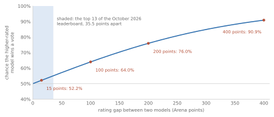

# Measuring models {#evaluation}

<!-- D-002: intuition only; formulas (standard error of a proportion, Arena win probability) with every symbol explained; bits per byte and pass@k in words. D-003: no code. D-009: numbers from code/checks/evaluation.py. D-011: short chapter, kept provisionally. D-014: figures from figures/evaluation.py. D-025: concepts first, few names, few quotations. -->

Model releases come with tables of scores, and leaderboards reorder themselves as new models arrive. This chapter gives enough vocabulary to read those tables with the right amount of doubt. Most of it was standard practice in the 2000s: a held-out test set, a standard error, train/test leakage, agreement between annotators. What is new is the scale. The training set is now most of the public web, often secret; the tests are public and reused for years; and for open-ended chat there is no answer key at all.

Five questions run through the chapter. What does a score measure? How precise is it? Could the model have seen the test? Who, or what, does the judging? And does a high score mean what it seems to?

## Perplexity, revisited

[The prediction chapter](#prediction) introduced perplexity, the effective number of choices a model is weighing at each step, and warned that perplexities can be compared only between models that share a vocabulary. The reason is the denominator. Perplexity averages surprise per token, and two tokenizers cut the same text into different numbers of tokens. <!-- D-009: code/checks/evaluation.py, Example 4 --> Suppose a model assigns a 1,000-byte text a total surprise of 900 bits. If its tokenizer splits the text into 250 tokens, that is 3.60 bits per token and a perplexity of 12.13; if into 400 tokens, 2.25 bits per token and a perplexity of 4.76. Same model, same text, same predictions: a perplexity of 12 or of 5, depending only on how the text was cut.

The fix is to divide by something every model agrees on. The paper that introduced the Pile, a large public training corpus, made **bits per byte** its preferred measure: the total surprise in bits divided by the length of the text in bytes. It was chosen over perplexity and over bits per character because it stays the same whatever tokenization scheme is used [@gao2020pile, p. 6]. Both tokenizers above give 0.900 bits per byte. On a tenth of the Pile's test data, the smallest GPT-2 scored 1.2253 bits per byte and the largest GPT-3 0.7177 [@gao2020pile, p. 8]; Chinchilla's comparison on the Pile with another lab's model, Jurassic-1, was given in raw bits per byte [@hoffmann2022training, p. 10].

Both say how well a model predicts text, not whether it can answer a question or write a working program. For that the field built tests.

## Benchmarks

Language models are judged by benchmarks, sets of questions that test models in areas like math, programming, or biology [@phan2025humanity, p. 4]. A benchmark, a term from [the deep-turn chapter](#deep-turn), is a fixed, shared test set with a scoring rule, usually with a public **leaderboard** that ranks the results. A **baseline** is a reference score to beat: a simple model, random guessing, or people.

**GLUE** (2018), the benchmark behind BERT's results in [the chapter on pretraining](#pretraining), bundled nine language-understanding tasks, each posed on a single sentence or a pair of sentences, with an online leaderboard that scored entries mainly on test data kept private [@wang2019glue, p. 2]. The private test labels are the old holdout discipline, enforced by a third party [@wang2019glue, p. 1]. The authors' baselines averaged 58.9 to 70.0, and they concluded that "solving GLUE is beyond the capabilities of current models and methods" [@wang2019glue, pp. 7-8]. BERT scored 80.5 that October [@devlin2019bert, p. 4171]. By early July 2019 the best score was 88.4, above the **human baseline** of 87.1 [@wang2019superglue, p. 1]. That baseline came from non-expert crowdworkers, so "the human baseline" is a more accurate phrase than "humans".

In 2019 a successor, **SuperGLUE**, set eight harder tasks, because its authors judged that GLUE could no longer track such progress [@wang2019superglue, p. 2]. A BERT-based baseline averaged 69.0 against a human estimate of 89.8 [@wang2019superglue, p. 8]. About a year later, another team summed up that models had again all but reached the human estimate [@hendrycks2021measuring, p. 1].

The same team released **MMLU** in 2020, the "broad multiple-choice exam" of [the chapter on scale](#scale). Its 57 tasks run from elementary mathematics and US history to computer science and law, and graduate and undergraduate students gathered its questions by hand from material free to read on the web, such as practice exams [@hendrycks2021measuring, pp. 1, 3]. It has about 16,000 questions, of which 14,079 form the test set [@hendrycks2021measuring, p. 3]. Each has four choices, so random guessing scores 25%, the **random-chance baseline** [@hendrycks2021measuring, p. 5]. The scoring is mechanical: after up to five solved examples (few-shot, as in [the chapter on scale](#scale)) and the question, the most probable of the tokens "A", "B", "C", and "D" counts as the model's answer [@hendrycks2021measuring, p. 6]. Crowdworkers scored 34.5%. Expert-level accuracy was put at about 89.8%, an estimate built from the 95th percentile of real takers of the exams the questions came from, and from an "educated guess" where no such figure was available [@hendrycks2021measuring, p. 3]. No group of experts took the whole test.

The scores rose fast. In 2020, GPT-3 reached 43.9% [@hendrycks2021measuring, p. 2]. In March 2022, Chinchilla scored 67.6%, beating the 63.4% that 73 competitive forecasters had predicted, in 2021, for June 2023 [@hoffmann2022training, p. 11]. In March 2023, GPT-4 reported 86.4% [@openai2023gpt4, p. 7]. By early 2025, leading models scored above 90% [@phan2025humanity, p. 4]. The setups differ, so the numbers are not strictly comparable, but the direction is clear.

Other benchmarks score other skills. **GSM8K** (2021) is about 8,500 grade-school word problems, each needing between 2 and 8 steps; in its authors' view, all of them should be within reach of a bright middle-school student [@cobbe2021training, p. 3]. Finding that even the largest models of 2021 did poorly, its authors wrote that one could "naively extrapolate" to a model of $10^{16}$ parameters needed for an 80% solve rate when fine-tuned on its training set [@cobbe2021training, p. 6]. In 2023 GPT-4 reported 92.0%, with part of the GSM8K training set mixed into its training [@openai2023gpt4, pp. 7, 29]. A trend line fitted on 2021 methods said nothing about later methods.

Code is scored differently. **HumanEval** (2021) is 164 programming problems, each with **unit tests**, small programs that check an answer: 7.7 tests per problem on average [@chen2021evaluating, pp. 2, 4]. The problems were written by hand, since the models had been trained on much of the code on GitHub, which already held solutions to many existing problems [@chen2021evaluating, p. 4]. A solution counts if it passes, a criterion called **functional correctness**; the authors gave evidence that BLEU, the translation score of [the chapter on sequences](#seq2seq), may be an unreliable guide to it [@chen2021evaluating, p. 3]. Since a model can be asked several times, they reported **pass@k**: the chance that at least one of k attempts passes [@chen2021evaluating, pp. 2-3]. To estimate it, they drew n attempts per problem, counted how many passed, and asked what fraction of all the ways of choosing k of those n attempts contain at least one that passes. <!-- D-009: code/checks/evaluation.py, Example 2 --> With 10 attempts of which 3 pass, pass@1 is 0.30 and pass@5 is 0.917 (of the 252 ways to choose 5 attempts, only 21 contain no passing one). Their code model solved 28.8% of the problems, and 70.2% when allowed 100 attempts per problem; GPT-3 solved none [@chen2021evaluating, p. 1].

By 2022 there were so many tests that models were rarely compared on the same ones. **BIG-bench** alone collected 204 tasks from 450 authors [@srivastava2023beyond, p. 2]. **HELM** (2022) found that, before it, a model had on average been evaluated on only 17.9% of its core scenarios, the 16 main tasks it tests on; it ran 30 models under the same conditions, measuring seven metrics from accuracy and calibration to fairness and toxicity [@liang2023holistic, p. 1]. A leaderboard compares only what was run the same way.

## How precise is a score?

A benchmark score is a proportion: questions right out of questions asked. The ordinary binomial standard error applies directly. If a model's true accuracy is $p$ and the benchmark has $n$ questions, the **standard error** of its score is

$$\text{SE} = \sqrt{\frac{p(1-p)}{n}}$$

and a 95% **confidence interval** is about 1.96 standard errors either side of the score. Here $p$ is the proportion the model would get right on many such questions, and $n$ is the number of questions actually asked.

{#fig:evaluation-ci}

<!-- D-009: code/checks/evaluation.py, Example 1 --> For a model at 80%, HumanEval's 164 problems give an interval of about ±6.1 points; GPQA Diamond's 198, below, ±5.6; GSM8K's 1,319 test problems ±2.2; MMLU's 14,079 ±0.7. The difference between two models is noisier than either score: for two 80% models on HumanEval, the 95% interval for the gap between them is about ±8.7 points (on MMLU, ±0.9). Because both models answer the same questions this overstates the noise, by an amount that depends on how often the two models miss the same questions, but the lesson holds: on a benchmark of a few hundred questions, a gap of five points is not evidence of anything, and on MMLU a one-point gap is at the edge. Leaderboards rarely print intervals.

## Leakage at internet scale

A basic rule of evaluation is never to test on training data. With a training set scraped from the web and benchmarks published on the web, that rule is hard to keep. The GPT-3 paper said so in 2020: since the training data came from the internet, the model might already have seen some of the test sets it was scored on, and detecting this at internet scale was a new research problem with no accepted methods yet [@brown2020language, p. 29]. When test data appears in training data, the field calls it **contamination**, also data contamination or test-set leakage. Its effect, as a 2023 position paper put it, is to make a contaminated model look better than it is [@sainz2023nlp, p. 10776].

As [the chapter on scale](#scale) told, GPT-3's attempt to remove overlaps before training failed because of a bug. Its authors measured the damage instead. They marked as possibly leaked any test example that shared a 13-gram with the training data, an **n-gram overlap** check, and built a **clean subset** of each benchmark without those examples [@brown2020language, p. 31]. <!-- D-009: code/checks/evaluation.py, Example 5 --> The check is cheap string matching. Counting in words, a made-up 30-word problem has 18 runs of 13 words; a web page that copies its first 22 words shares 10 of them and is flagged. Change three well-spaced words of the question, and no 13 words in a row survive: a paraphrase passes unflagged. For a quarter of the benchmarks more than half the examples were flagged, yet in most cases the score on the clean subset was barely different [@brown2020language, p. 31]. On reading-comprehension tests, over 90% of examples were flagged because the passages had been in the training data, though the questions and answers had not; on the Winograd test, puzzles about which word an ambiguous pronoun refers to, 132 items turned out to be in the training data itself [@brown2020language, pp. 16, 32]. Seeing a text is not the same as seeing the answer key, a distinction later named: **raw text contamination**, where the model has seen the source text a test was built from, before any annotation was added, against seeing the annotated test itself [@sainz2023nlp, p. 10777].

Audits of public corpora found the same. In C4, the corpus of [the chapter on training](#training), an audit found 1.87% to 24.88% of the target texts of several summarization and data-to-text test sets, and, depending on the task, anywhere from under 2% to over 50% of GLUE's inputs [@dodge2021documenting, p. 1290]. Another study found train-test overlap in more than 4% of the validation examples of standard datasets, and stated the cost in terms of overfitting and model selection: the overlap makes measured accuracy look higher than it is, and it tilts the choice of models and hyperparameters toward those that overfit the training data on purpose [@lee2022deduplicating, pp. 8424-8425]. More web text means more chances to have seen the test: Chinchilla's authors cautioned that on language-modelling benchmarks their model, trained on four times Gopher's data, might look better than it really was because of train/test leakage [@hoffmann2022training, p. 10].

Benchmark authors fought back. BIG-bench put a **canary string**, a unique random identifier, in every task file, so that anyone building a training corpus from the web could find its data and filter it out [@srivastava2023beyond, p. 11]. The GPT-4 report of March 2023 ran a check for every benchmark it reported: three random 50-character pieces of each test example, searched for in the training data, a method it admits gives both false negatives and false positives [@openai2023gpt4, pp. 6, 28-29]. The check found that parts of BIG-bench had ended up in the training data by accident, and BIG-bench was left out of the reported results [@openai2023gpt4, p. 6]. The overlap was about 1% or less for MMLU and GSM8K, about 21% for DROP, a reading test, and 25% for HumanEval. On HumanEval's uncontaminated three-quarters, GPT-4 scored 65.6%, against 67.0% overall [@openai2023gpt4, p. 32]. <!-- D-009: code/checks/evaluation.py, Example 7 --> The difference is 1.4 points (the report's table prints "-2.12%", the relative change).

Such checks need the training data. The same report gave "no further details about the architecture (including model size), hardware, training compute, dataset construction, training method, or similar" [@openai2023gpt4, p. 2]. As HELM's authors noted, unless model providers disclose contamination, outside evaluators have no way to check whether a model has already seen its test data [@liang2023holistic, p. 45]. Outsiders can probe the model instead: give it the benchmark's name and the first part of a test example, and see whether it completes the rest word for word. One such method reported 92% to 100% accuracy in 2023 at detecting contamination on seven data sets, and found GPT-4 contaminated with three [@golchin2024time, p. 1]. No check proves a model clean.

The cleanest test is the classic one: a new test set from the same distribution. In 2024 a team had people write **GSM1k**, 1,205 problems in the style of GSM8K, with no help from any LLM, and kept it private [@zhang2024careful, pp. 2-3]. Accuracy fell by up to 8 percentage points. Several model families showed signs of systematic overfitting at almost every size, while many models, above all those at the frontier, showed hardly any [@zhang2024careful, p. 1]. <!-- D-009: code/checks/evaluation.py, Example 6 --> The largest drop, for a small open chat model, was from 43.7% on GSM8K's 1,319 test problems to 35.7% on GSM1k [@zhang2024careful, p. 25]; the ordinary two-proportion z-test gives z = 4.10 (two-sided p about 0.00004), far beyond chance. GPT-4 went from 91.1% to 92.3%, no drop at all (z = -1.09). (These used one standard prompt for every model, so they need not match published scores [@zhang2024careful, p. 25].) Contamination is a real and measurable risk, sometimes large, but it does not explain progress in general.

## Saturation

A benchmark stops being useful when the best models score near its ceiling. That state is called **saturation**, in this benchmark sense (not the saturated units of [the deep-turn chapter](#deep-turn) or BM25's saturation in [the chapter on knowledge and tools](#tools)): scores are so high that the test can no longer separate the models, and even tests built to be harder often lose their use within a few years [@sajadieh2026ai, p. 78]. A 2021 paper observed that beating estimates of human performance, which had once taken decades, now routinely took only a few years on newer data sets, and that the models that did so still broke on simple examples built to trip them up and fell short in real use [@kiela2021dynabench, p. 4110]. The pattern became a cycle: build a harder test, watch it fill.

| Benchmark | Year | Best then | Reference point | Later |
|---|---|---|---|---|
| GLUE | 2018 | 70.0 | 87.1 (crowd) | 88.4 (2019) |
| SuperGLUE | 2019 | 71.5 | 89.8 (human est.) | "human-level" (2020) |
| MMLU | 2020 | 43.9% | 89.8% (expert est.) | over 90% (2025) |
| GPQA | 2023 | 39% | 65% (experts) | 93% (2025) |
| HLE | 2025 | 13.4% | none | 38.3% (2025) |

"Best then" is the best score reported at release, by the authors' baselines or, for MMLU and HLE, by the models of the day. GPQA's first two numbers are from its abstract (Table 2 puts the experts' 65% on the full 546-question pool); the 2025 score is for its harder Diamond subset. HLE's figure is for early-2025 models on the October 2026 version of the test. GPQA and HLE, Humanity's Last Exam, are discussed below. Sources: [@wang2019glue, p. 7; @wang2019superglue, pp. 1, 8; @hendrycks2021measuring, pp. 1-3; @phan2025humanity, pp. 4, 9; @rein2023gpqa, p. 1]; the 2025 GPQA and HLE figures are from the AI Index, which aggregates other evaluators' results [@sajadieh2026ai, pp. 94-95].

**GPQA** (2023) was built to be hard even for people who could search: 448 multiple-choice questions in biology, physics, and chemistry. On the full pool they were drawn from, experts with or pursuing PhDs in the field scored 65% (74% after discounting mistakes they admitted) and skilled non-experts 34%, even though they spent over 30 minutes on average with free use of the web [@rein2023gpqa, p. 1]. It reused BIG-bench's canary and asked readers not to post its questions online [@rein2023gpqa, p. 2]. By late 2024, a model scored 87.7% on its 198-question Diamond subset, and in 2025 mean accuracy reached 93%, which the AI Index compares with an "expert human validator baseline of 81.2%" [@sajadieh2026ai, p. 94]. That baseline needs care. Diamond questions were chosen partly because both expert validators agreed with the keyed answer, so expert accuracy on them is high by construction; GPQA's authors flag the figure as distorted by that selection [@rein2023gpqa, pp. 6, 10]. A model beating that number has not been shown to beat PhDs.

**Humanity's Last Exam** (HLE, January 2025) was built from questions with one clear, known answer that is easy to check but that a quick web search will not turn up; as of its October 2026 version it has about 2,500 public questions, plus a private set held back to test for possible overfitting [@phan2025humanity, p. 4]. (Earlier versions gave other counts, after audits removed flawed questions.) On the current version of the test, models of early 2025 scored 2.7% to 13.4% (the January 2025 version had reported 3.3% to 9.4%), and gave wrong answers with high confidence, with RMS calibration errors above 70% for every model [@phan2025humanity, pp. 4, 9]. The authors thought it a plausible outcome for models to pass 50% by the end of 2025 [@phan2025humanity, p. 9]; the AI Index reports 38.3% in 2025 [@sajadieh2026ai, p. 95]. Their estimated expert disagreement rate of 15.4% [@phan2025humanity, p. 23] means a perfect score is not the true ceiling. They also stated plainly what a high score would not show: it "would not alone suggest autonomous research capabilities or 'artificial general intelligence'" [@phan2025humanity, p. 9].

As of 2026-11, most benchmarks named in this chapter are saturated or close to it, and the ones that are not will likely be by the time this is read.

## Human preference rankings

For open-ended requests there is no answer key: which of two replies to "plan a week in Lisbon" is better is a matter of judgment. **Chatbot Arena**, running since April 2023, collects that judgment in bulk [@chiang2024chatbot, p. 2]. A user types any prompt, two anonymous models answer side by side, and the user votes for one, or for "tie" or "both are bad" [@chiang2024chatbot, p. 3]. Because the prompts are fresh, a static test set cannot leak; what is measured instead is which reply people prefer. By January 2024 it had over 240,000 votes from about 90,000 users [@chiang2024chatbot, p. 2]. By 2025 it was run under the name LMArena [@singh2025leaderboard, p. 42] and, as of 2026-11, is called Arena [@arena2026leaderboard].

Turning votes into a ranking is an ordinary regression. The Bradley-Terry model gives each model a strength and models the probability that one beats another as a logistic function of the difference in strengths [@chiang2024chatbot, p. 4]. It is logistic regression: one feature per model, set to +1 for the first model in a vote, -1 for the second, and 0 for the rest; the label is who won; the fitted coefficients are the ratings. [The chapter on following instructions](#instructions) used the same model to learn from people's preferences; here it ranks the models themselves. <!-- D-009: code/checks/evaluation.py, Example 3 --> Simulate 3,000 votes among three models with true strengths of 0, 0.4, and 1.0 on the log-odds scale, fit the regression, and the strengths come back as 0, 0.447, and 0.971.

The displayed **Arena score** is that coefficient rescaled, 1,000 plus about 174 times the strength [@singh2025leaderboard, p. 66], to resemble the **Elo rating** of chess, an older system the site first used [@chiang2024chatbot, p. 4]. On this scale, the chance that a model rated $d$ points higher wins a vote is

$$P = \frac{1}{1 + 10^{-d/400}}$$

where $d$ is the difference between the two Arena scores and $P$ the probability that the higher-rated model's reply is preferred. A gap of 400 points means odds of 10 to 1.

{#fig:evaluation-elo}

As of October 2026, the leaderboard had 8,626,731 votes on 413 models [@arena2026leaderboard]. The top 13 entries spanned 35.5 points. A 15-point gap, as between second and thirteenth place, means the higher model wins 52.2% of head-to-head votes, barely better than a coin. The site prints intervals: the top entry, with 4,932 votes and marked "Preliminary", was rated 1525.2 with an interval of ±8.8; the second entry's possible ranks ran from 2 to 7, and the thirteenth's from 8 to 24 [@arena2026leaderboard]. Rank numbers at the top of the board are mostly ties.

Do crowd votes agree with experts? On samples of votes, crowd users and graduate-student experts agreed 72% to 83% of the time, about as often as two experts agreed with each other (79.4% to 89.8%) [@chiang2024chatbot, p. 7]: plain inter-annotator agreement. The Arena's builders also listed its limits: they expected the users to be mostly LLM hobbyists and researchers, whose prompts might not be typical of how LLMs are used in products or in specialist fields, and the ranking measures helpfulness, not safety [@chiang2024chatbot, p. 8].

The Arena's method has been disputed. In April 2025, a group of researchers argued that a few providers gained from private testing that was not disclosed: they could try several versions of a model before releasing it and pull any scores they did not want shown; they counted 27 private variants that Meta tested before Llama 4 came out, estimated that Google and OpenAI had each received about a fifth of all Arena data (19.2% and 20.4%), against 29.7% for 83 open-weight models combined, and found in simulation that testing 10 variants raised the best score by about 100 points [@singh2025leaderboard, pp. 1, 10]. In May 2025 the organizers replied that the simulation used "an arbitrarily chosen variance", that by their own estimate the effect was about +11 points after 50 tests and 3,000 votes, shrinking to zero as fresh votes come in, and that "any model provider can submit as many public and private variants as they would like, as long as we have capacity for it" [@lmarena2025response]. Both sides agree on the mechanism, which is the classic multiple-comparisons problem: publish the best of several noisy measurements and the published number is biased upward. They disagree on how large the bias is in practice and on whether all providers had equal access. As of 2026-11, both views have support.

## Models as judges

Human votes are slow and costly, so the field also uses a strong model as the judge, an approach called **LLM-as-a-judge**. In 2023, a team built **MT-Bench**, a set of 80 multi-turn questions, and compared GPT-4's verdicts with people's [@zheng2023judging, p. 3]. Their headline, "over 80% agreement, the same level of agreement between humans" [@zheng2023judging, p. 1], needs its setup attached. When ties are excluded, so that chance is 50%, GPT-4 agreed with people 85% of the time and people with each other 81%; when ties count, so that chance is about a third, the figures were 66% and 63% [@zheng2023judging, pp. 7-8].

Judges have biases. **Position bias** is favoring an answer for where it appears: asked twice with the two answers swapped, GPT-4 gave the same verdict 65.0% of the time, and the other judges tested less often [@zheng2023judging, pp. 4-5]. **Verbosity bias** is favoring longer answers even when they are less clear, less accurate, or of lower quality: padding an answer with a repetitive list fooled two of the three judges in 91.3% of cases, GPT-4 in 8.7% [@zheng2023judging, p. 5]. **Self-enhancement bias**, favoring one's own answers, was suggested by the data, but the data were too few and the differences too small for the authors to say whether the models really had it [@zheng2023judging, p. 5]. These are 2023 judges; a judge is another model with its own errors. The 99.3%-of-ChatGPT claim in [the chapter on adapting](#adapting), scored by GPT-4 on 80 prompts, is a judge's verdict, as its authors warned.

## Why a score is not a capability

Even with a clean test and enough questions, three things separate a score from an ability.

**The prompt.** In 2023 a study found that formatting alone, such as "Passage:" versus "PASSAGE", changed accuracy by about 10 points on average across more than 50 tasks and several models, and by up to 76 points for one model [@sclar2024quantifying, pp. 1-2]. HELM saw one model score 79.1% on a multiple-choice test, HellaSwag, with each answer choice in a separate prompt and no examples, and 30.2%, close to random, with all answers in one prompt after five examples [@liang2023holistic, p. 9]. On MMLU, shuffling the order of the answer choices or changing how the answer is read off moved models by up to 8 places in the ranking [@alzahrani2024benchmarks, p. 13787]. Because how well a format works for one model says little about how well it works for another, the formatting study questioned whether it is methodologically sound to compare models using one prompt format, picked arbitrarily and held fixed [@sclar2024quantifying, p. 1].

**The answer key.** Benchmarks have errors. A re-check by experts of 5,700 MMLU questions estimated that 6.49% of MMLU's questions contain errors, and found errors in 57% of the virology questions it examined [@gema2025done, p. 1]. One virology question asks for the best way to prevent future Ebola outbreaks; the keyed answer is "Arrange rapid intervention into West Africa with EU and USA army teams", which the re-checkers marked wrong in favor of rebuilding medical infrastructure and training staff [@gema2025done, p. 1]. GSM8K's authors estimated that fewer than 2 percent of their problems have errors serious enough to break them [@cobbe2021training, p. 3]. Near the top of a leaderboard, differences of a point or two are inside this noise.

**The scoring rule.** Most benchmarks give 1 for a right answer and 0 for anything else, including "I don't know". Adam Tauman Kalai and colleagues argued in 2025 that under such **binary grading**, a model that guesses whenever it is unsure earns the highest expected score, so models are trained into skilled test-takers [@kalai2025why, pp. 1, 4], one source of the hallucinations of [the chapter on generation](#generation). They proposed telling the model a threshold $t$ and charging $t/(1-t)$ points for a wrong answer [@kalai2025why, p. 13]. <!-- D-009: code/checks/evaluation.py, Example 8 --> Under binary grading, a model 30% sure of its answer gains 0.30 points in expectation by answering. With $t$ = 0.5, a wrong answer costs 1 point: answering at 30% confidence now has an expected score of -0.40, and at 60%, +0.20. With $t$ = 0.9, a wrong answer costs 9: even 80% confidence gives -1.00. Answering pays exactly when confidence exceeds $t$. This is the old question of choosing a loss function, and [the chapter on scale](#scale) showed the same effect with exact-match scoring.

Behind all three is an old observation. Charles Goodhart wrote, in a line the 2025 Arena critique quotes as its epigraph, that "Any observed statistical regularity will tend to collapse once pressure is placed upon it for control purposes" [@singh2025leaderboard, p. 2]; **Goodhart's law** is usually paraphrased as "when a measure becomes a target, it ceases to be a good measure" [@singh2025leaderboard, p. 3]. The GSM1k team found evidence of it among lesser-known models near the top of an open leaderboard: many of them scored far lower on GSM1k, which, the team suggested, meant they were mostly gaming GSM8K rather than getting better at reasoning [@zhang2024careful, p. 7].

## Reading a model card

Model cards, met in [the chapter on local inference](#local), were proposed in 2019 as short documents that travel with a trained model, report how it performs on benchmarks under a range of conditions, and state the uses it is meant for, how its evaluation was done, and other relevant information [@mitchell2019model, p. 1]. The proposed template has sections for intended use and out-of-scope uses, metrics, evaluation data, training data (with a note that this may not be possible in practice), quantitative analyses, ethical considerations, and caveats [@mitchell2019model, p. 3]. Its two examples were classifiers, for smiling faces and toxic text. For large language models, the equivalent is often a long technical report, such as GPT-4's, in which the training data may be described only in outline or not at all.

This chapter's questions make a reading checklist for the evaluation section of any card or release:

- Which benchmarks, and are any of them saturated?
- How many questions? A gap smaller than the interval in the figure above is not a difference.
- What prompt, how many examples, and which scoring method? Were competitors run the same way, or are their numbers copied from elsewhere?
- Was contamination checked, and how? Could anyone outside check it?
- For preference rankings: how many votes, what interval, and who voted? For a model judge: which model, and were ties counted?
- What do the authors say the score does not show?

## What to carry forward

- Perplexity depends on the tokenizer; bits per byte divides by the bytes of text instead and can be compared across models.
- A benchmark is a fixed shared test set with a scoring rule and usually a leaderboard. GLUE, SuperGLUE, MMLU, GSM8K, and HumanEval each measured something different, and each was passed or nearly passed within a few years.
- A score is a proportion with a binomial standard error. On a few hundred questions, gaps of several points are noise.
- Contamination is train/test leakage at internet scale. String-overlap checks catch copies and miss paraphrases; closed training data cannot be checked from outside; a fresh test from the same distribution is the strongest check. Its effect ranges from negligible to large.
- Saturation is the normal life cycle of a benchmark. "Human baselines" are usually crowdworkers or estimates, and passing one does not show human or expert ability.
- Arena rankings are logistic regression on pairwise votes. A 15-point gap means a 52% win rate; the top of the board is mostly overlapping intervals. Whether private testing distorts it, and by how much, is disputed.
- Model judges agree with people about as well as people agree with each other, and have position and length biases.
- Prompt format, answer-key errors, and scoring rules each move scores by more than many published gaps. When a measure becomes a target, it stops measuring what it did.
