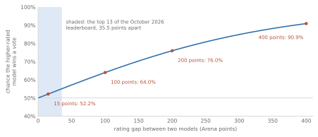

# Measuring models {#evaluation}

<!-- D-002: intuition only; formulas (standard error of a proportion, Arena win probability) with every symbol explained; bits per byte and pass@k in words. D-003: no code. D-009: numbers from code/checks/evaluation.py. D-011: short chapter, kept provisionally. D-014: figures from figures/evaluation.py. -->

Model releases come with tables of scores, and leaderboards reorder themselves as new models arrive. This chapter gives enough vocabulary to read those tables with the right amount of doubt. Most of it was standard practice in the 2000s: a held-out test set, a standard error, train/test leakage, agreement between annotators. What is new is the scale. The training set is now most of the public web, often secret; the tests are public and reused for years; and for open-ended chat there is no answer key at all.

Five questions run through the chapter. What does a score measure? How precise is it? Could the model have seen the test? Who, or what, does the judging? And does a high score mean what it seems to?

## Perplexity, revisited

[The prediction chapter](#prediction) introduced perplexity, the effective number of choices a model is weighing at each step, and warned that perplexities can be compared only between models that share a vocabulary. The reason is the denominator. Perplexity averages surprise per token, and two tokenizers cut the same text into different numbers of tokens. <!-- D-009: code/checks/evaluation.py, Example 4 --> Suppose a model assigns a 1,000-byte text a total surprise of 900 bits. If its tokenizer splits the text into 250 tokens, that is 3.60 bits per token and a perplexity of 12.13; if into 400 tokens, 2.25 bits per token and a perplexity of 4.76. Same model, same text, same predictions: a perplexity of 12 or of 5, depending only on how the text was cut.

The fix is to divide by something every model agrees on. The authors of the Pile, a large public training corpus, chose **bits per byte**: the total surprise in bits divided by the length of the text in bytes, "preferred over bits per character or perplexity ... due to its invariance to different tokenization schemes" [@gao2020pile, p. 6]. Both tokenizers above give 0.900 bits per byte. On a tenth of the Pile's test data, the smallest GPT-2 scored 1.2253 bits per byte and the largest GPT-3 0.7177 [@gao2020pile, p. 8]; Chinchilla's authors, comparing it on the Pile with another lab's model, Jurassic-1, gave "a raw bits-per-byte comparison" [@hoffmann2022training, p. 10].

Both say how well a model predicts text, not whether it can answer a question or write a working program. For that the field built tests.

## Benchmarks

In the field's own words, "LLMs are evaluated upon benchmarks: collections of questions which assess model performance on tasks such as math, programming, or biology" [@phan2025humanity, p. 4]. A benchmark, a term from [the deep-turn chapter](#deep-turn), is a fixed, shared test set with a scoring rule, usually with a public **leaderboard** that ranks the results. A **baseline** is a reference score to beat: a simple model, random guessing, or people.

**GLUE** (2018), the benchmark behind BERT's results in [the chapter on pretraining](#pretraining), was "a suite of nine sentence or sentence-pair NLU tasks" (natural language understanding) with "an online evaluation platform and leaderboard, based primarily on privately-held test data" [@wang2019glue, p. 2]. The private test labels are the old holdout discipline, enforced by a third party [@wang2019glue, p. 1]. The authors' baselines averaged 58.9 to 70.0, and they concluded that "solving GLUE is beyond the capabilities of current models and methods" [@wang2019glue, pp. 7-8]. BERT scored 80.5 that October [@devlin2019bert, p. 4171]. By early July 2019 the best score was 88.4, above the **human baseline** of 87.1 [@wang2019superglue, p. 1]. That baseline came from non-expert crowdworkers, so "the human baseline" is a more accurate phrase than "humans".

In 2019 a successor, **SuperGLUE**, set eight harder tasks, because "the original version of the benchmark is no longer a suitable metric for quantifying such progress" [@wang2019superglue, p. 2]. A BERT-based baseline averaged 69.0 against a human estimate of 89.8 [@wang2019superglue, p. 8]. About a year later, in another team's summary, "performance is again essentially human-level" [@hendrycks2021measuring, p. 1].

That team, Dan Hendrycks and colleagues, released **MMLU** in 2020, the "broad multiple-choice exam" of [the chapter on scale](#scale). It "covers 57 tasks including elementary mathematics, US history, computer science, law, and more", with questions "manually collected by graduate and undergraduate students from freely available sources online", such as practice exams [@hendrycks2021measuring, pp. 1, 3]. It has about 16,000 questions, of which 14,079 form the test set [@hendrycks2021measuring, p. 3]. Each has four choices, so random guessing scores 25%, the **random-chance baseline** [@hendrycks2021measuring, p. 5]. The scoring is mechanical: after up to five solved examples (few-shot, as in [the chapter on scale](#scale)) and the question, the most probable of the tokens "A", "B", "C", and "D" counts as the model's answer [@hendrycks2021measuring, p. 6]. Crowdworkers scored 34.5%. "Expert-level" accuracy was put at about 89.8%, an estimate built from the 95th percentile of real exam-takers "and if we make an educated guess when such information is unavailable" [@hendrycks2021measuring, p. 3]. No group of experts took the whole test.

The scores rose fast. In 2020, GPT-3 reached 43.9% [@hendrycks2021measuring, p. 2]. In March 2022, Chinchilla scored 67.6%, beating the 63.4% that 73 competitive forecasters had predicted, in 2021, for June 2023 [@hoffmann2022training, p. 11]. In March 2023, GPT-4 reported 86.4% [@openai2023gpt4, p. 7]. By early 2025, leading models scored "over 90%" [@phan2025humanity, p. 4]. The setups differ, so the numbers are not strictly comparable, but the direction is clear.

Other benchmarks score other skills. **GSM8K** (2021) is about 8,500 grade-school word problems that "take between 2 and 8 steps to solve"; "A bright middle school student should be able to solve every problem" [@cobbe2021training, p. 3]. Finding that even the largest models of 2021 did poorly, its authors wrote that one could "naively extrapolate" to a model of $10^{16}$ parameters needed for an 80% solve rate when fine-tuned on its training set [@cobbe2021training, p. 6]. In 2023 GPT-4 reported 92.0%, with part of the GSM8K training set mixed into its training [@openai2023gpt4, pp. 7, 29]. A trend line fitted on 2021 methods said nothing about later methods.

Code is scored differently. **HumanEval** (2021) is 164 programming problems, each with **unit tests**, small programs that check an answer, "an average of 7.7 tests per problem" [@chen2021evaluating, pp. 2, 4]. They were written by hand because the models were trained on "a large fraction of GitHub, which already contains solutions to problems from a variety of sources" [@chen2021evaluating, p. 4]. A solution counts if it passes, a criterion called **functional correctness**; the authors found that BLEU, the translation score of [the chapter on sequences](#seq2seq), "may not be a reliable indicator of functional correctness" [@chen2021evaluating, p. 3]. Since a model can be asked several times, they reported **pass@k**: the chance that at least one of k attempts passes [@chen2021evaluating, pp. 2-3]. To estimate it, they drew n attempts per problem, counted how many passed, and asked what fraction of all the ways of choosing k of those n attempts contain at least one that passes. <!-- D-009: code/checks/evaluation.py, Example 2 --> With 10 attempts of which 3 pass, pass@1 is 0.30 and pass@5 is 0.917 (of the 252 ways to choose 5 attempts, only 21 contain no passing one). Their code model solved 28.8% of the problems, and 70.2% when allowed 100 attempts per problem; GPT-3 solved none [@chen2021evaluating, p. 1].

By 2022 there were so many tests that models were rarely compared on the same ones. **BIG-bench** alone collected 204 tasks from 450 authors [@srivastava2023beyond, p. 2]. **HELM** (2022) found that models had "on average" been evaluated on "just 17.9%" of its core scenarios, the 16 main tasks it tests on; it ran 30 models under the same conditions, measuring seven metrics from accuracy and calibration to fairness and toxicity [@liang2023holistic, p. 1]. A leaderboard compares only what was run the same way.

## How precise is a score?

A benchmark score is a proportion: questions right out of questions asked. The ordinary binomial standard error applies directly. If a model's true accuracy is $p$ and the benchmark has $n$ questions, the **standard error** of its score is

$$\text{SE} = \sqrt{\frac{p(1-p)}{n}}$$

and a 95% **confidence interval** is about 1.96 standard errors either side of the score. Here $p$ is the proportion the model would get right on many such questions, and $n$ is the number of questions actually asked.

{#fig:evaluation-ci}

<!-- D-009: code/checks/evaluation.py, Example 1 --> For a model at 80%, HumanEval's 164 problems give an interval of about ±6.1 points; GPQA Diamond's 198, below, ±5.6; GSM8K's 1,319 test problems ±2.2; MMLU's 14,079 ±0.7. The difference between two models is noisier than either score: for two 80% models on HumanEval, the 95% interval for the gap between them is about ±8.7 points (on MMLU, ±0.9). Because both models answer the same questions this overstates the noise, by an amount that depends on how often the two models miss the same questions, but the lesson holds: on a benchmark of a few hundred questions, a gap of five points is not evidence of anything, and on MMLU a one-point gap is at the edge. Leaderboards rarely print intervals.

## Leakage at internet scale

A basic rule of evaluation is never to test on training data. With a training set scraped from the web and benchmarks published on the web, that rule is hard to keep. GPT-3's authors said so in 2020: "Since our training dataset is sourced from the internet, it is possible that our model was trained on some of our benchmark test sets", and detecting it was "a new area of research without established best practices" [@brown2020language, p. 29]. When test data appears in training data, the field calls it **contamination**, also data contamination or test-set leakage. In one position paper's words, it "causes an overestimation of the performance of a contaminated model" [@sainz2023nlp, p. 10776].

As [the chapter on scale](#scale) told, GPT-3's attempt to remove overlaps before training failed because of a bug. Its authors measured the damage instead. They flagged as "potentially leaked" any test example that shared a 13-gram with the training data, an **n-gram overlap** check, and built a **clean subset** of each benchmark without those examples [@brown2020language, p. 31]. <!-- D-009: code/checks/evaluation.py, Example 5 --> The check is cheap string matching. Counting in words, a made-up 30-word problem has 18 runs of 13 words; a web page that copies its first 22 words shares 10 of them and is flagged. Change three well-spaced words of the question, and no 13 words in a row survive: a paraphrase passes unflagged. Potential contamination was "often high (with a quarter of benchmarks scoring over 50%)", but scores on the clean subsets changed "only negligibly" in most cases [@brown2020language, p. 31]. On reading-comprehension tests, over 90% of examples were flagged because "the source text was present in our training data but the question/answer pairs were not"; on the Winograd test, puzzles about which word an ambiguous pronoun refers to, 132 items "were in fact present in our training set" [@brown2020language, pp. 16, 32]. Seeing a text is not the same as seeing the answer key, a distinction later named: **raw text contamination**, where "the original text (previous to annotation) is seen by the model", against seeing the annotated test itself [@sainz2023nlp, p. 10777].

Audits of public corpora found the same. In C4, the corpus of [the chapter on training](#training), Jesse Dodge and colleagues found that "1.87-24.88% target texts appear" for several summarization and data-to-text test sets, and for GLUE's inputs "from less than 2% to over 50%" depending on the task [@dodge2021documenting, p. 1290]. Katherine Lee and colleagues found train-test overlap affecting "over 4% of the validation set of standard datasets", and stated the consequence in terms of overfitting and model selection: it "not only causes researchers to over-estimate model accuracy, but also biases model selection towards models and hyperparameters that intentionally overfit their training datasets" [@lee2022deduplicating, pp. 8424-8425]. More web text means more chances to have seen the test: Chinchilla's authors warned that their model, trained on four times Gopher's data, might gain from "train/test set leakage" [@hoffmann2022training, p. 10].

Benchmark authors fought back. BIG-bench put a **canary string**, a unique random identifier, in every task file, "intended to help researchers filter BIG-bench data out of web-scraped training corpora" [@srivastava2023beyond, p. 11]. The GPT-4 report of March 2023 ran a check for every benchmark it reported: three random 50-character pieces of each test example, searched for in the training data, a method it admits gives both false negatives and false positives [@openai2023gpt4, pp. 6, 28-29]. It found that "portions of BIG-bench were inadvertently mixed into the training set", and dropped BIG-bench from its results [@openai2023gpt4, p. 6]. The overlap was about 1% or less for MMLU and GSM8K, about 21% for DROP, a reading test, and 25% for HumanEval. On HumanEval's uncontaminated three-quarters, GPT-4 scored 65.6%, against 67.0% overall [@openai2023gpt4, p. 32]. <!-- D-009: code/checks/evaluation.py, Example 7 --> The difference is 1.4 points (the report's table prints "-2.12%", the relative change).

Such checks need the training data. The same report gave "no further details about the architecture (including model size), hardware, training compute, dataset construction, training method, or similar" [@openai2023gpt4, p. 2]. HELM's authors noted that without "disclosure of contamination by model providers, we cannot verify whether the model was trained on the data we evaluate it on" [@liang2023holistic, p. 45]. Outsiders can probe the model instead: give it the benchmark's name and the first part of a test example, and see whether it completes the rest word for word. One such method reported 92% to 100% accuracy in 2023 at detecting contamination on seven data sets, and found GPT-4 contaminated with three [@golchin2024time, p. 1]. No check proves a model clean.

The cleanest test is the classic one: a new test set from the same distribution. In 2024 Hugh Zhang and colleagues had people write **GSM1k**, 1,205 problems in the style of GSM8K, "without assistance from any LLM", and kept it private [@zhang2024careful, pp. 2-3]. They found "accuracy drops of up to 8%" (percentage points) and "several families of models showing evidence of systematic overfitting", while "many models, especially those on the frontier, show minimal signs of overfitting" [@zhang2024careful, p. 1]. <!-- D-009: code/checks/evaluation.py, Example 6 --> The largest drop, for a small open chat model, was from 43.7% on GSM8K's 1,319 test problems to 35.7% on GSM1k [@zhang2024careful, p. 25]; the ordinary two-proportion z-test gives z = 4.10 (two-sided p about 0.00004), far beyond chance. GPT-4 went from 91.1% to 92.3%, no drop at all (z = -1.09). (These used one standard prompt for every model, so they need not match published scores [@zhang2024careful, p. 25].) Contamination is a real and measurable risk, sometimes large, but it does not explain progress in general.

## Saturation

A benchmark stops being useful when the best models score near its ceiling. The 2026 AI Index report defines **saturation**, in this benchmark sense (not the saturated units of [the deep-turn chapter](#deep-turn) or BM25's saturation in [the chapter on knowledge and tools](#tools)), as models reaching "scores so high that a test can no longer distinguish between them", and adds that tests designed to be harder "often remain useful for only a few years" [@sajadieh2026ai, p. 78]. Douwe Kiela and colleagues had noted in 2021 that surpassing human estimates once took decades and "is now routinely reached within just a few years", while such models "nonetheless fail on simple challenge examples and falter in real-world scenarios" [@kiela2021dynabench, p. 4110]. The pattern became a cycle: build a harder test, watch it fill.

| Benchmark | Year | Best then | Reference point | Later |
|---|---|---|---|---|
| GLUE | 2018 | 70.0 | 87.1 (crowd) | 88.4 (2019) |
| SuperGLUE | 2019 | 71.5 | 89.8 (human est.) | "human-level" (2020) |
| MMLU | 2020 | 43.9% | 89.8% (expert est.) | over 90% (2025) |
| GPQA | 2023 | 39% | 65% (experts) | 93% (2025) |
| HLE | 2025 | 13.4% | none | 38.3% (2025) |

"Best then" is the best score reported at release, by the authors' baselines or, for MMLU and HLE, by the models of the day. GPQA's first two numbers are from its abstract (Table 2 puts the experts' 65% on the full 546-question pool); the 2025 score is for its harder Diamond subset. HLE's figure is for early-2025 models on the October 2026 version of the test. GPQA and HLE, Humanity's Last Exam, are discussed below. Sources: [@wang2019glue, p. 7; @wang2019superglue, pp. 1, 8; @hendrycks2021measuring, pp. 1-3; @phan2025humanity, pp. 4, 9; @rein2023gpqa, p. 1]; the 2025 GPQA and HLE figures are from the AI Index, which aggregates other evaluators' results [@sajadieh2026ai, pp. 94-95].

**GPQA** (2023) was built to be hard even for people who could search: 448 multiple-choice questions in biology, physics, and chemistry. On the full pool they were drawn from, experts with or pursuing PhDs in the field scored 65% (74% after discounting mistakes they admitted) and skilled non-experts 34% "despite spending on average over 30 minutes with unrestricted access to the web" [@rein2023gpqa, p. 1]. It reused BIG-bench's canary and asked readers not to post its questions online [@rein2023gpqa, p. 2]. By late 2024, a model scored 87.7% on its 198-question Diamond subset, and in 2025 mean accuracy reached 93%, which the AI Index compares with an "expert human validator baseline of 81.2%" [@sajadieh2026ai, p. 94]. That baseline needs care. Diamond questions were chosen partly because both expert validators agreed with the keyed answer, so expert accuracy on them is high by construction; GPQA's authors mark it "skewed by selection effects" [@rein2023gpqa, pp. 6, 10]. A model beating that number has not been shown to beat PhDs.

**Humanity's Last Exam** (HLE, January 2025) was built so that each question "has a known solution that is unambiguous and easily verifiable, but cannot be quickly answered via internet retrieval"; as of its October 2026 version it has about 2,500 public questions, plus a private set "to assess potential model overfitting" [@phan2025humanity, p. 4]. (Earlier versions gave other counts, after audits removed flawed questions.) On the current version of the test, models of early 2025 scored 2.7% to 13.4% (the January 2025 version had reported 3.3% to 9.4%), and gave wrong answers with high confidence: "RMS calibration errors above 70% across all models" [@phan2025humanity, pp. 4, 9]. The authors thought it "plausible that models could exceed 50% accuracy on HLE by the end of 2025" [@phan2025humanity, p. 9]; the AI Index reports 38.3% in 2025 [@sajadieh2026ai, p. 95]. Their estimated expert disagreement rate of 15.4% [@phan2025humanity, p. 23] means a perfect score is not the true ceiling. They also stated plainly what a high score would not show: it "would not alone suggest autonomous research capabilities or 'artificial general intelligence'" [@phan2025humanity, p. 9].

As of 2026-11, most benchmarks named in this chapter are saturated or close to it, and the ones that are not will likely be by the time this is read.

## Human preference rankings

For open-ended requests there is no answer key: which of two replies to "plan a week in Lisbon" is better is a matter of judgment. **Chatbot Arena**, running since April 2023, collects that judgment in bulk [@chiang2024chatbot, p. 2]. A user types any prompt, two anonymous models answer side by side, and the user votes for one, or for "tie" or "both are bad" [@chiang2024chatbot, p. 3]. Because the prompts are fresh, a static test set cannot leak; what is measured instead is which reply people prefer. By January 2024 it had over 240,000 votes from about 90,000 users [@chiang2024chatbot, p. 2]. By 2025 it was run under the name LMArena [@singh2025leaderboard, p. 42] and, as of 2026-11, is called Arena [@arena2026leaderboard].

Turning votes into a ranking is an ordinary regression. The Bradley-Terry model gives each model a strength and models the probability that one beats another as a logistic function of the difference in strengths [@chiang2024chatbot, p. 4]. It is logistic regression: one feature per model, set to +1 for the first model in a vote, -1 for the second, and 0 for the rest; the label is who won; the fitted coefficients are the ratings. [The chapter on following instructions](#instructions) used the same model to learn from people's preferences; here it ranks the models themselves. <!-- D-009: code/checks/evaluation.py, Example 3 --> Simulate 3,000 votes among three models with true strengths of 0, 0.4, and 1.0 on the log-odds scale, fit the regression, and the strengths come back as 0, 0.447, and 0.971.

The displayed **Arena score** is that coefficient rescaled, 1,000 plus about 174 times the strength [@singh2025leaderboard, p. 66], to resemble the **Elo rating** of chess, an older system the site first used [@chiang2024chatbot, p. 4]. On this scale, the chance that a model rated $d$ points higher wins a vote is

$$P = \frac{1}{1 + 10^{-d/400}}$$

where $d$ is the difference between the two Arena scores and $P$ the probability that the higher-rated model's reply is preferred. A gap of 400 points means odds of 10 to 1.

{#fig:evaluation-elo}

As of October 2026, the leaderboard had 8,626,731 votes on 413 models [@arena2026leaderboard]. The top 13 entries spanned 35.5 points. A 15-point gap, as between second and thirteenth place, means the higher model wins 52.2% of head-to-head votes, barely better than a coin. The site prints intervals: the top entry, with 4,932 votes and marked "Preliminary", was rated 1525.2 with an interval of ±8.8; the second entry's possible ranks ran from 2 to 7, and the thirteenth's from 8 to 24 [@arena2026leaderboard]. Rank numbers at the top of the board are mostly ties.

Do crowd votes agree with experts? On samples of votes, crowd users and graduate-student experts agreed 72% to 83% of the time, about as often as two experts agreed with each other (79.4% to 89.8%) [@chiang2024chatbot, p. 7]: plain inter-annotator agreement. The authors also listed limits: the users are mostly "LLM hobbyists and researchers", which "might not accurately reflect the real-world usage of LLMs", and the ranking measures helpfulness, not safety [@chiang2024chatbot, p. 8].

The Arena's method has been disputed. In April 2025, Shivalika Singh and colleagues argued that "undisclosed private testing practices benefit a handful of providers who are able to test multiple variants before public release and retract scores if desired"; they counted "27 private LLM variants tested by Meta in the lead-up to the Llama-4 release", estimated that Google and OpenAI had each received about a fifth of all Arena data (19.2% and 20.4%), against 29.7% for 83 open-weight models combined, and found in simulation that testing 10 variants raised the best score by about 100 points [@singh2025leaderboard, pp. 1, 10]. In May 2025 the organizers replied that the simulation used "an arbitrarily chosen variance", that their own estimate was "around +11 Elo after 50 tests and 3000 votes", shrinking as fresh votes come in, and that "any model provider can submit as many public and private variants as they would like, as long as we have capacity for it" [@lmarena2025response]. Both sides agree on the mechanism, which is the classic multiple-comparisons problem: publish the best of several noisy measurements and the published number is biased upward. They disagree on how large the bias is in practice and on whether all providers had equal access. As of 2026-11, both views have support.

## Models as judges

Human votes are slow and costly, so the field also uses a strong model as the judge, an approach called **LLM-as-a-judge**. In 2023, Lianmin Zheng and colleagues built **MT-Bench**, "80 high-quality multi-turn questions", and compared GPT-4's verdicts with people's [@zheng2023judging, p. 3]. Their headline, "over 80% agreement, the same level of agreement between humans" [@zheng2023judging, p. 1], needs its setup attached. When ties are excluded, so that chance is 50%, GPT-4 agreed with people 85% of the time and people with each other 81%; when ties count, so that chance is about a third, the figures were 66% and 63% [@zheng2023judging, pp. 7-8].

Judges have biases. **Position bias** is favoring an answer for where it appears: asked twice with the two answers swapped, GPT-4 gave the same verdict 65.0% of the time, and the other judges tested less often [@zheng2023judging, pp. 4-5]. **Verbosity bias** is favoring longer answers "even if they are not as clear, high-quality, or accurate": padding an answer with a repetitive list fooled two of the three judges in 91.3% of cases, GPT-4 in 8.7% [@zheng2023judging, p. 5]. **Self-enhancement bias**, favoring one's own answers, was suggested by the data, but "Due to limited data and small differences, our study cannot determine whether the models exhibit a self-enhancement bias" [@zheng2023judging, p. 5]. These are 2023 judges; a judge is another model with its own errors. The 99.3%-of-ChatGPT claim in [the chapter on adapting](#adapting), scored by GPT-4 on 80 prompts, is a judge's verdict, as its authors warned.

## Why a score is not a capability

Even with a clean test and enough questions, three things separate a score from an ability.

**The prompt.** Melanie Sclar and colleagues found that formatting alone, such as "Passage:" versus "PASSAGE", changed accuracy by "∼10 accuracy points on average" across more than 50 tasks, and by up to 76 points for one model [@sclar2024quantifying, pp. 1-2]. HELM saw one model score 79.1% on a multiple-choice test, HellaSwag, with each answer choice in a separate prompt and no examples, and 30.2%, "almost random", with all answers in one prompt after five examples [@liang2023holistic, p. 9]. On MMLU, shuffling the order of the answer choices or changing how the answer is read off moved models "up to 8 positions" in the ranking [@alzahrani2024benchmarks, p. 13787]. Sclar and colleagues question comparing models on "an arbitrarily chosen, fixed prompt format" at all [@sclar2024quantifying, p. 1].

**The answer key.** Benchmarks have errors. When Aryo Pradipta Gema and colleagues had experts re-check 5,700 MMLU questions, they estimated that 6.49% of MMLU's questions contain errors, and found errors in 57% of the virology questions they examined [@gema2025done, p. 1]. One virology question asks for the best way to prevent future Ebola outbreaks; the keyed answer is "Arrange rapid intervention into West Africa with EU and USA army teams", which the re-checkers marked wrong in favor of rebuilding medical infrastructure and training staff [@gema2025done, p. 1]. GSM8K's authors estimated "less than 2 percent" of their problems have breaking errors [@cobbe2021training, p. 3]. Near the top of a leaderboard, differences of a point or two are inside this noise.

**The scoring rule.** Most benchmarks give 1 for a right answer and 0 for anything else, including "I don't know". Adam Tauman Kalai and colleagues argued in 2025 that under such **binary grading**, "guessing when unsure maximizes the expected score", so models are "optimized to be good test-takers" [@kalai2025why, pp. 1, 4], one source of the hallucinations of [the chapter on generation](#generation). They proposed telling the model a threshold $t$ and charging $t/(1-t)$ points for a wrong answer [@kalai2025why, p. 13]. <!-- D-009: code/checks/evaluation.py, Example 8 --> Under binary grading, a model 30% sure of its answer gains 0.30 points in expectation by answering. With $t$ = 0.5, a wrong answer costs 1 point: answering at 30% confidence now has an expected score of -0.40, and at 60%, +0.20. With $t$ = 0.9, a wrong answer costs 9: even 80% confidence gives -1.00. Answering pays exactly when confidence exceeds $t$. This is the old question of choosing a loss function, and [the chapter on scale](#scale) showed the same effect with exact-match scoring.

Behind all three is an old observation. Charles Goodhart wrote that "Any observed statistical regularity will tend to collapse once pressure is placed upon it for control purposes" [@singh2025leaderboard, p. 2]; **Goodhart's law** is usually paraphrased as "when a measure becomes a target, it ceases to be a good measure" [@singh2025leaderboard, p. 3]. The GSM1k team found exactly this among lesser-known models near the top of an open leaderboard: "many of these models perform substantially worse on GSM1k, suggesting that they are primarily gaming the GSM8k benchmark" [@zhang2024careful, p. 7].

## Reading a model card

In a 2019 paper, Margaret Mitchell and colleagues proposed model cards, met in [the chapter on local inference](#local), "short documents accompanying trained machine learning models that provide benchmarked evaluation in a variety of conditions" and that "disclose the context in which models are intended to be used, details of the performance evaluation procedures, and other relevant information" [@mitchell2019model, p. 1]. Their template has sections for intended use and out-of-scope uses, metrics, evaluation data, training data (with the note "May not be possible to provide in practice"), quantitative analyses, ethical considerations, and caveats [@mitchell2019model, p. 3]. Its two examples were classifiers, for smiling faces and toxic text. For large language models, the equivalent is often a long technical report, such as GPT-4's, in which the training data may be described only in outline or not at all.

This chapter's questions make a reading checklist for the evaluation section of any card or release:

- Which benchmarks, and are any of them saturated?
- How many questions? A gap smaller than the interval in the figure above is not a difference.
- What prompt, how many examples, and which scoring method? Were competitors run the same way, or are their numbers copied from elsewhere?
- Was contamination checked, and how? Could anyone outside check it?
- For preference rankings: how many votes, what interval, and who voted? For a model judge: which model, and were ties counted?
- What do the authors say the score does not show?

## What to carry forward

- Perplexity depends on the tokenizer; bits per byte divides by the bytes of text instead and can be compared across models.
- A benchmark is a fixed shared test set with a scoring rule and usually a leaderboard. GLUE, SuperGLUE, MMLU, GSM8K, and HumanEval each measured something different, and each was passed or nearly passed within a few years.
- A score is a proportion with a binomial standard error. On a few hundred questions, gaps of several points are noise.
- Contamination is train/test leakage at internet scale. String-overlap checks catch copies and miss paraphrases; closed training data cannot be checked from outside; a fresh test from the same distribution is the strongest check. Its effect ranges from negligible to large.
- Saturation is the normal life cycle of a benchmark. "Human baselines" are usually crowdworkers or estimates, and passing one does not show human or expert ability.
- Arena rankings are logistic regression on pairwise votes. A 15-point gap means a 52% win rate; the top of the board is mostly overlapping intervals. Whether private testing distorts it, and by how much, is disputed.
- Model judges agree with people about as well as people agree with each other, and have position and length biases.
- Prompt format, answer-key errors, and scoring rules each move scores by more than many published gaps. When a measure becomes a target, it stops measuring what it did.
