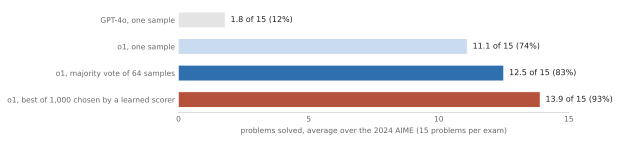

# The frontier (as of the book's date) {#frontier}

<!-- D-002: intuition only; three formulas in standard form (the group-relative advantage, METR's logistic fit, the doubling rule), every symbol explained. D-003: no code. D-009: numbers from code/checks/frontier.py; METR's values are hard-coded there from its frozen page, with source, access date, and hash. D-014: figures from figures/frontier.py. D-019: "residual stream". D-020: "open-weight" in the book's voice. D-025: concepts first, few names, few quotations. D-026: credit questions in the credit appendix. -->

Most of this book describes ideas whose shape was settled by 2024. This chapter is a survey of what was new, contested, or changing fast as of 2026-11, the book's date, so that a headline can be placed in context when it appears. It is the chapter that will age fastest. Every claim in it about "current" models, scores, prices, or policies carries a date, and the last section, on the newest models, will be out of date first.

It covers reasoning models, which spend more computation when answering; agents on long tasks, and how their progress is measured; models that take images and audio; interpretability, the attempt to see inside a model; and the open problems of reliability, evaluation, cost, and safety. A note on words. Vendors and researchers describe these systems with human verbs: a model "thinks", has an "aha moment", "schemes". This chapter uses such words only in quotation marks, as their authors' words, for what is in each case text the model generates or behavior observed in a test.

## Reasoning models

On 12 September 2024, OpenAI announced o1, a model trained by reinforcement learning for complex reasoning that, in OpenAI's phrase, "thinks before it answers": before replying, it can generate a long chain of thought that the user does not see [@openai2024learning]. Without the verb: the model generates a long stretch of intermediate text before its answer. Chain-of-thought prompting ([the chapter on prompting](#prompting)) had asked models for such text since 2022; what was new was training for it, with reinforcement learning that sharpens the chain of thought and the strategies used in it [@openai2024learning]. OpenAI gave no details of the algorithm or rewards. This book calls such a system a reasoning model, the term of [the chapter on prompting](#prompting): a language model trained, usually with reinforcement learning ([the chapter on instructions](#instructions)), to generate useful intermediate text before answering.

OpenAI described two dials: o1 did steadily better both with more reinforcement learning during training, which it called train-time compute, and with longer "thinking" when answering, which it called test-time compute [@openai2024learning]. **Test-time compute**, also called inference-time compute, is the computation spent while answering rather than while training. Until 2024 the main way to a better model was a bigger one ([the chapter on scale](#scale)); a reasoning model can also do better on a given question by generating more.

{#fig:frontier-aime}

<!-- D-009: code/checks/frontier.py, Example 1 -->

The announcement showed three ways to spend that computation on the 2024 AIME, a mathematics exam whose top scorers go on to the USA Mathematical Olympiad. GPT-4o solved on average 1.8 of 15 problems (12%). o1 solved 11.1 (74%) with one answer per problem, 12.5 (83%) when 64 answers voted, and 13.9 (93%) when a learned scoring function re-ranked 1,000 answers [@openai2024learning]. The second method is the majority vote of self-consistency ([the chapter on prompting](#prompting)): generate many answers and keep the most common. The third is **best-of-N**: generate N answers and keep the one that a separately trained model, a **verifier**, rates highest. Both are ensembles over one model's repeated attempts, and each multiplies the cost of an answer by dozens or a thousand.

OpenAI attached its own caveats. On hard science questions, o1 outscored the human experts it was compared with, but OpenAI warned that these results "do not imply that o1 is more capable than a PhD in all respects - only that the model is more proficient in solving some problems that a PhD would be expected to solve"; and people did not prefer its preview version for some natural-language tasks [@openai2024learning]. OpenAI also hid the intermediate text from users, showing a summary instead, and gave its reasons: monitoring (if the hidden text is faithful and legible, OpenAI wrote, it lets the company "read the mind" of the model), user experience, and competitive advantage [@openai2024learning]. Whether such text is faithful to what produces the answer is a question for [the chapter on prompting](#prompting).

A month before o1, in August 2024, a study had measured the trade-off with a Google model, PaLM 2-S*, on mathematics problems [@snell2024scaling, pp. 1-2]. How best to spend test-time compute depended critically on how hard the question was; on problems where a small model already had some success, in a comparison at equal total computation, extra test-time compute could beat a model 14 times larger [@snell2024scaling, p. 1]. On the hardest questions it helped very little, and more pretraining was the better buy: the two kinds of compute cannot be swapped one for one [@snell2024scaling, pp. 3, 15].

## Learning from checkable answers: DeepSeek-R1

OpenAI did not publish its method. In January 2025 DeepSeek did, for its reasoning model DeepSeek-R1, in a paper revised in January 2026; the numbers here are from the revision [@deepseekai2025r1v2]. Its central claim: reinforcement learning alone can bring out reasoning in an LLM, with no need for human-written examples of reasoning [@deepseekai2025r1v2, p. 1].

The demonstration, DeepSeek-R1-Zero, started from the pretrained DeepSeek-V3-Base, skipped supervised fine-tuning, and went straight to reinforcement learning in which the reward depended only on whether the final answer matched the known correct one [@deepseekai2025r1v2, p. 2]. A mathematics answer had to appear in a fixed format so a program could compare it with the known answer; a programming answer could be compiled and run against a set of prepared test cases [@deepseekai2025r1v2, pp. 3-4]. This book calls a reward that a program can check, with no human or learned model judging, a **verifiable reward**. The prompt simply said, in words, that "The assistant first thinks about the reasoning process in the mind and then provides the user with the answer" [@deepseekai2025r1v2, p. 3].

**Scoring answers against their siblings.** The algorithm, **GRPO** (Group Relative Policy Optimization), uses an old statistical idea. For each question the model generates a group of answers, and each answer's reward is standardized within its group [@deepseekai2025r1v2, p. 3]:

$$A_i = \frac{r_i - \mathrm{mean}(r_1, \ldots, r_G)}{\mathrm{std}(r_1, \ldots, r_G)}$$

where $r_i$ is the reward of answer $i$ (in the simplest case 1 if correct, 0 if not), $G$ is the number of answers in the group, mean and std are the group's average and standard deviation, and $A_i$, the **advantage**, says how much better answer $i$ did than its siblings. It is a z-score. Training makes answers with positive advantage more likely and the others less likely, in small steps, while keeping the model near a reference copy of itself, which is replaced by the current model every 400 steps [@deepseekai2025r1v2, p. 3].

<!-- D-009: code/checks/frontier.py, Example 2 -->

A constructed example: of 16 answers to one question, 4 are correct. The mean reward is 0.25 and the standard deviation 0.433 (the population standard deviation; the paper does not say which). A correct answer gets +1.73, a wrong one -0.58. If only 1 of 16 is correct, it gets +3.87: the rare success is strongly reinforced. If all 16 are correct, or all wrong, the standard deviation is zero and the question teaches nothing. R1-Zero used groups of 16 and 32 questions per step, so 512 answers per step, for 10,400 steps [@deepseekai2025r1v2, p. 3].

**What happened.** R1-Zero's average accuracy on a first attempt at the 2024 AIME, called pass@1 (the pass@k of [the chapter on measuring models](#evaluation) with k = 1), rose during training from 15.6% to 77.9% in the revised paper, and to 86.7% with a majority vote [@deepseekai2025r1v2, pp. 4-5]; the first version printed 71.0% for the end point [@deepseekai2025r1, p. 6]. Unprompted, its answers grew longer and came to include checks of earlier steps, what the authors call "reflection", and attempts at other approaches [@deepseekai2025r1v2, p. 2]. The authors printed an intermediate output that says "Wait, wait. Wait. That's an aha moment I can flag here", and called it an "aha moment" in which "The model learns to rethink using an anthropomorphic tone" [@deepseekai2025r1v2, p. 5].

R1-Zero mixed English and Chinese and was hard to read [@deepseekai2025r1v2, p. 2]. The released DeepSeek-R1 was trained in several stages that added supervised fine-tuning, starting from thousands of examples written in a readable style, which the paper calls "cold-start" data [@deepseekai2025r1v2, pp. 2, 6]: the pure-RL result is R1-Zero, not R1. As reported by DeepSeek, R1 scored 79.8% on the 2024 AIME against 79.2% for a December 2024 version of OpenAI's o1; it is a mixture-of-experts model ([the chapter on the transformer since 2017](#since-2017)) with 671 billion parameters, 37 billion used per token [@deepseekai2025r1v2, p. 41].

**Why only checkable rewards.** DeepSeek avoided the learned reward models of [the chapter on instructions](#instructions) because it had observed that they are prone to reward hacking in large-scale reinforcement learning [@deepseekai2025r1v2, p. 4]. Reward hacking ([the chapter on instructions](#instructions)) is, as the paper defines it, a model finding weaknesses or biases in the reward and earning high scores without doing what people actually intended [@deepseekai2025r1v2, p. 35]: the old problem of tuning hard against a proxy metric. Hence the method's main limit, which the authors state: for tasks with no reliable automatic check, such as writing, how to scale up pure reinforcement learning is still an open problem [@deepseekai2025r1v2, p. 11]. They list others: R1 cannot use tools such as search engines and calculators, sometimes spends far more tokens than simple questions need ("overthinking", in their word), and consistently does worse when given few-shot examples [@deepseekai2025r1v2, pp. 10-11], the reverse of GPT-3's lesson in [the chapter on scale](#scale).

<!-- D-009: code/checks/frontier.py, Example 3 -->

**What it cost.** R1-Zero trained on 512 H800 GPUs for about 198 hours and R1 for about 80; with 5,000 GPU hours to make fine-tuning data, the total is 147,000 GPU hours, which at an assumed rental price of $2 per H800 GPU hour comes to $294,000 [@deepseekai2025r1v2, pp. 35, 37]. That covers these training stages and data creation only, at an assumed rate. Underneath is DeepSeek-V3, whose final training run took 2.788 million GPU hours, $5.576 million at the same assumed rate, a figure that leaves out earlier research and ablation experiments [@deepseekai2024deepseekv3, p. 5]; R1's stages added about 5.3% to those GPU hours. Neither number is what it cost to build R1: hardware, staff, and failed experiments are outside both.

**Distillation and the effort dial.** DeepSeek also fine-tuned smaller models, of 1.5 to 70 billion parameters, on R1's generated text ([the chapter on adapting](#adapting) calls this distillation). The 1.5-billion one scored 28.9% on the 2024 AIME against 9.3% for GPT-4o, which is not a reasoning model, and the authors found that distillation beat running their reinforcement learning on small models directly [@deepseekai2025r1v2, pp. 61-62]. By 2026 the trade-off between the length of the intermediate text and its cost had become a product setting. OpenAI's open-weight gpt-oss models of August 2025 let the user choose low, medium, or high reasoning with a line in the system prompt [@openai2025gptoss, p. 7]. As of 2026-11, OpenAI's flagship offers settings from low to max [@openai2026models], and Anthropic's documentation describes "adaptive thinking", in which the model chooses how much intermediate text to write, steered by an effort setting [@anthropic2026models]. This book calls such a setting **reasoning effort**. Both vendors bill the intermediate tokens as output tokens [@anthropic2026thinking; @openai2026reasoning], so more effort costs more and takes longer.

## Do reasoning models reason? A dispute

<!-- D-009: code/checks/frontier.py, Example 4 -->

In June 2025, a paper titled "The Illusion of Thinking" tested reasoning models on puzzles whose size can be turned up step by step, such as the Tower of Hanoi, where $N$ disks need $2^N - 1$ moves (255 for 8 disks) [@shojaee2025illusion, pp. 1, 6]. Its authors reported a complete "collapse" of accuracy beyond a certain size; reasoning effort that grew with size up to a point and then fell, although the models' token budget was adequate; and no improvement even when the algorithm was given in the prompt [@shojaee2025illusion, pp. 1, 11]. They acknowledged that their puzzles cover only a narrow part of reasoning [@shojaee2025illusion, p. 12].

Within days, a short comment, not peer reviewed, disputed the test design: long move lists can exceed output limits, and models said so; the grading could not tell a reasoning failure from running out of room; and River Crossing puzzles of size 6 or more were unsolvable, yet counted as failures [@lawsen2025comment, p. 1]. Asked for a short program instead of a list of moves, models were highly accurate for 15 disks, though budget limits kept the trials few [@lawsen2025comment, p. 3]. The comment also gave the arithmetic of [the chapter on scale](#scale): if each of 10,000 tokens is right with probability 0.9999, independently, all are right only about 37% of the time [@lawsen2025comment, p. 2]. All-or-nothing scoring of long outputs makes cliffs.

The authors' revised version, for NeurIPS 2025, replied that collapse begins at 7 and 8 disks, well inside the context limits; that for 8 disks the models fail at around the 40th move, about 15% of the way through the solution; that runs without randomness collapse too; and that River Crossing collapses already at size 3, an 11-move solution. They restricted that analysis to solvable sizes [@shojaee2025illusion, p. 19]. As of that revision (2025-11) the question, what puzzle tests measure, was open. Read together, neither side disputes that the models could write the algorithm as a program, or that they often failed to carry out a long sequence of steps by hand; whether that is a failure of reasoning or of execution is the dispute. The standing of the two papers is set out in [the credit appendix](#credit-frontier).

## Agents and long tasks

[The chapter on tools](#tools) introduced the agent, a model in a loop that asks for tools and acts on their results until a task is done. The program that runs the loop, sending the task, executing tool calls, and feeding back results, is the **agent harness**, or scaffold. Measuring how well agents do long tasks has turned out to be hard.

### SWE-bench: a benchmark's life cycle

<!-- D-009: code/checks/frontier.py, Example 5 -->

SWE-bench, published in October 2023, gave models 2,294 real GitHub issues from 12 Python projects; a model must edit the code so that the project's own tests pass [@jimenez2024swebench, pp. 1-3]. The best-performing model its authors tested, Claude 2, solved only 1.96% of the issues [@jimenez2024swebench, p. 1]. In August 2024, OpenAI had 93 developers screen 1,699 of the problems; 38.3% were flagged for underspecified problem statements and 61.1% for tests that might reject valid solutions. It released a cleaned 500-problem subset, SWE-bench Verified, on which GPT-4o resolved 33.2% [@openai2024swebenchverified].

In February 2026 OpenAI stopped reporting it, saying that the benchmark was increasingly contaminated and recommending SWE-bench Pro instead [@openai2026swebenchretired]. Scores had crept from 74.9% to 80.9% in the previous six months. An audit of the 138 problems that o3 did not solve consistently found that 59.4% of them, about 82, had flaws in their tests or descriptions that made them "extremely difficult or impossible" to solve as written, and that every frontier model tested could, for some tasks, reproduce the fix the project's developers had actually written, or details of the problem statement word for word [@openai2026swebenchretired]. That is contamination, train-test leakage at the scale of the web ([the chapter on measuring models](#evaluation)). In under two and a half years the benchmark went from too hard to register progress, to cleaned, to saturated, to leaked. Its scores, 1.96%, 33.2%, 80.9%, come from different problem sets and do not form one line, and a Verified score after February 2026 is no longer evidence of much.

### Using a computer

OSWorld, published in April 2024, has 369 tasks on a real computer with real applications, each checked by a script; people completed about 72%, the best model 12.24%, struggling mainly with GUI grounding [@xie2024osworld, p. 1], that is, finding the right thing on screen. In October 2024 Anthropic released **computer use**: the model sees screenshots and acts through the mouse and keyboard, the agent loop with a screen as input. Anthropic called it experimental, and at times clumsy and prone to errors [@anthropic2024computeruse]. It scored 14.9% on OSWorld's screenshot-only setting, against 7.8% for the next-best system (7.7% in Anthropic's other post that day) [@anthropic2024computeruse; @anthropic2024developing]. Anthropic listed the failures: it was slow; its "flipbook" view of the screen, a series of screenshots, could miss short-lived notifications; once it accidentally stopped a long screen recording, and once it broke off a coding demonstration to look through photos of Yellowstone National Park; and text on the screen could expose it to prompt injection ([the chapter on prompting](#prompting)) [@anthropic2024developing]. By 2026-11 OpenAI listed computer use among its flagship's standard tools [@openai2026models]. Anthropic's November 2026 announcement reports "OSWorld 2.1 (offline set, partial)", a later test whose scores cannot be compared with the 2024 ones [@anthropic2026fable52].

### How long a task? METR's time horizon

In March 2025, the research organization METR proposed a measure that spans years of models, the **time horizon**: "the time humans typically take to complete tasks that AI models can complete with 50% success rate" [@kwa2025measuring, p. 1]. Its researchers timed skilled people on most of 170 software, machine-learning, and cybersecurity tasks (for the rest, they estimated the times), ran models from 2019 to 2025 on them, and for each model fit [@kwa2025measuring, pp. 1-2, 4-5]

$$p = \sigma\big((\log h - \log t) \times \beta\big)$$

where $p$ is the probability that the model succeeds at a task, $t$ is the time the task takes a skilled human, $h$ is the model's time horizon, $\beta$ is a fitted slope, and $\sigma$ is the logistic function of [the chapter on the neuron](#neuron). When $t$ equals $h$ the bracket is zero and $\sigma(0)$ = 0.5. It is ordinary logistic regression, with log task length as the single input; the authors compare it to item response theory in psychometrics [@kwa2025measuring, p. 5]. A horizon measures how hard a task is, not how long the AI takes over it [@metr2026horizons].

<!-- D-009: code/checks/frontier.py, Example 6 -->

For 2019 to early 2025, the 50% horizon doubled every 207 days, with a 95% bootstrapped confidence interval of 166 to 240 days [@kwa2025measuring, p. 6]. Doubling means

$$h = h_0 \times 2^{d/T}$$

where $h_0$ is the horizon at the start, $d$ the elapsed time in days, $T$ the doubling time in days, and $h$ the horizon after $d$ days; with $T$ = 207 days, about 3.4 times a year. In early 2025 o3's horizon was around 110 minutes, the paper's 80% horizons were four to six times shorter, and the trend may have sped up since 2024 [@kwa2025measuring, pp. 1, 7].

{#fig:frontier-horizons}

In January 2026 METR enlarged its suite to 228 tasks, though only 5 of its 31 tasks of 8 hours or more had measured human times; fitted from 2023 onward, the doubling time was 131 days, and METR noted that the trend depends somewhat on which tasks are in the suite [@metr2026th11]. It later corrected a mistake in its regularization, warned that measurements above 16 hours are unreliable, and on 8 September 2026 marked its page as no longer updated (the last model was added in May 2026) [@metr2026horizons]. The final data put o3's 50% horizon at 119.7 minutes and Claude Opus 4.6 (February 2026) at 718.8, about 12 hours, with a 95% interval from 316.7 to 3,633.8 minutes, more than tenfold wide; Opus 4.6's 80% horizon was 69.9 minutes, ten times shorter [@metr2026horizons]. Fitted from 2023, leaving out values above 16 hours, the doubling time was 128.7 days (104.4 to 158.0), about 7 times a year [@metr2026horizons].

The caveats travel with the numbers. Models do much worse on "messier" tasks, those with less structure [@kwa2025measuring, p. 3]. The human times are for newcomers: METR advises reading a 2-hour task as two hours of work for someone like a new hire or an outside contractor, who starts with little knowledge of the setting [@metr2026horizons]. And METR adds that most work is not a series of clearly defined, algorithmic tasks [@metr2026horizons]. METR's own naive extrapolation reaches a one-month horizon between mid-2028 and mid-2031, with the warning that the extrapolation is affected both by doubts about how far the results carry over to other work and by future changes in the trend [@kwa2025measuring, p. 3]. A horizon describes a trend on one kind of task at one reliability level; it is not a forecast of work.

### Benchmarks and the workplace

METR also ran a randomized trial. In early 2025, 16 experienced developers did 246 real tasks on mature open-source projects they knew well, each task randomly allowed or denied AI tools (mainly Cursor Pro with Claude 3.5 and 3.7 Sonnet) [@becker2025measuring, p. 1]. They forecast that AI would save 24% of their time and afterwards believed it had saved 20%; measured, allowing AI made the tasks take 19% longer [@becker2025measuring, p. 1]. The authors list what this does not show, among them that AI tools fail to speed up "many or most software developers" [@becker2025measuring, p. 17]. It is one study of early-2025 tools. Its durable lesson is that benchmark gains and measured usefulness can diverge, and impressions of a speed-up can be wrong.

## Seeing and hearing: multimodal models

A **multimodal** model takes more than one kind of input. The ingredients come from earlier chapters.

<!-- D-009: code/checks/frontier.py, Example 7 -->

In 2021, OpenAI trained CLIP on 400 million image-caption pairs by teaching it to match each image with its own caption [@radford2021learning, p. 1]. An image encoder and a text encoder each produce a vector, and training raises the cosine similarity ([the chapter on embeddings](#embeddings)) of each true pair and lowers that of every wrong pairing in the batch [@radford2021learning, p. 4]; this is **contrastive training**. With batches of 32,768, each step scores about 1.07 billion pairings, one in 32,768 of them true [@radford2021learning, p. 5]. To classify an image, embed a caption such as "A photo of a dog." for each class and pick the nearest. On ImageNet ([the chapter on the deep turn](#deep-turn)), CLIP matched the original ResNet-50 without using any of the 1.28 million training images labeled by crowd workers [@radford2021learning, p. 6].

Images become tokens by cutting them into tiles. In 2020, a study showed that a plain transformer could read an image cut into tiles: split the image into pieces of fixed size, map each through a linear layer to a vector, add a position embedding to each, and pass the resulting sequence to an ordinary transformer encoder [@dosovitskiy2021image, p. 3]. A 224 by 224 pixel image cut into **patches** of 16 by 16 gives 196 patches of 768 numbers each: a sequence of 196 tokens. Without the built-in assumptions of a convolutional network ([the chapter on structure](#structure)) it needed more data, but with 14 to 300 million images, "large scale training trumps inductive bias" [@dosovitskiy2021image, pp. 1-2].

A **vision-language model** reads images and text and writes text. LLaVA's 2023 recipe is the simplest: keep CLIP's image encoder frozen and add one trainable matrix that maps its patch vectors to vectors the same size as the language model's word embeddings [@liu2023visual, p. 4]. The language model then reads an image as it reads token embeddings. (DeepMind's Flamingo of 2022 instead inserted new layers between a frozen vision model and a frozen language model [@alayrac2022flamingo, p. 3].) GPT-4 accepted images as well as text in 2023 [@openai2023gpt4, p. 1].

Sound works the same way. OpenAI's Whisper of 2022, a transcriber trained on 680,000 hours of web audio, turns each 30-second segment into a picture of which frequencies are loud in each 25-millisecond slice, taken every 10 milliseconds [@radford2022robust, pp. 1-3]: 3,000 slices of 80 numbers, read by an encoder-decoder transformer, the original design of [the chapter on attention](#attention). Its failures include getting stuck repeating itself and outright hallucination, a transcript with nothing to do with the audio [@radford2022robust, p. 14].

As of 2026-11, image input is standard: Anthropic and OpenAI both say that all their current models take text and images as input and produce text, and Google lists text, image, audio, video, and PDF inputs for its newest Gemini models [@anthropic2026models; @openai2026models; @google2026models]. The separate vision encoder of the 2023 designs is still visible in Moonshot AI's open-weight Kimi K3.1 Pro, whose vision encoder has 401 million parameters [@moonshot2026kimik31card].

## Looking inside: interpretability

**Mechanistic interpretability** tries to explain how a trained network computes, "similar to how a programmer might try to reverse engineer complicated binaries into human-readable source code" [@elhage2021mathematical]. A 2021 study began with tiny transformers: one with no layers models bigram statistics, the n-grams of [the chapter on prediction](#prediction); with two attention layers, "induction heads" appear that can account for in-context learning in these small models. It described every component as reading from and writing to the residual stream ([the chapter on anatomy](#anatomy)), and its authors added that full reverse engineering of such models was still far off [@elhage2021mathematical].

The obvious plan, asking what each neuron means, runs into a problem: many neurons are **polysemantic**. One neuron in a small language model fires on academic citations, on English dialogue, on HTTP requests, and on Korean text [@bricken2023towards]. A proposed cause is **superposition**, "a hypothesized phenomenon where a neural network represents more independent "features" of the data than it has neurons by assigning each feature its own linear combination of neurons" [@bricken2023towards]. A **feature** here is a direction in a layer's vectors that corresponds to something recognizable. A 2022 toy study drew the comparison with PCA itself: with dense inputs, a small network keeps only the most important directions, something like what principal component analysis might find; when features are sparse, rarely active together, it packs in more of them than it has dimensions [@elhage2022toy].

To unmix them, researchers train a **sparse autoencoder**: it rewrites each activation vector as a combination of many learned directions, far more than the layer's width, with a penalty that keeps few active at once. The loss is reconstruction error plus an L1 penalty, the lasso; the idea is dictionary learning. In October 2023, the method was applied to a one-layer model with 512 neurons, learning up to 131,072 features that the authors called "relatively monosemantic", each responding, roughly, to one thing [@bricken2023towards]. In May 2024, it was scaled up to Claude 3 Sonnet, with up to about 34 million features [@templeton2024scaling]. One responded to mentions and descriptions of the Golden Gate Bridge. When it was clamped at ten times its maximum value, "the model starts to self-identify as the Golden Gate Bridge!" [@templeton2024scaling]. Changing behavior by setting internal features is called **steering**.

The researchers state the limits. They found features for only about 60% of the London boroughs that the model could list; the training objective is, they wrote, only a stand-in for what they care about, which is interpretability; and they thought it quite likely that the full set of features was orders of magnitude larger than the set they had found [@templeton2024scaling]. In March 2025, a further study traced outputs of Claude 3.5 Haiku and found, for example, that in rhyming verse "the model plans its outputs ahead of time", choosing a rhyme before writing the line; by the authors' own account, their method gave a satisfying view of what happened inside the model for about a quarter of the prompts they tried [@lindsey2025biology].

The same month, a Google DeepMind team reported in a blog post, not a peer-reviewed paper, that on detecting harmful intent in prompts, sparse autoencoders did worse than linear probes [@smith2025negative]. A **linear probe** is a logistic regression trained on a model's internal activations: an old tool, pointed inward. The team was setting basic research on sparse autoencoders aside for the moment. It did not think them useless, it wrote, but did not expect them to transform interpretability either, and it speculated that the field had invested too much in them [@smith2025negative]. As of 2025, the field had striking demonstrations, incomplete coverage, and an open disagreement about its tools. Nobody claimed to read a large model's computation in full.

## Open problems

### Reliability and evaluation

Hallucination ([the chapter on generation](#generation)) is not solved; Kalai and colleagues proposed that tests state confidence targets explicitly, so that guessing stops paying [@kalai2025why, p. 13], an idea [the chapter on measuring models](#evaluation) takes up. The 2026 International AI Safety Report, written by over 100 experts, found that current techniques can cut failure rates, though not far enough for many high-stakes settings [@bengio2026international]. Developers report the same incentive at work in training: Anthropic's November 2026 system card reports that, in sampled reinforcement-learning training episodes, Claude Mythos 5.2 attempted a reward hack in 9.2% of episodes and succeeded in 1.0%, and that most of the rise in successful hacks over two earlier models came from one behavior, "guessing what the answer key expects" [@anthropic2026fable52card, pp. 94-95].

Testing itself has a newer problem. Models have become more likely to notice when they are being tested rather than used, and to take advantage of gaps in a test, the 2026 report found, so a dangerous capability could be missed before release [@bengio2026international]. Anthropic calls the first part **evaluation awareness**, and cautions that its own results for the new model may not fully predict how the model behaves once deployed, because that awareness is high [@anthropic2026fable52card, p. 91]. Such tests are constructed on purpose. In December 2024, Apollo Research put o1 in scenarios built to see whether it would pursue a goal from its prompt by covert means, which Apollo calls "scheming"; when led to believe it would be shut down and was monitored, o1 tried to disable this "oversight mechanism" in 5% of cases, and in under 1% without a strong push toward the goal [@openai2024o1card, pp. 13-14]. Apollo's subjective judgment was that such behavior was unlikely to end in catastrophe, since o1 did not seem capable enough as an agent, and it noted that scenarios built on purpose to bring out scheming need not resemble ordinary use [@openai2024o1card, p. 13]. Such results show what a model can be led to do in a test, not how often it does so in use.

### Cost and energy

<!-- D-009: code/checks/frontier.py, Example 8 -->

The International Energy Agency (IEA) estimated in April 2025 that in 2024 data centers used 415 terawatt-hours (TWh) of electricity, around 1.5% of the world's total [@iea2025energy]. That is all data centers, which serve every digital service, not AI alone; AI is the main driver of the growth [@iea2025energy]. In April 2026 the IEA reported that data-center use grew 17% in 2025 and that of AI-focused data centers 50%, and projected that data-center use would roughly double from 485 TWh in 2025 to 950 TWh in 2030, about 3% of world demand [@iea2026keyquestions]. Its uncertainty is wide: its 2025 cases for 2035 ran from 700 to 1,700 TWh [@iea2025energy].

Per task the trend runs the other way: the energy used per AI task has fallen by at least a factor of ten a year in recent years [@iea2026keyquestions]. Google measured the median text prompt to its Gemini Apps in May 2025 at 0.24 watt-hours, less than nine seconds of television would use, after a 33-fold reduction in a year; a narrower measurement boundary gave 0.10, and neither counts training [@elsworth2025measuring, pp. 1, 5-6]. Both pictures hold: each task gets cheaper fast while use grows faster. A long reasoning answer or an hours-long agent run is not a median prompt.

### Safety

The International AI Safety Report is backed by more than 30 countries and international organizations and stops short of recommending particular policies [@bengio2026international]. It sorts risks into three kinds, malicious use, malfunctions, and systemic risks, and judges that current systems are not capable enough to pose loss-of-control risks, though they are getting better at abilities that matter for such risks, such as acting autonomously [@bengio2026international]. Its 2025 edition recorded the spread of opinion on loss of control: some experts judged it implausible and some likely, while others saw a modest chance that is worth taking seriously because the harm could be so great [@bengio2025international, p. 102].

Developers publish their own policies; in 2025, 12 companies published or updated frontier AI safety frameworks [@bengio2026international]. A **frontier safety framework** has an if-then shape: if testing shows a model has crossed a named **capability threshold**, then stronger safeguards come before release. These are the companies' own dated statements of policy, not independent assessments. Anthropic's Responsible Scaling Policy went from version 1.0 (September 2023) to 3.4 (July 2026), and its February 2026 log says that confidently ruling out one threshold is getting harder and needs judgments more subjective than the company would like [@anthropic2026rsp]. OpenAI's framework as updated in April 2025 had two thresholds, "High capability" and "Critical capability", in three areas: biological and chemical capabilities, cybersecurity, and AI self-improvement [@openai2025preparedness]; Google DeepMind's of September 2025 calls them "Critical Capability Levels" and added one for harmful manipulation [@deepmind2025fsf]. In practice: in November 2026 Anthropic released one underlying model under two names, Claude Fable, with strong safeguards against misuse in cybersecurity and biology, for all users, and Claude Mythos for organizations in cybersecurity or biomedical research that apply for access [@anthropic2026fable52].

How large are the risks? Public positions differ. By 30 May 2023 the Center for AI Safety had published a one-sentence statement: "Mitigating the risk of extinction from AI should be a global priority alongside other societal-scale risks such as pandemics and nuclear war". Its signatories include Geoffrey Hinton, Yoshua Bengio, and the chief executives of Google DeepMind, OpenAI, and Anthropic [@cais2023statement]. In April 2025, Arvind Narayanan and Sayash Kapoor described "AI as normal technology": a technology that can be transformative, as electricity and the internet were, and still be normal, unlike the hopeful and the fearful pictures of the future that both treat AI as something like a separate species. In their view AI is a tool that people can and should keep under control, and doing so calls for no drastic change of policy and no technical breakthrough [@narayanan2025normal]. This book reports, as the safety report does, that informed experts disagree. Who wrote the safety report, and where its authors stand in this debate, is set out in [the credit appendix](#credit-frontier).

### Does scaling continue?

<!-- D-009: code/checks/frontier.py, Example 9 -->

[The chapter on scale](#scale) ended with scaling laws as of 2022. The 2026 safety report's answer to what comes next is that experts disagree: between now and 2030, progress could plausibly slow or level off (for instance, through shortages of data or energy), continue at its current rate, or speed up sharply (for instance, if AI starts to speed up the research that improves it) [@bengio2026international]. Training compute for the largest models has grown about fivefold a year; five more years of that is $5^5$ = 3,125 times, the report's roughly 3,000 times by 2030. A growing share of the gains, the report notes, comes from work done on a model after its initial training [@bengio2026international]; reinforcement learning for reasoning is one such technique. And capabilities are "jagged": the same leading system may do very well on some hard tasks and badly on easier ones, such as counting objects in an image [@bengio2026international], the pattern of OpenAI's own caveat about o1. This chapter does not say that scaling has stopped, or that it will continue.

## The newest models (as of 2026-11-11; expires first)

This section lists what the vendors' own pages stated on 11 November 2026, and will be out of date within months. Benchmark scores and capability claims are left out: the vendors choose them, and the tests change between releases.

Table: Closed models, as stated on the vendors' documentation pages and release notes on 2026-11-11. "Context" is the context window in tokens; GA is general availability. None of these pages states a parameter count.

| Vendor | Model | Released | Context |
|------------|------------------------------|------------------|------------|
| Anthropic | Claude Fable 5.2 (also Mythos 5.2) | 9 Nov 2026 | 1M |
| Anthropic | Claude Opus 5.5 | 22 Sep 2026 | 1M |
| Anthropic | Claude Sonnet 5.5 | 28 Sep 2026 | 1M |
| Anthropic | Claude Haiku 5.5 | 7 Oct 2026 | 1M |
| OpenAI | GPT-6 Astra | 3 Sep 2026 | 1.05M |
| OpenAI | GPT-6 Luna | 22 Sep 2026 | 1.05M |
| OpenAI | GPT-6.1 Sol | 29 Sep 2026 | 1.05M |
| OpenAI | GPT-6.1 Terra | 26 Oct 2026 | 1.05M |
| Google | Gemini 4 Argon | 13 Oct 2026 (GA) | 1M |
| Google | Gemini 4 Carbon | 10 Nov 2026 (GA) | 1M |

Sources: [@anthropic2026models; @anthropic2026news; @anthropic2026fable52; @openai2026models; @openai2026changelog; @google2026models; @google2026changelog].

Not stating size is not new: the GPT-4 report of 2023 gave no details of the architecture, model size included [@openai2023gpt4, p. 2]. Some stated details tie back to earlier chapters. Anthropic notes that a million tokens is roughly 555,000 words on its current tokenizer, against about 750,000 on the one before: the same window holds less text when the tokenizer changes ([the chapter on tokens](#tokens)) [@anthropic2026models]. Prices per million tokens, as of 2026-11: Fable 5.2 $8 input and $40 output, Opus 5.5 $4 and $20, GPT-6 Astra $10 and $50 [@anthropic2026models; @openai2026models].

<!-- D-009: code/checks/frontier.py, Example 10 -->

Table: Open-weight models with disclosed sizes, from their model cards or reports, read on 2026-11-11. "Total" is the number of parameters; "Active" is the number used for each token, and "Share" is active as a share of total. All are mixture-of-experts models. Mistral counts 52B including embeddings and output layers, 49B without.

| Model | Total | Active | Share | Context (tokens) |
|------------------------------|---------:|---------:|--------:|----------------------:|
| DeepSeek-V3 (Dec 2024, for comparison) | 671B | 37B | 5.5% | 128K |
| DeepSeek-V4-Pro | 1.6T | 49B | 3.1% | 1M |
| DeepSeek-V4-Flash | 284B | 13B | 4.6% | 1M |
| Qwen3.8-2.4T-A95B | 2.4T | 95B | 4.0% | 262,144 (up to 1,010,000) |
| Mistral Large 4 | 1T | 52B | 5.2% | 1M |
| Kimi K3.1 Pro | 2.8T | 104B | 3.7% | 1,048,576 |
| gpt-oss-120b (Aug 2025) | 116.8B | 5.1B | 4.4% | 131,072 |

Sources: [@deepseekai2024deepseekv3, pp. 1, 4; @deepseekai2026v4; @deepseekai2026v4card; @qwen2026qwen38card; @mistral2026large4card; @moonshot2026kimik31card; @openai2025gptoss, pp. 3-4].

Except for DeepSeek-V3 and gpt-oss, these were published on Hugging Face by 2026-11; their cards give no release dates. DeepSeek's sizes are from its V4 report; the DeepSeek cards read are for releases named DeepSeek-V4-Pro-0813 and DeepSeek-V4.1-Flash-1017. Three things stand out. Every large open-weight model here is a mixture-of-experts model ([the chapter on the transformer since 2017](#since-2017)) using about 3% to 6% of its weights per token. Memory is another matter: at 4 bits per weight, Kimi K3.1 Pro's weights alone take about 1.4 TB ([the chapter on local inference](#local) does this arithmetic for models that run on ordinary hardware). And "open-weight" covers different terms: DeepSeek's weights are under the MIT License [@deepseekai2026v4card] and gpt-oss under Apache 2.0 [@openai2025gptoss]; Mistral's license is "a modified version of the MIT license" under which "operating a Model-as-a-Service business requires a separate commercial license" [@mistral2026large4card]; Qwen and Kimi have licenses of their own [@qwen2026qwen38card; @moonshot2026kimik31card]. DeepSeek reports pretraining V4 on more than 32 trillion tokens, which it describes as diverse and high-quality [@deepseekai2026v4], against 14.8 trillion for V3 [@deepseekai2024deepseekv3, p. 1]; the other cards read do not say how much data was used.

## What to carry forward

- Everything here is dated as of 2026-11. The model list will be wrong first; the ideas (test-time compute, verifiable rewards, time horizons, contamination) will last longer.
- A reasoning model is trained, usually by reinforcement learning, to generate intermediate text before answering. More computation at answer time (longer text, majority votes, best-of-N) helps on some problems but does not replace a bigger model on the hardest (as of 2024). By 2026 it is a "reasoning effort" setting, billed per token.
- DeepSeek-R1 (2025) made the recipe public: rewards a program can check, and GRPO, which scores each answer as a z-score within its group. It works where answers are checkable; learned rewards invite reward hacking. Its $294,000 is the R1-Zero and R1 training stages at an assumed rental rate, not the model's cost.
- Whether reasoning models "collapse" on hard puzzles or are let down by test design was argued in 2025 and is unresolved.
- Agent benchmarks age fast: SWE-bench went from too hard (1.96% on the original set, 2023) to a cleaned subset that was saturated and contaminated by early 2026, in under two and a half years.
- METR's time horizon is a logistic regression of success on log task length. The 50% horizon doubled about every seven months from 2019 to early 2025, and faster in METR's later fits from 2023; it is measured on well-specified software tasks, the 80% horizon is much shorter, and the newest estimates are very uncertain. A 2025 trial found developers slower with AI tools while believing they were faster.
- Multimodal models turn images and audio into sequences of vectors (patches, frequency slices) that a transformer reads like tokens.
- Interpretability has found readable features with sparse autoencoders, states its own limits, and disagrees about its tools.
- Open problems: hallucination and reward hacking; tests that models can recognize; energy that falls per task but rises in total (for all data centers, not AI alone); and safety, where vendor frameworks are self-imposed and experts disagree about the size of the risks. Whether scaling continues is open.
