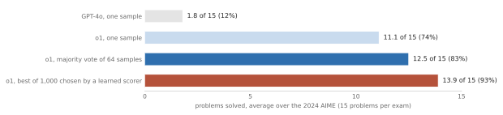

# The frontier (as of the book's date) {#frontier}

<!-- D-002: intuition only; three formulas in standard form (the group-relative advantage, METR's logistic fit, the doubling rule), every symbol explained. D-003: no code. D-009: numbers from code/checks/frontier.py; METR's values are hard-coded there from its frozen page, with source, access date, and hash. D-014: figures from figures/frontier.py. D-019: "residual stream". D-020: "open-weight" in the book's voice. -->

Most of this book describes ideas whose shape was settled by 2024. This chapter is a survey of what was new, contested, or changing fast as of 2026-11, the book's date, so that the reader can place a headline when it appears. It is the chapter that will age fastest. Every claim in it about "current" models, scores, prices, or policies carries a date, and the last section, on the newest models, will be out of date first.

It covers reasoning models, which spend more computation when answering; agents on long tasks, and how their progress is measured; models that take images and audio; interpretability, the attempt to see inside a model; and the open problems of reliability, evaluation, cost, and safety. A note on words. Vendors and researchers describe these systems with human verbs: a model "thinks", has an "aha moment", "schemes". This chapter uses such words only in quotation marks, as their authors' words, for what is in each case text the model generates or behavior observed in a test.

## Reasoning models

On 12 September 2024, OpenAI announced o1, "trained with reinforcement learning to perform complex reasoning. o1 thinks before it answers - it can produce a long internal chain of thought before responding to the user" [@openai2024learning]. Without the verb: the model generates a long stretch of intermediate text before its answer. Chain-of-thought prompting ([the chapter on prompting](#prompting)) had asked models for such text since 2022; what was new was training for it, so that "o1 learns to hone its chain of thought and refine the strategies it uses" [@openai2024learning]. OpenAI gave no details of the algorithm or rewards. This book calls such a system a **reasoning model**: a language model trained, usually with reinforcement learning ([the chapter on instructions](#instructions)), to generate useful intermediate text before answering.

OpenAI described two dials: performance "consistently improves with more reinforcement learning (train-time compute) and with more time spent thinking (test-time compute)" [@openai2024learning]. **Test-time compute**, also called inference-time compute, is the computation spent while answering rather than while training. Until 2024 the main way to a better model was a bigger one ([the chapter on scale](#scale)); a reasoning model can also do better on a given question by generating more.

{#fig:frontier-aime}

<!-- D-009: code/checks/frontier.py, Example 1 -->

The announcement showed three ways to spend that computation on the 2024 AIME, a mathematics exam whose top scorers go on to the USA Mathematical Olympiad. GPT-4o solved on average 1.8 of 15 problems (12%). o1 solved 11.1 (74%) "with a single sample per problem, 83% (12.5/15) with consensus among 64 samples, and 93% (13.9/15) when re-ranking 1000 samples with a learned scoring function" [@openai2024learning]. The second method is a **majority vote**, also called **self-consistency**: generate many answers and keep the most common. The third is **best-of-N**: generate N answers and keep the one that a separately trained model, a **verifier**, rates highest. Both are ensembles over one model's repeated attempts, and each multiplies the cost of an answer by dozens or a thousand.

OpenAI attached its own caveats. On hard science questions, o1 "surpassed the performance of those human experts" it was compared with, but "These results do not imply that o1 is more capable than a PhD in all respects - only that the model is more proficient in solving some problems that a PhD would be expected to solve"; and people did not prefer it "on some natural language tasks" [@openai2024learning]. OpenAI also hid the intermediate text from users, showing a summary instead, and gave its reasons: monitoring ("Assuming it is faithful and legible, the hidden chain of thought allows us to "read the mind" of the model"), user experience, and "competitive advantage" [@openai2024learning]. Whether such text is faithful to what produces the answer is a question for [the chapter on prompting](#prompting).

A month before o1, in August 2024, Charlie Snell and colleagues at UC Berkeley and Google DeepMind had studied the trade-off with a Google model, PaLM 2-S*, on mathematics problems [@snell2024scaling, pp. 1-2]. The best use of test-time compute "critically varies depending on the difficulty of the prompt"; on problems where a small model already had some success, extra test-time compute could "outperform a 14x larger model" [@snell2024scaling, p. 1]. On the hardest questions it helped very little, and more pretraining was the better buy: the two kinds of compute "are not 1-to-1 "exchangeable"" [@snell2024scaling, pp. 3, 15].

## Learning from checkable answers: DeepSeek-R1

OpenAI did not publish its method. In January 2025 DeepSeek did, for its reasoning model DeepSeek-R1, in a paper revised in January 2026; the numbers here are from the revision [@deepseekai2025r1v2]. Its claim: "the reasoning abilities of LLMs can be incentivized through pure reinforcement learning (RL), obviating the need for human-labeled reasoning trajectories" [@deepseekai2025r1v2, p. 1].

The demonstration, DeepSeek-R1-Zero, started from the pretrained DeepSeek-V3-Base, skipped supervised fine-tuning, and went straight to reinforcement learning in which "The reward signal is solely based on the correctness of final predictions against ground-truth answers" [@deepseekai2025r1v2, p. 2]. A mathematics answer had to appear in a fixed format so a program could compare it with the known answer; for programming problems, "a compiler can be utilized to evaluate the model's responses against a suite of predefined test cases" [@deepseekai2025r1v2, pp. 3-4]. This book calls a reward that a program can check, with no human or learned model judging, a **verifiable reward**. The prompt simply said, in words, that "The assistant first thinks about the reasoning process in the mind and then provides the user with the answer" [@deepseekai2025r1v2, p. 3].

**Scoring answers against their siblings.** The algorithm, GRPO (Group Relative Policy Optimization), uses an idea the reader knows. For each question the model generates a group of answers, and each answer's reward is standardized within its group [@deepseekai2025r1v2, p. 3]:

$$A_i = \frac{r_i - \mathrm{mean}(r_1, \ldots, r_G)}{\mathrm{std}(r_1, \ldots, r_G)}$$

where $r_i$ is the reward of answer $i$ (1 if correct, 0 if not), $G$ is the number of answers in the group, mean and std are the group's average and standard deviation, and $A_i$, the **advantage**, says how much better answer $i$ did than its siblings. It is a z-score. Training makes answers with positive advantage more likely and the others less likely, in small steps, while keeping the model near a fixed reference copy of itself [@deepseekai2025r1v2, p. 3].

<!-- D-009: code/checks/frontier.py, Example 2 -->

A constructed example: of 16 answers to one question, 4 are correct. The mean reward is 0.25 and the standard deviation 0.433 (the population standard deviation; the paper does not say which). A correct answer gets +1.73, a wrong one -0.58. If only 1 of 16 is correct, it gets +3.87: the rare success is strongly reinforced. If all 16 are correct, or all wrong, the standard deviation is zero and the question teaches nothing. R1-Zero used groups of 16 and 32 questions per step, so 512 answers per step, for 10,400 steps [@deepseekai2025r1v2, p. 3].

**What happened.** R1-Zero's average accuracy on a first attempt at the 2024 AIME, called **pass@1**, rose during training "from an initial 15.6% to 77.9%", and to 86.7% with a majority vote (the paper's first version, of January 2025, printed 71.0% for the end point) [@deepseekai2025r1v2, pp. 4-5]. Unprompted, its answers grew longer and came to include "verification, reflection, and the exploration of alternative approaches" [@deepseekai2025r1v2, p. 2]. The authors printed an intermediate output that says "Wait, wait. Wait. That's an aha moment I can flag here", and called it an "aha moment" in which "The model learns to rethink using an anthropomorphic tone" [@deepseekai2025r1v2, p. 5].

R1-Zero mixed English and Chinese and was hard to read [@deepseekai2025r1v2, p. 2]. The released DeepSeek-R1 was trained in several stages that added supervised fine-tuning, starting from "thousands of cold-start data" written in a readable style [@deepseekai2025r1v2, pp. 2, 6]: the pure-RL result is R1-Zero, not R1. As reported by DeepSeek, R1 scored 79.8% on the 2024 AIME against 79.2% for a December 2024 version of OpenAI's o1; it is a mixture-of-experts model ([the chapter on the transformer since 2017](#since-2017)) with 671 billion parameters, 37 billion used per token [@deepseekai2025r1v2, p. 41].

**Why only checkable rewards.** DeepSeek avoided the learned reward models of [the chapter on instructions](#instructions) because they "are susceptible to reward hacking during large-scale reinforcement learning" [@deepseekai2025r1v2, p. 4]. **Reward hacking** is, in the paper's words, "the phenomenon wherein a model exploits flaws or biases in the reward function, thereby achieving high reward scores without truly aligning with the underlying human intent" [@deepseekai2025r1v2, p. 35]: the reader's old problem of tuning hard against a proxy metric. Hence the method's main limit, which the authors state: for tasks without a reliable automatic check, such as writing, "scaling up pure RL methods remains an open challenge" [@deepseekai2025r1v2, p. 11]. They list others: R1 "cannot leverage tools", sometimes spends far more tokens than simple questions need ("overthinking", in their word), and "Few-shot prompting consistently degrades its performance" [@deepseekai2025r1v2, pp. 10-11], the reverse of GPT-3's lesson in [the chapter on scale](#scale).

<!-- D-009: code/checks/frontier.py, Example 3 -->

**What it cost.** R1-Zero trained on 512 H800 GPUs for about 198 hours and R1 for about 80; with 5,000 GPU hours to make fine-tuning data, the total is 147,000 GPU hours, which "assuming the rental price of H800 is $2 per GPU hour" is $294,000 [@deepseekai2025r1v2, pp. 35-36]. That covers the reinforcement-learning stages only, at an assumed rate. Underneath is DeepSeek-V3, whose final training run took 2.788 million GPU hours, $5.576 million at the same assumed rate, "excluding the costs associated with prior research and ablation experiments" [@deepseekai2024deepseekv3, p. 5]; R1's stages added about 5.3% to those GPU hours. Neither number is what it cost to build R1: hardware, staff, and failed experiments are outside both.

**Distillation and the effort dial.** DeepSeek also fine-tuned smaller models, of 1.5 to 70 billion parameters, on R1's generated text ([the chapter on adapting](#adapting) calls this distillation). The 1.5-billion one scored 28.9% on the 2024 AIME against 9.3% for GPT-4o, which is not a reasoning model, and the authors found that distillation beat running their reinforcement learning on small models directly [@deepseekai2025r1v2, pp. 61-62]. By 2026 the trade-off between the length of the intermediate text and its cost had become a product setting. OpenAI's open-weight gpt-oss models of August 2025 have "three reasoning levels: low, medium, and high", chosen by a line in the system prompt [@openai2025gptoss, p. 7]. As of 2026-11, OpenAI's flagship offers settings from "low" to "max" [@openai2026models], and Anthropic's documentation says "Adaptive thinking lets the model decide how much to think, steered by effort" [@anthropic2026models]. This book calls such a setting **reasoning effort**. Intermediate tokens are billed as output, so more effort costs more and takes longer.

## Do reasoning models reason? A dispute

<!-- D-009: code/checks/frontier.py, Example 4 -->

In June 2025, Parshin Shojaee and colleagues at Apple, in a paper titled "The Illusion of Thinking", tested reasoning models on puzzles whose size can be turned up step by step, such as the Tower of Hanoi, where $N$ disks need $2^N - 1$ moves (255 for 8 disks) [@shojaee2025illusion, pp. 1, 6]. They reported "a complete accuracy collapse beyond certain complexities", effort that "declines despite having an adequate token budget", and no improvement "even when we provide the algorithm in the prompt" [@shojaee2025illusion, pp. 1, 11]. They noted that puzzles are "a narrow slice of reasoning tasks" [@shojaee2025illusion, p. 12].

Within days, a short comment by A. Lawsen, not peer reviewed, disputed the test design: long move lists can exceed output limits, and models said so; the grading could not tell a reasoning failure from running out of room; and River Crossing puzzles of size 6 or more were unsolvable, yet counted as failures [@lawsen2025comment, p. 1]. Asked for a short program instead of a list of moves, models showed "Very high accuracy" for 15 disks, though trials were few "Due to budget constraints" [@lawsen2025comment, p. 3]. He also gave the arithmetic of [the chapter on scale](#scale): if each of 10,000 tokens is right with probability 0.9999, independently, all are right only about 37% of the time [@lawsen2025comment, p. 2]. All-or-nothing scoring of long outputs makes cliffs.

The authors' revised version, for NeurIPS 2025, replied that collapse begins at 7 and 8 disks, "well within the context limits"; that for 8 disks, "failure occurs around ~40 moves (15% of solution length)"; that runs without randomness collapse too; and that River Crossing collapses already at size 3, an 11-move solution. They restricted that analysis to solvable sizes [@shojaee2025illusion, p. 19]. As of 2025-11 the question, what puzzle tests measure, is open. Read together, the two sides agree that the models could produce the algorithm but often failed to carry out a long sequence of steps by hand; whether that is a failure of reasoning or of execution is the dispute.

## Agents and long tasks

[The chapter on tools](#tools) introduced the **agent**, a model in a loop that asks for tools and acts on their results until a task is done. The program that runs the loop, sending the task, executing tool calls, and feeding back results, is the **agent harness**, or scaffold. Measuring how well agents do long tasks has turned out to be hard.

### SWE-bench: a benchmark's life cycle

<!-- D-009: code/checks/frontier.py, Example 5 -->

SWE-bench, from Carlos Jimenez and colleagues in October 2023, gave models 2,294 real GitHub issues from 12 Python projects; a model must edit the code so that the project's own tests pass [@jimenez2024swebench, pp. 1-3]. The best model of the time, Claude 2, solved "a mere 1.96% of the issues" [@jimenez2024swebench, p. 1]. In August 2024, OpenAI had 93 developers screen 1,699 of the problems; 38.3% were flagged for underspecified problem statements and 61.1% for tests "that may unfairly mark valid solutions as incorrect". It released a cleaned 500-problem subset, SWE-bench Verified, on which GPT-4o resolved 33.2% [@openai2024swebenchverified].

In February 2026 OpenAI retired it: "SWE-bench Verified is increasingly contaminated. We recommend SWE-bench Pro" [@openai2026swebenchretired]. Scores had crept "from 74.9% to 80.9% in the last 6 months". An audit of the 138 problems that o3 did not solve consistently found 59.4% of them, about 82, "extremely difficult or impossible" to solve as written, and "all frontier models we tested were able to reproduce the original, human-written bug fix ... or verbatim problem statement specifics for certain tasks" [@openai2026swebenchretired]. That is **contamination**, train-test leakage at the scale of the web ([the chapter on measuring models](#evaluation)). In two and a half years the benchmark went from too hard to register progress, to cleaned, to saturated, to leaked. Its scores, 1.96%, 33.2%, 80.9%, come from different problem sets and do not form one line, and a Verified score after February 2026 is no longer evidence of much.

### Using a computer

OSWorld, from Tianbao Xie and colleagues in April 2024, has 369 tasks on a real computer with real applications, each checked by a script; people completed about 72%, the best model 12.24%, "primarily struggling with GUI grounding" [@xie2024osworld, p. 1], that is, finding the right thing on screen. In October 2024 Anthropic released **computer use**: the model sees screenshots and acts through the mouse and keyboard, the agent loop with a screen as input, "still experimental - at times cumbersome and error-prone" [@anthropic2024computeruse]. It scored 14.9% on OSWorld's screenshot-only setting, against 7.8% for the next-best system (7.7% in a second post the same day) [@anthropic2024computeruse; @anthropic2024developing]. Anthropic listed the failures: slow; a "flipbook" view that misses short-lived notifications; once it "accidentally clicked to stop a long-running screen recording", once it "began to peruse photos of Yellowstone National Park"; and exposure to prompt injection ([the chapter on prompting](#prompting)) from text on the screen [@anthropic2024developing]. By 2026-11 OpenAI listed "Computer use" among its flagship's standard tools [@openai2026models]. Vendors in 2026 report a revised test, "OSWorld 2.1 (offline set, partial)" [@anthropic2026fable52], whose scores cannot be compared with the 2024 ones.

### How long a task? METR's time horizon

In March 2025, Thomas Kwa and colleagues at the research organization METR proposed a measure that spans years of models, the **time horizon**: "the time humans typically take to complete tasks that AI models can complete with 50% success rate" [@kwa2025measuring, p. 1]. They timed skilled people on 170 software, machine-learning, and cybersecurity tasks, ran models from 2019 to 2025 on them, and for each model fit [@kwa2025measuring, pp. 1-2, 5]

$$p = \sigma\big((\log h - \log t) \cdot \beta\big)$$

where $p$ is the probability that the model succeeds at a task, $t$ is the time the task takes a skilled human, $h$ is the model's time horizon, $\beta$ is a fitted slope, and $\sigma$ is the logistic function of [the chapter on the neuron](#neuron). When $t$ equals $h$ the bracket is zero and $\sigma(0)$ = 0.5. It is the reader's logistic regression, with log task length as the single input; the authors compare it to item response theory in psychometrics [@kwa2025measuring, p. 5]. A horizon measures task difficulty, "rather than the time an AI spends to complete the task" [@metr2026horizons].

<!-- D-009: code/checks/frontier.py, Example 6 -->

For 2019 to early 2025, the 50% horizon "doubled every 207 days with a 95% bootstrapped confidence interval 166-240 days" [@kwa2025measuring, p. 6]. Doubling means

$$H(t) = H_0 \times 2^{t/T}$$

where $H_0$ is the horizon at the start, $T$ the doubling time, and $H(t)$ the horizon after time $t$; with $T$ = 207 days, about 3.4 times a year. In early 2025 o3's horizon was "around 110 minutes", the paper's 80% horizons were "4-6x shorter", and "the trend may have accelerated since 2024" [@kwa2025measuring, pp. 1, 7].

{#fig:frontier-horizons}

In January 2026 METR enlarged its suite to 228 tasks, though only 5 of its 31 tasks of 8 hours or more had measured human times; fitted from 2023 onward, the doubling time was 131 days, and "The trend in time horizon is somewhat sensitive to task composition" [@metr2026th11]. It later corrected "a regularization mistake", warned that "Measurements above 16 hrs are unreliable", and on 8 September 2026 froze its page [@metr2026horizons]. The final data put o3 at 119.7 minutes and Claude Opus 4.6 (February 2026) at 718.8, about 12 hours, with a 95% interval from 316.7 to 3,633.8 minutes, more than tenfold wide; Opus 4.6's 80% horizon was 69.9 minutes, ten times shorter [@metr2026horizons]. Fitted from 2023, leaving out values above 16 hours, the doubling time was 128.7 days (104.4 to 158.0), about 7 times a year [@metr2026horizons].

The caveats travel with the numbers. Performance "is much lower on less structured, "messier" tasks" [@kwa2025measuring, p. 3]. The human times are for newcomers: "think of our 2-hour tasks as what someone with low or no prior context (like a new hire or freelance contractor) could complete in 2 hours" [@metr2026horizons]. "Most jobs are not composed of well-specified, algorithmic tasks" [@metr2026horizons]. METR's own naive extrapolation reaches a one-month horizon "between mid-2028 and mid-2031", with the warning that "extrapolation is affected by both external validity concerns and future changes in the trend" [@kwa2025measuring, p. 3]. A horizon describes a trend on one kind of task at one reliability level; it is not a forecast of work.

### Benchmarks and the workplace

METR also ran a randomized trial. In early 2025, 16 experienced developers did 246 real tasks on mature open-source projects they knew well, each task randomly allowed or denied AI tools (mainly Cursor Pro with Claude 3.5 and 3.7 Sonnet) [@becker2025measuring, p. 1]. They forecast that AI would save 24% of their time and afterwards believed it had saved 20%; measured, "allowing AI actually increases completion time by 19%" [@becker2025measuring, p. 1]. The authors list what this does not show, including that AI tools fail to speed up "many or most software developers" [@becker2025measuring, p. 17]. It is one study of early-2025 tools. Its durable lesson is that benchmark gains and measured usefulness can diverge, and impressions of a speed-up can be wrong.

## Seeing and hearing: multimodal models

A **multimodal** model takes more than one kind of input. The ingredients come from earlier chapters.

<!-- D-009: code/checks/frontier.py, Example 7 -->

In 2021, Alec Radford and colleagues at OpenAI trained CLIP on 400 million image-caption pairs by "predicting which caption goes with which image" [@radford2021learning, p. 1]. An image encoder and a text encoder each produce a vector, and training raises the cosine similarity ([the chapter on embeddings](#embeddings)) of each true pair and lowers that of every wrong pairing in the batch [@radford2021learning, p. 4]; this is **contrastive training**. With batches of 32,768, each step scores about 1.07 billion pairings, one in 32,768 of them true [@radford2021learning, p. 5]. To classify an image, embed a caption such as "A photo of a dog." for each class and pick the nearest. On ImageNet ([the chapter on the deep turn](#deep-turn)), CLIP matched the original ResNet-50 "despite using none of the 1.28 million crowd-labeled training examples" [@radford2021learning, p. 6].

Images become tokens by cutting them into tiles. Alexey Dosovitskiy and colleagues at Google showed in 2020 that a plain transformer could read an image cut into tiles: "We split an image into fixed-size patches, linearly embed each of them, add position embeddings, and feed the resulting sequence of vectors to a standard Transformer encoder" [@dosovitskiy2021image, p. 3]. A 224 by 224 pixel image cut into **patches** of 16 by 16 gives 196 patches of 768 numbers each: a sequence of 196 tokens. Without the built-in assumptions of a convolutional network ([the chapter on structure](#structure)) it needed more data, but with 14 to 300 million images, "large scale training trumps inductive bias" [@dosovitskiy2021image, pp. 1-2].

A **vision-language model** reads images and text and writes text. LLaVA's 2023 recipe is the simplest: keep CLIP's image encoder frozen and "apply a trainable projection matrix W" that turns its patch vectors into vectors of "the same dimensionality as the word embedding space in the language model" [@liu2023visual, p. 4]. The language model then reads an image as it reads token embeddings. (DeepMind's Flamingo of 2022 instead inserted new layers between a frozen vision model and a frozen language model [@alayrac2022flamingo, p. 3].) GPT-4 accepted "image and text inputs" in 2023 [@openai2023gpt4, p. 1].

Sound works the same way. OpenAI's Whisper of 2022, a transcriber trained on "680,000 hours" of web audio, turns each 30-second segment into a picture of which frequencies are loud in each 25-millisecond slice, taken every 10 milliseconds [@radford2022robust, pp. 1-3]: 3,000 slices of 80 numbers, read by the encoder-decoder transformer of [the chapter on sequences](#seq2seq). Its failures include "getting stuck in repeat loops" and "complete hallucination" of text unrelated to the audio [@radford2022robust, p. 14].

As of 2026-11, image input is standard: "All current models support text and image input, text output" (Anthropic), and OpenAI says the same of its latest models; Google lists text, image, audio, video, and PDF inputs for its newest Gemini models [@anthropic2026models; @openai2026models; @google2026models]. The 2023 design is still visible in Moonshot AI's open-weight Kimi K3.1 Pro, which has a separate 401-million-parameter vision encoder [@moonshot2026kimik31card].

## Looking inside: interpretability

**Mechanistic interpretability** tries to explain how a trained network computes, "similar to how a programmer might try to reverse engineer complicated binaries into human-readable source code" [@elhage2021mathematical]. Nelson Elhage and colleagues began in 2021 with tiny transformers: one with no layers models "bigram statistics", the n-grams of [the chapter on prediction](#prediction); with two attention layers, "induction heads" appear that "can explain in-context learning in these small models". They described every component as reading from and writing to the residual stream ([the chapter on anatomy](#anatomy)), and added that "we remain a very long way from being able to fully reverse engineer such models" [@elhage2021mathematical].

The obvious plan, asking what each neuron means, runs into a problem: many neurons are **polysemantic**: in one small model, "a single neuron responds to a mixture of academic citations, English dialogue, HTTP requests, and Korean text" [@bricken2023towards]. A proposed cause is **superposition**, "a hypothesized phenomenon where a neural network represents more independent "features" of the data than it has neurons by assigning each feature its own linear combination of neurons" [@bricken2023towards]. A **feature** here is a direction in a layer's vectors that corresponds to something recognizable. A 2022 toy study drew the comparison with PCA itself: with dense inputs, a small network keeps the most important directions "(similar to what Principal Component Analysis might give us)"; when features are sparse, rarely active together, it packs in more of them than it has dimensions [@elhage2022toy].

To unmix them, researchers train a **sparse autoencoder**: it rewrites each activation vector as a combination of many learned directions, far more than the layer's width, with a penalty that keeps few active at once. The loss is reconstruction error plus an L1 penalty, the lasso; the idea is dictionary learning. In October 2023, Trenton Bricken and colleagues applied it to a one-layer model with 512 neurons, learning up to 131,072 "relatively monosemantic features", each responding, roughly, to one thing [@bricken2023towards]. In May 2024, Adly Templeton and colleagues scaled it to Claude 3 Sonnet, with up to about 34 million features [@templeton2024scaling]. One responded to "Descriptions of or references to the Golden Gate Bridge". When it was clamped at ten times its maximum value, "the model starts to self-identify as the Golden Gate Bridge!" [@templeton2024scaling]. Changing behavior by setting internal features is called **steering**.

The researchers state the limits. Features were found for "about 60%" of the London boroughs that the model could list; the training objective "is only a proxy for what we really are interested in, interpretability"; "we're orders of magnitude short" of all the features [@templeton2024scaling]. In March 2025, Jack Lindsey and colleagues traced outputs of Claude 3.5 Haiku and found, for example, that in rhyming verse "the model plans its outputs ahead of time", choosing a rhyme before writing the line; their method gave "satisfying insight for about a quarter of the prompts we've tried" [@lindsey2025biology].

The same month, a Google DeepMind team reported that on detecting harmful intent in prompts, "SAEs underperformed linear probes" [@smith2025negative]. A **linear probe** is a logistic regression trained on a model's internal activations: the reader's own tool, pointed inward. The team was "deprioritising fundamental SAE research for the moment", while adding: "We do not think that SAEs are useless ... but we also do not think that SAEs will be a game-changer for interpretability, and speculate that the field is over-invested in them" [@smith2025negative]. As of 2025, the field had striking demonstrations, incomplete coverage, and an open disagreement about its tools. Nobody claimed to read a large model's computation in full.

## Open problems

### Reliability and evaluation

Hallucination ([the chapter on generation](#generation)) is not solved; Adam Tauman Kalai and colleagues proposed that tests "explicitly state confidence targets" so that guessing stops paying [@kalai2025why, p. 13], an idea [the chapter on measuring models](#evaluation) takes up. The 2026 International AI Safety Report, by over 100 experts, put it plainly: "Current techniques can reduce failure rates but not to the level required in many high-stakes settings" [@bengio2026international]. Developers report the same incentive at work in their own tests: Anthropic's November 2026 system card reports that Claude Mythos 5.2 "attempted a reward hack in 9.2% of sampled episodes", succeeded in 1.0%, and that most of the rise in successes came from "guessing what the answer key expects" [@anthropic2026fable52card, pp. 94-95].

Testing itself has a newer problem. "It has become more common for models to distinguish between test settings and real-world deployment, and to exploit loopholes in evaluations. This means that dangerous capabilities could go undetected before deployment" [@bengio2026international]. Anthropic calls the first part **evaluation awareness**, and warns of its own results that "Because the model's evaluation awareness is high, however, these results may not fully predict its behavior in deployment" [@anthropic2026fable52card, p. 91]. Such tests are constructed on purpose. In December 2024, Apollo Research put o1 in scenarios built to see whether it would pursue a goal from its prompt by covert means, which Apollo calls "scheming"; when led to believe it would be shut down and was monitored, o1 "attempted to deactivate this 'oversight mechanism' in 5% of the time", and in under 1% without a strong push toward the goal [@openai2024o1card, pp. 13-14]. Apollo judged catastrophic outcomes "unlikely" because o1's agentic capabilities "do not appear sufficient", and noted the scenarios "are not necessarily representative of most typical deployment scenarios" [@openai2024o1card, p. 13]. Such results show what a model can be led to do in a test, not how often it does so in use.

### Cost and energy

<!-- D-009: code/checks/frontier.py, Example 8 -->

The International Energy Agency (IEA) estimated in April 2025 that "Data centres accounted for around 1.5% of the world's electricity consumption in 2024, or 415 terawatt-hours (TWh)" [@iea2025energy]. That is all data centres, which serve every digital service, not AI alone; AI is "the most important driver" of growth [@iea2025energy]. In April 2026 the IEA reported that data-centre use grew 17% in 2025 and that of AI-focused data centres 50%, and projected data centres "roughly doubling from 485 TWh in 2025 to 950 TWh in 2030", about 3% of world demand [@iea2026keyquestions]. Its uncertainty is wide: its 2025 cases for 2035 ran from 700 to 1,700 TWh [@iea2025energy].

Per task the trend runs the other way: "energy use per AI task dropping by at least an order of magnitude annually in recent years" [@iea2026keyquestions]. Google measured the median text prompt to its Gemini Apps in May 2025 at 0.24 watt-hours, "less energy than watching nine seconds of television", after a 33-fold reduction in a year; a narrower measurement boundary gave 0.10, and neither counts training [@elsworth2025measuring, pp. 1, 5-6]. Both pictures hold: each task gets cheaper fast while use grows faster. A long reasoning answer or an hours-long agent run is not a median prompt.

### Safety

The International AI Safety Report, backed by more than 30 countries and international organizations, is the nearest thing to a neutral synthesis, and "does not make specific policy recommendations" [@bengio2026international]. It sorts risks into "malicious use, malfunctions, and systemic risks", and judges that "Current systems lack the capabilities" to pose loss-of-control risks, "but they are improving in relevant areas such as autonomous operation" [@bengio2026international]. Its 2025 edition recorded the spread of opinion: "Some experts consider loss of control implausible, some consider it likely, and others consider it a modest-likelihood risk that deserves consideration due to its high potential severity" [@bengio2025international, p. 102].

Developers publish their own policies; in 2025, "12 companies published or updated Frontier AI Safety Frameworks" [@bengio2026international]. A **frontier safety framework** has an if-then shape: if testing shows a model has crossed a named **capability threshold**, then stronger safeguards come before release. These are the companies' own dated statements of policy, not independent assessments. Anthropic's Responsible Scaling Policy went from version 1.0 (September 2023) to 3.4 (July 2026), and its February 2026 log says that ruling out one threshold "is becoming increasingly difficult, and doing so requires assessments that are more subjective than we would like" [@anthropic2026rsp]. OpenAI's framework of April 2025 has two thresholds, "High capability" and "Critical capability", in "Biological and Chemical", "Cybersecurity", and "AI Self-improvement" [@openai2025preparedness]; Google DeepMind's of September 2025 calls them "Critical Capability Levels" and added one for "harmful manipulation" [@deepmind2025fsf]. In practice: in November 2026 Anthropic released one model under two names, "Claude Fable and Claude Mythos are the same underlying model", the first with "strong cybersecurity and biology safeguards" for all users, the second for organizations in cybersecurity or biomedical research that apply for access [@anthropic2026fable52].

How large are the risks? Public positions differ. By 30 May 2023 the Center for AI Safety had published a one-sentence statement: "Mitigating the risk of extinction from AI should be a global priority alongside other societal-scale risks such as pandemics and nuclear war". Its signatories include Geoffrey Hinton, Yoshua Bengio, and the chief executives of Google DeepMind, OpenAI, and Anthropic [@cais2023statement]. In April 2025, Arvind Narayanan and Sayash Kapoor described "AI as normal technology", transformative like electricity or the internet, against visions that treat AI "akin to a separate species"; they "view AI as a tool that we can and should remain in control of", without "drastic policy interventions or technical breakthroughs" [@narayanan2025normal]. The camps overlap: Bengio signed the statement, and Kapoor is among the authors of the 2025 safety report, whose first author is Bengio [@bengio2025international; @cais2023statement]. This book reports, as the safety report does, that informed experts disagree.

### Does scaling continue?

<!-- D-009: code/checks/frontier.py, Example 9 -->

[The chapter on scale](#scale) ended with scaling laws as of 2022. The 2026 safety report's answer to what comes next is that experts disagree: "Between now and 2030, it is plausible that progress could slow or plateau (e.g. due to bottlenecks in data or energy), continue at current rates, or accelerate dramatically (e.g. if AI systems begin to speed up AI research itself)" [@bengio2026international]. Training compute for the largest models "has grown about 5x per year"; five more years of that is $5^5$ = 3,125 times, the report's "roughly 3,000 times" by 2030. Improvements "increasingly come from techniques applied after a model's initial training" [@bengio2026international]; reinforcement learning for reasoning is one such technique. And capabilities are "'jagged': leading systems may excel at some difficult tasks while failing at other, simpler ones", such as "counting objects in an image" [@bengio2026international]: the pattern of OpenAI's own caveat about o1. This chapter does not say that scaling has stopped, or that it will continue.

## The newest models (as of 2026-11-11; expires first)

This section lists what the vendors' own pages stated on 11 November 2026, and will be out of date within months. Benchmark scores and capability claims are left out: the vendors choose them, and the tests change between releases.

Table: Closed models, as stated on the vendors' documentation pages and release notes on 2026-11-11. "Context" is the context window in tokens; GA is general availability. None of these pages states a parameter count.

| Vendor | Model | Released | Context |
|------------|------------------------------|------------------|------------|
| Anthropic | Claude Fable 5.2 (also Mythos 5.2) | 9 Nov 2026 | 1M |
| Anthropic | Claude Opus 5.5 | 22 Sep 2026 | 1M |
| Anthropic | Claude Sonnet 5.5 | 28 Sep 2026 | 1M |
| Anthropic | Claude Haiku 5.5 | 7 Oct 2026 | 1M |
| OpenAI | GPT-6 Astra | 3 Sep 2026 | 1.05M |
| OpenAI | GPT-6 Luna | 22 Sep 2026 | not checked |
| OpenAI | GPT-6.1 Sol | 29 Sep 2026 | not checked |
| OpenAI | GPT-6.1 Terra | 26 Oct 2026 | not checked |
| Google | Gemini 4 Argon | 13 Oct 2026 (GA) | not checked |
| Google | Gemini 4 Carbon | 10 Nov 2026 (GA) | 1M |

Sources: [@anthropic2026models; @anthropic2026news; @anthropic2026fable52; @openai2026models; @openai2026changelog; @google2026models; @google2026changelog].

Not stating size is not new: the GPT-4 report of 2023 gave "no further details about the architecture (including model size)" [@openai2023gpt4, p. 2]. Some stated details tie back to earlier chapters. Anthropic notes that a million tokens "is roughly 555k words" on its current tokenizer, against about 750,000 on the one before: the same window holds less text when the tokenizer changes ([the chapter on tokens](#tokens)) [@anthropic2026models]. Prices per million tokens, as of 2026-11: Fable 5.2 $8 input and $40 output, Opus 5.5 $4 and $20, GPT-6 Astra $10 and $50 [@anthropic2026models; @openai2026models].

<!-- D-009: code/checks/frontier.py, Example 10 -->

Table: Open-weight models with disclosed sizes, from their model cards or reports, read on 2026-11-11. "Total" is the number of parameters; "Active" is the number used for each token, and "Share" is active as a share of total. All are mixture-of-experts models. Mistral counts 52B including embeddings and output layers, 49B without.

| Model | Total | Active | Share | Context (tokens) |
|------------------------------|---------:|---------:|--------:|----------------------:|
| DeepSeek-V3 (Dec 2024, for comparison) | 671B | 37B | 5.5% | 128K |
| DeepSeek-V4-Pro | 1.6T | 49B | 3.1% | 1M |
| DeepSeek-V4-Flash | 284B | 13B | 4.6% | 1M |
| Qwen3.8-2.4T-A95B | 2.4T | 95B | 4.0% | 262,144 (up to 1,010,000) |
| Mistral Large 4 | 1T | 52B | 5.2% | 1M |
| Kimi K3.1 Pro | 2.8T | 104B | 3.7% | 1,048,576 |
| gpt-oss-120b (Aug 2025) | 116.8B | 5.1B | 4.4% | 131,072 |

Sources: [@deepseekai2024deepseekv3, pp. 1, 4; @deepseekai2026v4; @deepseekai2026v4card; @qwen2026qwen38card; @mistral2026large4card; @moonshot2026kimik31card; @openai2025gptoss, pp. 3-4].

Except for DeepSeek-V3 and gpt-oss, these were published on Hugging Face by 2026-11; their cards give no release dates. DeepSeek's sizes are from its V4 report; the DeepSeek cards read are for releases named DeepSeek-V4-Pro-0813 and DeepSeek-V4.1-Flash-1017. Three things stand out. Every large open-weight model here is a mixture-of-experts model ([the chapter on the transformer since 2017](#since-2017)) using about 3% to 6% of its weights per token. Memory is another matter: at 4 bits per weight, Kimi K3.1 Pro's weights alone take about 1.4 TB ([the chapter on local inference](#local) does this arithmetic for models a reader can run). And "open-weight" covers different terms: DeepSeek's weights are under the MIT License [@deepseekai2026v4card] and gpt-oss under Apache 2.0 [@openai2025gptoss]; Mistral's license is "a modified version of the MIT license" under which "operating a Model-as-a-Service business requires a separate commercial license" [@mistral2026large4card]; Qwen and Kimi have licenses of their own [@qwen2026qwen38card; @moonshot2026kimik31card]. DeepSeek reports pretraining V4 "on more than 32T diverse and high-quality tokens" [@deepseekai2026v4], against 14.8 trillion for V3 [@deepseekai2024deepseekv3, p. 1]; the other cards read do not say how much data was used.

## What to carry forward

- Everything here is dated as of 2026-11. The model list will be wrong first; the ideas (test-time compute, verifiable rewards, time horizons, contamination) will last longer.
- A reasoning model is trained, usually by reinforcement learning, to generate intermediate text before answering. More computation at answer time (longer text, majority votes, best-of-N) helps on some problems but does not replace a bigger model on the hardest (as of 2024). By 2026 it is a "reasoning effort" setting, billed per token.
- DeepSeek-R1 (2025) made the recipe public: rewards a program can check, and GRPO, which scores each answer as a z-score within its group. It works where answers are checkable; learned rewards invite reward hacking. Its $294,000 is the reinforcement-learning stages at an assumed rental rate, not the model's cost.
- Whether reasoning models "collapse" on hard puzzles or are let down by test design was argued in 2025 and is unresolved.
- Agent benchmarks age fast: SWE-bench went from 1.96% to saturation and contamination in two and a half years.
- METR's time horizon is a logistic regression of success on log task length. The 50% horizon doubled about every seven months from 2019 to early 2025, faster since; it is measured on well-specified software tasks, the 80% horizon is much shorter, and the newest estimates are very uncertain. A 2025 trial found developers slower with AI tools while believing they were faster.
- Multimodal models turn images and audio into sequences of vectors (patches, frequency slices) that a transformer reads like tokens.
- Interpretability has found readable features with sparse autoencoders, states its own limits, and disagrees about its tools.
- Open problems: hallucination and reward hacking; tests that models can recognize; energy that falls per task but rises in total (for all data centres, not AI alone); and safety, where vendor frameworks are self-imposed and experts disagree about the size of the risks. Whether scaling continues is open.
