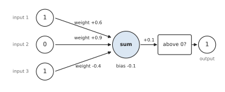

# The artificial neuron (1943-1969) {#neuron}

<!-- D-002: intuition only; formulas (weighted sum, sigmoid) follow worked examples. D-003: no code. D-008: first chapter of the "how networks learn" thread. D-009: numbers from code/checks/neuron.py. D-014: figures from figures/neuron.py. -->

The picture in [the destination chapter](#destination) had a box labeled "Layers", where most of an LLM's computation happens. Open that box far enough and you find a very large number of small, identical computing units, each doing something simple. This chapter is about that unit: what it computes, how a single one can learn, and why the first wave of work on it ran into a wall in 1969.

The story runs from 1943 to 1969, and almost all of it concerns a single unit, or a single layer of them. That restriction is the point of the chapter. A single unit can do surprisingly much, and its limits are exact and easy to see. Those limits shaped the field for the next two decades.

## A neuron as a weighted vote

An **artificial neuron** takes several numbers as input and produces one number as output. It works like a weighted vote.

Each input has a weight, a number saying how much that input counts and in which direction. A positive weight means "this input argues for firing"; a negative weight means "this input argues against". The neuron multiplies each input by its weight and adds up the results. It then adds one more number, the **bias**, which sets how easily the neuron fires regardless of its inputs. The total is the **weighted sum**. Finally the neuron passes the weighted sum through an **activation function**, which decides the output. The oldest choice is the **step function**: output 1 if the weighted sum is above zero, and 0 otherwise. Put the other way round, the neuron fires when its weighted inputs, before the bias is added, come to more than minus the bias. That amount is the neuron's **threshold**: a bias of -0.1 means a threshold of 0.1.

Here is one neuron with three inputs.

{#fig:neuron-vote}

<!-- D-009: code/checks/neuron.py, Example 1 -->

| Input | Value | Weight | Contribution |
|:---|---:|---:|---:|
| 1 | 1 | +0.6 | +0.6 |
| 2 | 0 | +0.9 | 0.0 |
| 3 | 1 | -0.4 | -0.4 |
| Bias | | | -0.1 |
| **Weighted sum** | | | **+0.1** |

Table: A weighted vote. Input 2 has the largest weight but is off, so it contributes nothing. The sum is just above zero, so the neuron outputs 1.

Written in its standard form, the weighted sum of a neuron with $n$ inputs is

$$z = w_1 x_1 + w_2 x_2 + \dots + w_n x_n + b$$

where $x_1$ to $x_n$ are the inputs, $w_1$ to $w_n$ are their weights, $b$ is the bias, and $z$ is the weighted sum. The output is the activation function applied to $z$.

The weights and the bias are the neuron's parameters, in exactly the sense of [the destination chapter](#destination): the numbers that learning will set. Everything that follows in this book, up to models with hundreds of billions of parameters, is built from this unit or close relatives of it.

## You have seen this before

If the weighted sum looks familiar, it should. Replace the step function with the **sigmoid** (the logistic function), which turns any number into a value between 0 and 1:

$$\sigma(z) = \frac{1}{1 + e^{-z}}$$

Here $z$ is the weighted sum, $e$ is the base of the natural logarithm (about 2.718), and $\sigma(z)$ is the output. A large positive $z$ gives an output near 1, a large negative $z$ gives an output near 0, and $z = 0$ gives exactly 0.5.

A weighted sum of the inputs, plus an intercept, passed through the sigmoid: that is the prediction function of logistic regression. **A neuron with a sigmoid activation is logistic regression.** The weights are the coefficients, and the bias is the intercept. For the weighted vote above, whose sum was +0.1, the sigmoid gives 0.525: just over one half, a hesitant yes where the step gave a flat 1. The step function is what you get if you take the sigmoid's output and cut it at one half.

The difference between the two traditions lies elsewhere: in how the weights are found. A statistician fits logistic regression by maximum likelihood. The early neuron builders set weights by hand, or with simple learning rules of their own, described below. Making the two meet, so that a whole network of neurons can be fitted the way a regression is fitted, is the subject of [the chapter on learning in layers](#backprop).

The bridge also connects to the end of [the destination chapter](#destination). The softmax that turns an LLM's scores into probabilities is the many-class version of the same idea. The final step of a language model is a very wide layer of weighted sums, one per vocabulary entry, turned into probabilities together by the softmax.

## 1943: a neuron as a piece of logic

The first mathematical model of a neuron came from Warren McCulloch and Walter Pitts in 1943 [@mcculloch1943logical]. Their starting point was a fact of biology: a nerve cell either fires or does not. Their abstract opens: "Because of the "all-or-none" character of nervous activity, neural events and the relations among them can be treated by means of propositional logic" [@mcculloch1943logical, p. 99]. In other words, if a neuron is either on or off, it can be treated as a statement that is either true or false, and a network of neurons can be analyzed as a piece of logic.

Their model neuron fires when enough of its excitatory inputs are active at once: "a certain fixed number of synapses must be excited ... in order to excite a neuron" [@mcculloch1943logical, p. 101]. That fixed number is a threshold. With it, single neurons compute the basic operations of logic. Take a neuron with two inputs, each counting 1.

- If it needs both inputs on to fire, it computes **AND**.
- If it needs only one, it computes **OR**.

In the weighted-vote form of the previous section, both are a neuron with weights of 1 and a bias that sets the threshold.

<!-- D-009: code/checks/neuron.py, Example 2 -->

| Input 1 | Input 2 | AND sum | AND | OR sum | OR |
|---:|---:|---:|---:|---:|---:|
| 0 | 0 | -1.5 | 0 | -0.5 | 0 |
| 0 | 1 | -0.5 | 0 | +0.5 | 1 |
| 1 | 0 | -0.5 | 0 | +0.5 | 1 |
| 1 | 1 | +0.5 | 1 | +1.5 | 1 |

Table: AND and OR computed by one threshold neuron, with both weights equal to 1. Only the bias differs: -1.5 for AND, -0.5 for OR.

<!-- D-009: code/checks/neuron.py, Example 6 -->

The same AND neuron with a sigmoid in place of the step gives 0.182, 0.378, 0.378, and 0.622 for the four rows: the right ordering, but hesitant. Multiply both weights and the bias by 10 and the outputs become 0.000, 0.007, 0.007, and 0.993. The larger the weights, the more the sigmoid behaves like a step.

Two features of the 1943 model separate it from everything later in this chapter. First, inhibition was not a negative weight. In their model, "the activity of any inhibitory synapse absolutely prevents excitation of the neuron at that time": a veto, not a vote against [@mcculloch1943logical, p. 101]. Second, and more important, the model did not learn. One of its stated assumptions is that "the structure of the net does not change with time" [@mcculloch1943logical, p. 101]. A McCulloch-Pitts network computes whatever its designer wired it to compute.

## 1949: learning as a change in connections

Where could learning come from? In 1949 D. O. Hebb, of McGill University, proposed an answer in terms of connections between nerve cells:

> When an axon of cell A is near enough to excite a cell B and repeatedly or persistently takes part in firing it, some growth process or metabolic change takes place in one or both cells such that A's efficiency, as one of the cells firing B, is increased. [@hebb1949organization, p. 62]

Hebb stated this as an assumption about biology, not as an algorithm. But it contains the idea every later learning rule shares: what is learned is stored in the strengths of connections, and experience changes those strengths. In the language of this book, learning means changing the weights.

Hebb's rule strengthens a connection when one cell repeatedly takes part in firing another. It does not ask whether the result was right. The rules that made machines learn tasks, a decade later, added exactly that: a comparison with the correct answer.

## 1958: the perceptron

In 1958 Frank Rosenblatt, at the Cornell Aeronautical Laboratory, published "The Perceptron: A Probabilistic Model for Information Storage and Organization in the Brain" [@rosenblatt1958perceptron]. He described the perceptron as "a hypothetical nervous system, or machine" [@rosenblatt1958perceptron, p. 387], and he placed his theory in what he called "the empiricist, or "connectionist" position": the view that what a brain knows is held in its connections [@rosenblatt1958perceptron, p. 387]. The work was sponsored by the US Office of Naval Research [@rosenblatt1958perceptron, p. 386].

The perceptron had layers of units with distinct roles: a "retina of sensory units", "association cells" that receive impulses from it, and response units that give the answer [@rosenblatt1958perceptron, pp. 389-390]. In the Mark I machine described below, the only adjustable connections were those into the response units; later analysis studied that adjustable part on its own, with the fixed connections in front of it removed [@olazaran1993sociological, pp. 339-340]. Rosenblatt reported that systems of this kind had "been simulated in detail in a series of experiments with the IBM 704 computer at the Cornell Aeronautical Laboratory" [@rosenblatt1958perceptron, p. 403]. A hardware version, the Mark I perceptron, was then built at the laboratory with Navy funding. Olazaran, in his history of the controversy, describes it as "a feedforward neural network machine with one layer of adjustable connections" [@olazaran1993sociological, p. 339]. ("Feedforward" means that signals flow in one direction only, from input to output, with no loops.)

That phrase, one layer of adjustable connections, is the version that survives in textbooks. Goodfellow, Bengio, and Courville's deep learning textbook describes the perceptron as the model "enabling the training of a single neuron" [@goodfellow2016deep, p. 13], and groups it with ADALINE (below) as a "linear model" [@goodfellow2016deep, p. 14]. The rest of this chapter uses **perceptron** in that sense: a single threshold neuron whose weights are learned from examples.

The perceptron drew attention far beyond research. A New York Times report of 8 July 1958, as quoted by Olazaran, said: "The Navy revealed the embryo of an electronic computer today that it expects will be able to walk, talk, see, write, reproduce itself and be conscious of its existence" [@nyt1958navy; quoted in @olazaran1993sociological, p. 341]. A second Times article, five days later, also quoted by Olazaran, described the actual demonstration on an IBM 704: shown 100 squares placed at random on the left or the right of a field, the machine "was able to 'say' correctly ninety-seven times whether the square was situated on the right or left" [@nyt1958brain; quoted in @olazaran1993sociological, pp. 341-342].

The gap between those two passages is the story of this chapter in miniature. What the machine did was real and new: it learned a task from examples. What was predicted for it was a different thing entirely. Olazaran notes that in the left-right experiment "the perceptron was distinguishing between right and left, but it was not recognizing the squares as the same object" [@olazaran1993sociological, p. 342].

## How a perceptron learns

A perceptron learns from labeled examples, the same kind of training data the reader knows from classification. Start with all weights and the bias at zero. Show the perceptron one example and compare its output with the correct answer. Then:

- If the output is right, change nothing.
- If the output is 0 but should be 1, add each input to its weight and add 1 to the bias. Every input that was on now counts more in favor of firing.
- If the output is 1 but should be 0, subtract each input from its weight and subtract 1 from the bias.

Go through the examples in turn, and repeat. One pass through all the training examples is called an **epoch**. This is the **perceptron learning rule**, in its simplest form. It is an error-correction rule: it acts only on mistakes, and it moves the weights in the direction that would have reduced the mistake.

Here is the rule learning AND from scratch, with the four examples shown in the same order in every epoch. Only the steps where the perceptron made a mistake are listed, since the others change nothing.

<!-- D-009: code/checks/neuron.py, Example 3 -->

| Epoch | Example | Output | Correct | Change | Weight 1 | Weight 2 | Bias |
|---:|:---|---:|---:|:---|---:|---:|---:|
| 1 | (1, 1) | 0 | 1 | add | 1 | 1 | +1 |
| 2 | (0, 0) | 1 | 0 | subtract | 1 | 1 | 0 |
| 2 | (0, 1) | 1 | 0 | subtract | 1 | 0 | -1 |
| 2 | (1, 1) | 0 | 1 | add | 2 | 1 | 0 |
| 3 | (0, 1) | 1 | 0 | subtract | 2 | 0 | -1 |
| 3 | (1, 0) | 1 | 0 | subtract | 1 | 0 | -2 |
| 3 | (1, 1) | 0 | 1 | add | 2 | 1 | -1 |
| 4 | (1, 0) | 1 | 0 | subtract | 1 | 1 | -2 |
| 4 | (1, 1) | 0 | 1 | add | 2 | 2 | -1 |
| 5 | (0, 1) | 1 | 0 | subtract | 2 | 1 | -2 |

Table: The perceptron learning rule on AND, starting from zero, where a weighted sum of exactly zero counts as "not above zero". Mistakes per epoch: 1, 3, 3, 2, 1, and then none in epoch 6.

The weights wander. A correction for one example undoes part of the correction for another, and from the first epoch to the second the number of mistakes even goes up. But in the sixth epoch the perceptron gets all four examples right, and the rule stops changing anything. The final weights, 2 and 1 with a bias of -2, are not the ones chosen by hand in the previous section, but they compute the same function. A problem usually has many solutions, and the rule finds one of them.

Was this luck? No. Rosenblatt proved that it was not, in what became known as the **perceptron convergence theorem**. In Olazaran's summary, it "showed that if a perceptron was physically capable of performing a classification task then that perceptron could be "taught" that task in a finite number of training cycles" [@olazaran1993sociological, p. 340]. If a set of weights that does the job exists, the error-correction rule will find one in a finite number of steps, whatever the starting point. The condition at the start of that sentence turns out to carry all the weight.

Learning rules for single-layer networks appeared from two groups in 1960, one from Rosenblatt and one from Widrow and Hoff [@olazaran1993sociological, p. 340]. Even Rosenblatt's critics accepted the theorem. Marvin Minsky, recalling the period in a 1981 New Yorker profile, said: "Rosenblatt's conjecture turned out to be mathematically correct, in fact. . . However, I started to worry about what such a machine could not do" [quoted in @olazaran1993sociological, p. 345].

## 1960: ADALINE

At Stanford's Department of Electrical Engineering, Bernard Widrow and Marcian Hoff, then a doctoral student there, built a learning machine of their own. They called it "Adaline" (usually written **ADALINE** today), for "adaptive linear", and described it as "about the size of a lunch pail" [@widrow1960adaptive, p. 97]. Its neuron was the same weighted vote: "a linear combination of the input signals is formed. The weights are the gains a1, a2, ..., which could have both positive and negative values. The output signal is +1 if this weighted sum is greater than a certain threshold, and -1 otherwise" [@widrow1960adaptive, p. 96]. Patterns were set on a 4-by-4 grid of switches, and "the machine's total experience is stored in the values of the weights" a0 to a16: sixteen weights for the switches and one for the threshold [@widrow1960adaptive, p. 97].

Training ADALINE was a manual procedure in 1960. An operator set a pattern, read the error on a meter, and turned each of the 17 weights "in the direction which will diminish the error by an amount which reduces the error magnitude by 1/17", so that after all 17 adjustments "the error for the present input pattern is zero" [@widrow1960adaptive, p. 97]. Two features set this apart from the perceptron rule. The correction is spread across all the weights according to how far off the answer was, not applied as a fixed step only when the final answer is wrong. And Widrow and Hoff analyzed the procedure as a search, by "the method of steepest descent", for the weights that minimize the mean square of the error [@widrow1960adaptive, pp. 98-99]: the quantity the reader knows from least-squares regression.

That second feature turned out to be the more important. Goodfellow, Bengio, and Courville, in their deep learning textbook, note that "the training algorithm used to adapt the weights of the ADALINE was a special case of an algorithm called stochastic gradient descent" [@goodfellow2016deep, p. 14]. The same textbook adds that slightly modified versions of it "remain the dominant training algorithms for deep learning models today" [@goodfellow2016deep, p. 14], as of the book's 2016 publication. Stochastic gradient descent returns in [the chapter on the training loop](#toolkit).

## What a single neuron cannot do

Go back to the weighted sum of a two-input neuron, $w_1 x_1 + w_2 x_2 + b$. The neuron fires on one side of the line where that sum equals zero, and stays silent on the other. That line is the neuron's **decision boundary**. With more inputs it is a flat plane or its higher-dimensional equivalent, but the idea is the same: a single neuron splits its input space with one straight cut. A task it can solve is called **linearly separable**: the examples labeled 1 and those labeled 0 can be separated by one straight cut.

AND and OR are linearly separable. Now consider **XOR**, "exclusive or": the output is 1 when exactly one of the two inputs is 1, and 0 otherwise [@goodfellow2016deep, p. 167].

{#fig:neuron-xor}

Look at the XOR panel. The two points that should give 1 sit on opposite corners of the square, and so do the two that should give 0. Any straight line that puts both filled corners on one side puts at least one hollow corner with them. You can see why without algebra. A line that keeps (0, 0) on the silent side but puts (0, 1) and (1, 0) on the firing side has to cross between them and the origin; the far corner (1, 1) then lies even further onto the firing side. So a single neuron cannot compute XOR. As Olazaran puts it, such a system "can only realize linearly separable functions, and exclusive-or is not linearly separable" [@olazaran1993sociological, p. 352].

Two computations confirm it.

<!-- D-009: code/checks/neuron.py, Examples 4 and 5 -->

First, a search. Trying every combination of two weights and a bias between -3 and 3, in steps of 0.25, gives 15,625 candidate neurons. Of these, 364 compute AND and 650 compute OR. None computes XOR.

Second, the learning rule. Run the perceptron rule on XOR exactly as it was run on AND. It makes 2 mistakes in the first epoch, 3 in the second, and then 4 in every epoch after that, through the twentieth. It never settles, because there is nothing for it to settle on. The convergence theorem is not broken: its condition, that a solution exists, does not hold.

XOR is not an exotic case. It is the smallest example of a pattern that a single straight cut cannot capture. The fix is to stack neurons: one layer computes intermediate features, and the next combines them. Take the OR neuron and the AND neuron from earlier, and feed both outputs into a third neuron with weights +1 and -1 and a bias of -0.5. It fires when OR is on and AND is off, which is exactly XOR. <!-- D-009: code/checks/neuron.py, Example 7 --> The hard question was not whether layered networks could represent such functions, but whether a learning rule could be found for them [@olazaran1993sociological, pp. 352, 358]. The error-correction rule needs to know the correct output of each neuron it adjusts, and for the neurons in the middle, later called hidden units, no training example says what that is.

## 1969: *Perceptrons*

In 1969 Marvin Minsky and Seymour Papert published *Perceptrons: An Introduction to Computational Geometry* [@minsky1969perceptrons]. The book is still in copyright and is quoted here through Olazaran's history of the controversy. Olazaran separates "two different issues in Minsky and Papert's arguments": "One is their work on the limitations of single-layer perceptrons. The other is their "intuitive judgement" (in their own words) about the possibility of developing a learning algorithm for multilayer perceptrons" [@olazaran1993sociological, p. 358].

The first issue was mathematics. Minsky and Papert analyzed in depth what single-layer perceptrons can and cannot compute, including the **parity** problem (does the input contain an odd number of active points?) and the **connectedness** problem (is a figure in one piece?) [@olazaran1993sociological, pp. 359, 361]. XOR is parity with two inputs. Rosenblatt himself had listed the connectedness problem, which he called the "figure-ground" problem, among the hardest open problems for perceptrons in 1962 [@olazaran1993sociological, pp. 348-349].

The second issue was a judgment. About networks with more than one layer, Minsky and Papert wrote:

> There is no reason to suppose that any of these virtues carry over to the many-layered version. Nevertheless, we consider it to be an important research problem to elucidate (or reject) our intuitive judgement that the extension is sterile. [@minsky1969perceptrons, pp. 231-232; quoted in @olazaran1993sociological, p. 367]

"Sterile" was not a theorem. It was a forecast about a problem nobody had yet solved: how to train the layers of hidden units.

## What happened next: two accounts

Interest in neural networks fell away in this period, in what the deep learning textbook calls "the first major dip in the popularity of neural networks" [@goodfellow2016deep, p. 14]. What role the book played in that decline is disputed, and the dispute is worth knowing because it still colors how the history is told.

**The common account** treats *Perceptrons* as the cause. The deep learning textbook of Goodfellow, Bengio, and Courville puts it this way: "Critics who observed these flaws in linear models caused a backlash against biologically inspired learning in general (Minsky and Papert, 1969). This was the first major dip in the popularity of neural networks" [@goodfellow2016deep, p. 14]. Elsewhere it says that critics including Marvin Minsky "pointed out several of the flaws of the linear model family, such as its inability to learn the XOR function, which led to a backlash against the entire neural network approach" [@goodfellow2016deep, p. 221].

**The sociological account**, from Olazaran's history based on the literature and interviews with researchers of the period, argues that this is too simple. "In popular versions of the history of neural networks," he writes, "Minsky and Papert's Perceptrons study is usually taken as the proof that neural network research had so many problems that it was not worth pursuing, and that therefore it had to be abandoned" [@olazaran1993sociological, p. 358]. His central point is about timing. The main arguments of the book, he writes, "were well known by the mid-1960s and had critically affected the development of neural network research by then"; the 1969 book was "the 'final push,' so to speak, for the closure of the controversy" [@olazaran1993sociological, p. 357]. The common view, in his words, "was the result of the closure of the perceptron controversy, and not its cause" [@olazaran1993sociological, p. 358]. In his reading, the single-layer limits were real results, but the verdict on multilayer networks was a judgment, and problems like parity and connectedness became decisive "not because of some intrinsic or necessary property" but because of how the research community of the time interpreted them [@olazaran1993sociological, p. 359]. He also places the book inside a contest for funding, describing symbolic AI researchers who "saw neural network researchers' efforts to obtain funding for building more complex machines as a direct threat to their research interests" [@olazaran1993sociological, p. 346]. One researcher he interviewed, from the Stanford Research Institute group that left neural networks in the mid-1960s, recalled moving to a robot project and having to sell it to the funding agency, "to some of the people who didn't like perceptrons" [@olazaran1993sociological, pp. 372-373].

The two accounts agree on the mathematics and on the decline. They disagree about cause and timing: whether the book produced a backlash against the whole approach, or whether it was the last word in a controversy already largely settled in the mid-1960s, in which a research community, in a contest over direction and money, came to read results about single-layer networks as a verdict on all of them. This book does not settle the question. What both accounts make clear is the technical problem that was left open: networks with hidden layers could represent far more than a single neuron, and nobody had a practical way to train them.

## Where this leaves us

By 1969 the field had its basic unit and its basic limit. In the long view of Goodfellow, Bengio, and Courville, this closes the first of the field's waves, which they date to the 1940s-1960s: a wave that began "with the development of theories of biological learning (McCulloch and Pitts, 1943; Hebb, 1949) and implementations of the first models, such as the perceptron (Rosenblatt, 1958), enabling the training of a single neuron" [@goodfellow2016deep, p. 13].

The next step needed two things that this chapter has set up. The first is the idea from ADALINE: treat learning as reducing a smooth measure of error, such as the mean squared error, rather than correcting right-or-wrong mistakes. The second is the sigmoid from the bridge section: a smooth activation, so that a small change in a weight makes a small change in the output, and the effect of each weight on the error can be computed. Put together across many layers, they give backpropagation, the subject of [the next chapter](#backprop).

## What to carry forward

- An artificial neuron computes a weighted sum of its inputs plus a bias, then applies an activation function. Its weights and bias are its parameters.
- With a sigmoid activation, a neuron is logistic regression. With a step, it is a linear classifier that outputs 0 or 1.
- McCulloch and Pitts (1943) modeled neurons as threshold logic, with fixed connections. Hebb (1949) proposed that learning changes connection strengths.
- The perceptron (Rosenblatt, 1958) learned from examples by error correction. The convergence theorem guarantees success whenever a solution exists. ADALINE (Widrow and Hoff, 1960) reduced a squared error instead, an early form of the method used to train modern networks.
- A single neuron draws one straight boundary, so it cannot compute XOR. Layers of neurons can, but in 1969 no one knew how to train them.
- *Perceptrons* (Minsky and Papert, 1969) proved limits of single-layer networks and judged multilayer ones "sterile". How far it caused the decline that followed is disputed.
