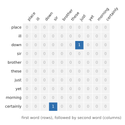

# Language as prediction (1948-2000) {#prediction}

<!-- D-002: intuition only; formulas (entropy, cross-entropy, perplexity) follow worked examples. D-003: no code; Shannon's sequences are shown as a figure. D-008: first chapter of the language thread; it jumps back to 1948. D-009: numbers from code/checks/prediction.py. D-014: figures from figures/prediction.py. -->

The chapters so far followed one thread: how networks learn. This chapter starts the second thread, how language is modeled, and it starts earlier, in 1948. The two threads meet at the transformer.

[The destination chapter](#destination) described an LLM as a machine that computes, for every possible next token, the probability that it comes next. This chapter shows that predicting the next piece of text is an old, well-defined statistical problem, much older than neural networks. For decades its standard solution was counting: tally which words follow which in a large body of text, and turn the tallies into probabilities. The reader may well have built such a model. The chapter follows that solution from its origin to its limits, and along the way introduces the measure that LLMs are still trained on and, as of 2026, still evaluated by [@jurafsky2026speech, p. 9].

## 1948: text as a random process

In 1948, Claude Shannon published "A Mathematical Theory of Communication" in the Bell System Technical Journal. He set meaning aside from the start: "These semantic aspects of communication are irrelevant to the engineering problem" [@shannon1948mathematical, p. 379]. That was a statement about engineering, not a claim that meaning is unimportant. What mattered for sending messages efficiently was that text is not random: "The letter E occurs more frequently than Q, the sequence TH more frequently than XP, etc." [@shannon1948mathematical, p. 385].

Shannon described a source of text as a machine that "will choose successive symbols according to certain probabilities depending, in general, on preceding choices" [@shannon1948mathematical, p. 385], and listed "Natural written languages such as English" among his examples. That is next-symbol prediction, stated as the definition of a text source, in 1948.

He then built a ladder of such machines, each one using more of the past, and showed what each one writes [@shannon1948mathematical, p. 388]. Here are four rungs, with letters chosen:

- independently and with equal probability: "XFOML RXKHRJFFJUJ ZLPWCFWKCYJ FFJEYVKCQSGXYD QPAAMKBZAACIBZLHJQD";
- depending on the one letter before ("digram structure as in English"): "ON IE ANTSOUTINYS ARE T INCTORE ST BE S DEAMY ACHIN D ILONASIVE TUCOOWE AT TEASONARE FUSO TIZIN ANDY TOBE SEACE CTISBE";
- depending on the two letters before ("trigram structure"): "IN NO IST LAT WHEY CRATICT FROURE BIRS GROCID PONDENOME OF DEMONSTURES OF THE REPTAGIN IS REGOACTIONA OF CRE";

and, switching from letters to words, with each word depending on the one before: "THE HEAD AND IN FRONTAL ATTACK ON AN ENGLISH WRITER THAT THE CHARACTER OF THIS POINT IS THEREFORE ANOTHER METHOD FOR THE LETTERS THAT THE TIME OF WHO EVER TOLD THE PROBLEM FOR AN UNEXPECTED".

"The resemblance to ordinary English text increases quite noticeably at each of the above steps", Shannon wrote, and of the last one: "The particular sequence of ten words 'attack on an English writer that the character of this' is not at all unreasonable" [@shannon1948mathematical, pp. 388-389].

These are the models of this chapter. A sequence of $n$ consecutive symbols is an **n-gram**: a **unigram** is one, a **bigram** two, a **trigram** three. A model that predicts the next symbol from the previous $n - 1$ is an n-gram model. (Shannon called the bigram model "second-order" and the trigram model "third-order". Other writers count differently, so this book avoids "order" and uses the n-gram names.) The mathematics was older still. A textbook account credits Markov, who in 1913 used such chains to predict whether the next letter of Pushkin's *Eugene Onegin* would be a vowel or a consonant [@jurafsky2026speech, pp. 21-22].

Shannon made his samples without a computer. For the letter bigram sample, "one opens a book at random and selects a letter at random on the page. This letter is recorded. The book is then opened to another page and one reads until this letter is encountered. The succeeding letter is then recorded" [@shannon1948mathematical, p. 389]. A book read this way is a table of probabilities that nobody had to write down.

### Measuring uncertainty in bits

Shannon also gave the measure that this chapter needs: how uncertain is the next symbol?

<!-- D-009: code/checks/prediction.py, Example 4 -->

Start with something simpler than English. A fair coin has two equally likely outcomes, and its uncertainty is 1 **bit**. A coin that lands heads 90% of the time is less uncertain, 0.469 bits. A fair six-sided die is more uncertain: 2.585 bits. A loaded die that lands six half the time, and each other face a tenth of the time, is in between: 2.161 bits. This measure is the **entropy** of the outcome, and in its standard form it is

$$H = -\sum_i p_i \log_2 p_i$$

where $p_i$ is the probability of outcome $i$, the sum runs over all possible outcomes, and $\log_2$ is the logarithm to base 2, which makes the unit the bit. Each outcome contributes its probability times its "surprise", $-\log_2 p_i$: a likely outcome is unsurprising, a rare one very surprising. Entropy is the average surprise. Shannon showed that it is zero "only when we are certain of the outcome", and largest "when all the p_i are equal" [@shannon1948mathematical, p. 394]. The word "bit", short for binary digit, he credited to J. W. Tukey [@shannon1948mathematical, p. 380].

For English, Shannon estimated that "when we write English half of what we write is determined by the structure of the language and half is chosen freely" [@shannon1948mathematical, pp. 398-399], counting structure over up to about eight letters. He linked redundancy to crossword puzzles: with no redundancy, "any two dimensional array of letters forms a crossword puzzle", while "if the redundancy is too high the language imposes too many constraints for large crossword puzzles to be possible" [@shannon1948mathematical, p. 399].

## 1951: the guessing game

Three years later Shannon measured the entropy of English in a different way, with a human as the model. His 1951 paper describes a method that "exploits the knowledge of the language statistics possessed by those who speak the language, and depends on experimental results in prediction of the next letter when the preceding text is known" [@shannon1951prediction, p. 50].

The procedure was a game. A person sees a passage they do not know, one letter at a time, and guesses each next letter. "If the guess is correct he is so informed, and proceeds to guess the second letter. If not, he is told the correct first letter and proceeds to his next guess" [@shannon1951prediction, p. 54]. Spaces count as a 27th letter.

{#fig:prediction-shannon-game}

<!-- D-009: code/checks/prediction.py, Example 6 -->

"Of a total of 129 letters, 89 or 69% were guessed correctly. The errors, as would be expected, occur most frequently at the beginning of words and syllables where the line of thought has more possibility of branching out" [@shannon1951prediction, p. 55]. Once "ROO" was known, "M" followed easily; once the "SH" of "SHABBY" had been given, "ABBY" followed.

Shannon then made an observation that connects prediction to compression. The second line of his record, the dashes and the missed letters, contains the whole passage, provided you have a predictor that guesses exactly the same way: "To accomplish this we need an identical twin of the individual who produced the sequence" [@shannon1951prediction, p. 55]. A good predictor and a good compressor are the same thing. The better the guesses, the fewer letters need to be written down.

In a second version of the game, the subject kept guessing until right, and Shannon recorded how many guesses each letter took. "Out of 102 symbols the subject guessed right on the first guess 79 times" [@shannon1951prediction, p. 56]. In a larger experiment with 100 short samples from one book, the subject was shown the preceding letters and guessed the next one. Apart from "some statistical fluctuation", the first guess was right more often the more of the text was known; in a similar test with 100 letters of preceding text, it was right 80 times out of 100 [@shannon1951prediction, pp. 57-58].

Shannon first computed what tables of letter frequencies alone could give, for a 26-letter alphabet without the space. The entropy fell as more statistics were used: 4.70 bits per letter if all letters were equally likely, 4.14 using single-letter frequencies, 3.56 using pairs of letters, and 3.3 using triples [@shannon1951prediction, p. 54]. He could go no further by counting, because "tables of N-gram frequencies were not available for N > 3" [@shannon1951prediction, p. 52]. From the guessing counts, with a human predictor and 100 letters of context, he derived bounds of between 0.6 and 1.3 bits per letter (for an alphabet that includes the space) [@shannon1951prediction, p. 64]. Shannon summarized the result as "something of the order of one bit per letter" [@shannon1951prediction, p. 50], and stressed the "considerable sampling error" in figures that came from one subject and one book [@shannon1951prediction, p. 64].

One sentence in the paper describes, in 1951, what an LLM is trained to do: "A machine or person guessing in the best way would guess letters in the order of decreasing conditional probability" [@shannon1951prediction, p. 58].

## Counting: the n-gram language model

A language model, in a current textbook's definition, "assigns a probability to each possible next word, or equivalently gives a probability distribution over possible next words. Language models can also assign a probability to an entire sentence" [@jurafsky2026speech, p. 1]. [The destination chapter](#destination) showed how the two are connected: the probability of a whole sentence is the product of the next-word probabilities, each given everything before it.

The difficulty is "everything before it". No collection of text, however large, contains every sentence beginning a reader might write. "Language is creative and any particular context might have never occurred before!" [@jurafsky2026speech, p. 3]. The n-gram model's answer is to forget most of the past: predict each word from only the last one or two. This simplification is called the **Markov assumption** [@jurafsky2026speech, p. 3]. Then the probabilities can be estimated by counting. The probability of a word given the word before it is the number of times the pair occurs, divided by the number of times the first word occurs.

<!-- D-009: code/checks/prediction.py, Example 1 -->

Here is the counting on a three-sentence corpus from the same textbook, with markers for the start and end of each sentence: "I am Sam", "Sam I am", "I do not like green eggs and ham" [@jurafsky2026speech, p. 4]. Two of the three sentences start with "I", so the probability that a sentence starts with "I" is 2/3. "I" occurs three times, followed twice by "am" and once by "do", so the probability of "am" after "I" is 2/3 and of "do" after "I" is 1/3. A reader who has trained a naive Bayes text classifier has done exactly this counting, with the order of the words thrown away. An n-gram model is the same counting with the order kept.

A model like this can also write, the way Shannon's book-opening did: pick each next word at random according to its probability, using the "ruler" of [the destination chapter](#destination). The longer the context, the more the output resembles real text, up to a point. Trained on Shakespeare, a 4-gram model produces sentences that "look a little too much like Shakespeare. The words It cannot be but so are directly from King John" [@jurafsky2026speech, p. 12]. With long contexts and a small corpus, the table memorizes its training text. The reader knows this as overfitting.

## IBM and the noisy channel

Statistical models of language fell out of favor in linguistics after 1957. That year, Chomsky argued in *Syntactic Structures* that "Colorless green ideas sleep furiously" and "Furiously sleep ideas green colorless" have both, in all likelihood, never been written, so that "in any statistical model for grammaticalness, these sentences will be ruled out on identical grounds as equally 'remote' from English. Yet (1), though nonsensical, is grammatical, while (2) is not" (quoted in [@liberman2010obituary, p. 596]; Chomsky's book was not read for this chapter). Mark Liberman, in an obituary of Fred Jelinek, describes the effect: the argument "plausibly and effectively undermined the value of empirical n-gram approximations as models of natural-language syntax", and by 1972 "the Information Theory bandwagon of the 1950s was lying forgotten in a ditch" for speech and language applications [@liberman2010obituary, p. 596]. Liberman names a second cause beside Chomsky: artificial-intelligence researchers of the time treated intelligence as "a matter of applied logic" [@liberman2010obituary, p. 596]. Chomsky's own case was also broader than one example: he argued that "finite-state Markov processes" could not be "a complete cognitive model of human grammatical knowledge" [@jurafsky2026speech, p. 22].

The two-sentence argument, at least, has a precise target, and this chapter will return to it: models that give every unseen sentence a probability of zero.

Statistics came back through speech recognition. A speech recognition group at IBM started in early 1972, and Jelinek took charge of it later that year [@jelinek2009dawn, p. 484]. They framed recognition as Shannon would have, as "transmission through a noisy channel": a speaker chooses words $W$, the channel turns them into sounds $A$, and the recognizer picks the words that are most probable given the observed sounds [@jelinek2009dawn, p. 487]. By Bayes' rule, that means choosing the $W$ that maximizes the product of two probabilities. One is the probability of the sounds given the words, the **acoustic model**. The other is the probability of the words themselves, the language model. The reader knows the pattern from Bayesian classification: a likelihood times a prior. Here the prior is a language model. Jelinek later wrote that the terms "acoustic model" and "language model" were "invented" at IBM, along with "perplexity", a measure this chapter defines below [@jelinek2009dawn, p. 487]; a textbook puts it more narrowly, that the IBM group first used them "for this technology" [@jurafsky2026speech, p. 22]. At the same time, James Baker at Carnegie Mellon used n-grams independently in his own recognizers [@jurafsky2026speech, p. 22].

Around 1978, the IBM group decided to recognize natural speech with a 5,000-word vocabulary, and "at John Cocke's suggestion we decided to model English by trigrams" [@jelinek2009dawn, pp. 488-489]. In a 2004 talk, Jelinek recalled a line from a 1988 workshop talk of his: "Whenever I fire a linguist our system performance improves". He added that the quote "accentuated a certain situation that existed in ASR in the seventies and in NLP in the eighties", and the 2004 talk itself was titled "Some of my Best Friends are Linguists" [@jelinek2004friends, slides 2-3]. (ASR is automatic speech recognition, NLP natural language processing. The line circulates in other wordings; this is Jelinek's own.)

The same equation went to translation. In 1990, Peter Brown and colleagues at IBM proposed translating by choosing the sentence that maximizes the product of a language model probability and a translation probability [@brown1990statistical, p. 79]. They tested what a trigram model alone knows about word order with a game of their own. Take a sentence, "cut it up into words, place the words in a bag, and then try to recover the sentence given the bag". Of 38 short sentences, a trigram model "recover[ed] 24 (63%) of the sentences exactly" [@brown1990statistical, p. 80]. Translation returns in [the chapter on reading and writing sequences](#seq2seq).

## The trouble with counting: zeros

Counting has a fatal weakness, and the numbers show how severe it is.

<!-- D-009: code/checks/prediction.py, Example 5 -->

In 1992, Brown and colleagues counted word sequences in 366 million words of English, with a vocabulary of 260,741 [@brown1992class, p. 470]. With that vocabulary there are about 68 billion possible word pairs. "Only 14,494,217 actually did occur", about one possible pair in 4,700. Of the 18 million billion possible triples, 75 million occurred. And from the rate of sequences seen only once, they estimated that "maximum likelihood estimates will be 0 for 14.7 percent of the 3-grams ... in a new sample of English text" [@brown1992class, p. 470]. One trigram in seven in new text would never have been seen, even after 366 million words.

<!-- D-009: code/checks/prediction.py, Example 7 -->

A single novel shows the same thing at a smaller scale. Jane Austen's *Pride and Prejudice*, in the Project Gutenberg edition and counting lowercased words, has 128,565 words with a vocabulary of 6,729. That allows 45,279,441 possible word pairs, of which 56,767 occur: 0.125% of the table is filled, and 99.87% is zero.

{#fig:prediction-sparse-counts}

A zero is not merely an inaccuracy. Since the probability of a sentence is a product, one zero makes the whole sentence impossible. A small example from Stanley Chen and Joshua Goodman: train a bigram model on three sentences, "John read Moby Dick", "Mary read a different book", and "She read a book by Cher". The model gives "John read a book" a probability of 0.0556, and "Cher read a book" a probability of exactly zero, because "Cher read" never occurred [@chen1998empirical, p. 5]. In speech recognition the consequence was concrete: if the speaker said such a word sequence, Jelinek wrote, "the recognizer would necessarily make an error" [@jelinek2009dawn, p. 489]. The reader has met this problem in naive Bayes, where one word never seen with a class drives that class's probability to zero.

## Smoothing

The remedy is **smoothing**: "Smoothing algorithms shave off a bit of probability mass from some more frequent events and give it to unseen events" [@jurafsky2026speech, p. 14]. The name comes from the effect: smoothing makes distributions "more uniform, by adjusting low probabilities such as zero probabilities upward, and high probabilities downward" [@chen1998empirical, p. 5].

The simplest version adds one to every count before dividing, as in the Laplace correction the reader may have used in naive Bayes. In the Cher example, with every word in the corpus and the end-of-sentence marker counted in the vocabulary, **add-one smoothing** gives "Cher read a book" a small probability, 0.0000209, instead of zero. <!-- D-009: Example 2 --> But it takes too much from the frequent events. In a textbook example from a restaurant-query corpus, the probability of "to" after "want" falls from 0.66 to 0.26 when one is added to the counts of all 1,446 words of the vocabulary [@jurafsky2026speech, p. 16]. "The sharp change occurs because too much probability mass is moved to all the zeros" [@jurafsky2026speech, p. 16].

The better idea is to fall back on less context when the longer context has not been seen. If a trigram never occurred, use the bigram; if the bigram never occurred either, use the single word's frequency. One version mixes the estimates for all context lengths with weights chosen on held-out data, which the reader will recognize as shrinkage toward a simpler model [@jurafsky2026speech, p. 17]. Brown and colleagues stated the trade-off in terms of reliability: "As n increases, the accuracy of an n-gram model increases, but the reliability of our parameter estimates, drawn as they must be from a limited training text, decreases" [@brown1992class, p. 470]. More context means less bias and more variance.

Another version, **back-off**, uses the longer context when it has been seen and backs off to a shorter one otherwise. In 1987 Slava Katz of IBM published a back-off method that set aside probability for unseen sequences according to how many sequences had been seen exactly once [@katz1987estimation, p. 400]. It is the same estimate that gave Brown and colleagues their 14.7%.

The most effective idea came from Reinhard Kneser and Hermann Ney in 1995, and is now called **Kneser-Ney smoothing**. When backing off to a single word, do not ask how frequent the word is; ask in how many different contexts it appears. Their example: "dollars" is very frequent in Wall Street Journal text but "occurs almost exclusively after numbers and some country names", so after a word it has never followed, it should get a low probability, however common it is [@kneser1995improved, p. 181]. Chen and Goodman make the same point with "Francisco", which appears almost only after "San" [@chen1998empirical, p. 15].

In 1998, Chen and Goodman compared the main smoothing methods across several corpora and training-set sizes, and found that "Kneser-Ney smoothing and variations consistently outperform all other algorithms"; their own modified version "consistently had the best performance" [@chen1998empirical, p. 59]. It became, in the textbook's words, "the standard baseline for n-gram language modeling around the turn of the century" [@jurafsky2026speech, p. 22]. Their study was also a lesson in method the reader will appreciate: earlier comparisons had typically tested two methods "on one or two corpora and using a single training set size", too little to show which method was really better [@chen1998empirical, pp. 2, 6].

Smoothing also answers Chomsky's particular challenge, on its own terms. In 2000, Fernando Pereira trained a simple model that shares statistics among words of similar behavior, grouping words into 16 classes, on newspaper text. It rated "Colorless green ideas sleep furiously" about 200,000 times more probable than "Furiously sleep ideas green colorless" [@pereira2000formal, p. 1245]. Chomsky's two-sentence argument holds against a model that gives every unseen sequence a probability of zero. It fails against a model that generalizes from similar words. (His broader claim, about what a complete model of grammar needs, is a different question.) That idea, sharing what is known about one word with similar words, is the subject of [the next chapter](#embeddings).

## Measuring a language model: cross-entropy and perplexity

How do you tell which of two language models is better? Give each one text it has not seen, and measure how surprised it is. "A better model is better at predicting upcoming words, and so it will be less surprised by ... each word when it occurs in the test set" [@jurafsky2026speech, p. 9].

<!-- D-009: code/checks/prediction.py, Example 3 -->

Take a five-word text, "red red red red blue", and two models of a language with three color words. Model A thinks all three are equally likely, 1/3 each. Model B thinks red has probability 0.8, and green and blue 0.1 each [@jurafsky2026speech, pp. 10-11]. Model A's average surprise is 1.585 bits per word, and model B's is 0.922 bits: model B predicted the text better.

That average surprise is the **cross-entropy** of the model on the text. In its standard form, for a text of $N$ words,

$$H = -\frac{1}{N} \log_2 P(w_1 w_2 \ldots w_N)$$

where $P(w_1 w_2 \ldots w_N)$ is the probability the model gives the whole text (the product of its next-word probabilities), and dividing by $N$ makes it a per-word average. Lower is better.

Language modelers usually report it in another form. The **perplexity** is 2 raised to the cross-entropy:

$$PP = 2^{H}$$

It reads as the number of equally likely choices the model is, in effect, choosing among at each step. Model A's perplexity is exactly 3, since it really is choosing uniformly among three words. Model B's is 1.895. The textbook calls perplexity "the weighted average branching factor of a language" [@jurafsky2026speech, pp. 10-11]. The six-token text from [the destination chapter](#destination), with its made-up probabilities, has a cross-entropy of 2.815 bits per token and a perplexity of 7.04: on average, the model was as unsure as if it were choosing among about seven tokens.

Why "cross"? Because the surprise is measured with the model's probabilities, while the text comes from the true source. Return to the loaded die, whose true entropy is 2.161 bits. A model that wrongly believes the die is fair scores its rolls at 2.585 bits each. The extra 0.424 bits is the cost of the wrong model, and it is never negative: cross-entropy is lowest when the model's probabilities match the source's [@goodfellow2016deep, p. 73]. This is Shannon's identical twin in another form. Chen and Goodman put it in terms of compression: a model that gives a text probability $p$ can be turned into a code that writes the text in $-\log_2 p$ bits, so cross-entropy is the number of bits per word the model needs to encode the text [@chen1998empirical, p. 7].

Here is what the numbers looked like for n-grams. Trained on 38 million words of the Wall Street Journal and tested on 1.5 million more, a unigram model had a perplexity of 962, a bigram model 170, and a trigram model 109 [@jurafsky2026speech, p. 10]. Typical n-gram perplexities on English ranged "from about 50 to almost 1000", depending on the text [@chen1998empirical, p. 7]. Perplexities can be compared only between models that share a vocabulary [@jurafsky2026speech, p. 10], a point that matters in [the chapter on tokens](#tokens). Small differences mattered in practice: for speech recognition, Chen and Goodman found, on their data, a word-error rate about 5.4 percentage points lower for every bit of cross-entropy saved [@chen1998empirical, p. 58].

This is the measure promised in [the destination chapter](#destination). Neural networks are trained to minimize the same quantity. The textbook of Goodfellow, Bengio, and Courville: "Most modern neural networks are trained using maximum likelihood. This means that the cost function is simply the negative log-likelihood, equivalently described as the cross-entropy between the training data and the model distribution" [@goodfellow2016deep, p. 174]. The first GPT paper wrote its training objective as the sum of the log-probabilities of each token given the tokens before it [@radford2018improving, p. 3]. Its perplexity is still on the scoreboard: in 2019, GPT-2 reported a perplexity of 35.76 on a standard test set where the best earlier result was 46.54, without training on that data set at all [@radford2019language, p. 5]. (GPT-2 read the test text as bytes, through "invertible de-tokenizers", rather than with the earlier models' word vocabulary, so the comparison is less direct than it looks; see the caution above [@radford2019language, pp. 4-5].) As of 2026, a current textbook still describes perplexity as "used for evaluating large language models as well as n-gram models" [@jurafsky2026speech, p. 9].

## Where counting breaks

By 2000, smoothed n-gram models were mature and well understood. They had two limits that no amount of smoothing could remove.

The first is size. A table of contexts grows as the vocabulary raised to the length of the context. Yoshua Bengio and colleagues put a number on it in 2003: "if one wants to model the joint distribution of 10 consecutive words in a natural language with a vocabulary V of size 100,000, there are potentially 100,000^10 - 1 = 10^50 - 1 free parameters" [@bengio2003neural, p. 1137]. That is why practical models used n-grams of at most three to five words, that is two to four words of context, and most predictions used much less [@bengio2003neural, p. 1139]. The reader knows this as the **curse of dimensionality**: "the number of possible distinct configurations of a set of variables increases exponentially as the number of variables increases" [@goodfellow2016deep, p. 152].

The second is that an n-gram model has no idea that words resemble each other. To it, "cat" and "dog" are as different as "cat" and "furiously". Bengio and colleagues gave the example that matters: "having seen the sentence "The cat is walking in the bedroom" in the training corpus should help us generalize to make the sentence "A dog was running in a room" almost as likely" [@bengio2003neural, p. 1139]. A counting model gets no such help. The deep learning textbook describes an n-gram model as a kind of nearest-neighbor lookup in which "any two different words have the same distance from each other", so that "only training examples that repeat literally the same context are useful" [@goodfellow2016deep, p. 458].

Shannon's 1951 subject did not have this problem. A person guessing the next letter knows that "cat" and "dog" are both animals. [The next chapter](#embeddings) is about how to give a model that kind of knowledge: by representing each word not as an entry in a table but as a point in a space, where similar words are close together.

## What to carry forward

- Predicting the next symbol of text is an old problem. Shannon posed it in 1948, and in 1951 measured how predictable English is by having a person guess letters: about one bit per letter with 100 letters of context, by his estimate.
- An n-gram model predicts each word from the previous one or two, with probabilities estimated by counting. It is naive Bayes counting with word order kept.
- Counts are mostly zero. Even in 366 million words, about one trigram in seven of new text had never been seen, and a single zero makes a whole sentence impossible.
- Smoothing moves probability to unseen events. The best methods back off to shorter contexts, and Kneser-Ney smoothing (as modified by Chen and Goodman) was the standard around 2000.
- Entropy is average surprise in bits. Cross-entropy is a model's average surprise on real text, and perplexity is 2 to that power: the effective number of choices at each step. LLMs are trained to minimize cross-entropy and, as of 2026, are still evaluated by perplexity.
- Counting fails in two ways: the table grows as the vocabulary to the power of the context length, and words are unrelated symbols, so nothing learned about "cat" helps with "dog".
