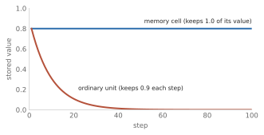

# Networks with structure, and the second winter (1980-2005) {#structure}

<!-- D-002: intuition only; formulas limited to the memory-cell update, after its worked example. D-003: no code. D-008: last chapter of the "how networks learn" thread before deep-turn. D-009: numbers from code/checks/structure.py. D-014: figures from figures/structure.py. D-016: convolution kept brief and taught on a sequence. -->

[The previous chapter](#backprop) ended with a method for training networks with hidden layers and a theorem saying such networks could approximate almost anything. This chapter follows what happened when researchers pointed them at real data: handwritten digits, speech, and sentences.

Plain layered networks, with every unit connected to every unit in the next layer, turned out to be a poor fit for that data. Two structural ideas made the difference, and both are the same idea in two settings: use the same weights in many places. Sharing weights across positions in an image or signal gave the **convolutional network**. Sharing weights across steps in time gave the **recurrent network**. The second ran into an obstacle that took most of the 1990s to understand and partly overcome. Meanwhile, much of machine learning moved to methods the reader will know well, above all the support vector machine. This chapter ends in the reader's own era.

## The trouble with connecting everything

A layer in which every unit receives every input is called **fully connected**. It is the network of [the previous chapter](#backprop), and it ignores two facts about real data.

The first is size. In their 1998 paper on document recognition, Yann LeCun and colleagues put the problem in numbers: "typical images are large, often with several hundred variables (pixels). A fully-connected first layer with, say one hundred hidden units in the first layer, would already contain several tens of thousands of weights. Such a large number of parameters increases the capacity of the system and therefore requires a larger training set" [@lecun1998gradient, p. 5]. The reader will recognize the argument: more free parameters, more capacity, more risk of overfitting, more data needed.

The second is position. A fully connected network treats each pixel as a separate variable with its own weights, so a pattern learned in one place tells it nothing about the same pattern somewhere else. The same paper continues: "the main deficiency of unstructured nets for image or speech applications is that they have no built-in invariance with respect to translations, or local distortions of the inputs" [@lecun1998gradient, p. 5]. In principle a large enough network could learn the same pattern separately at every position, but "learning such a task would probably result in multiple units with similar weight patterns positioned at various locations in the input" [@lecun1998gradient, p. 5]. And a fully connected layer does not even know which pixels are neighbors: "The input variables can be presented in any (fixed) order without affecting the outcome of the training" [@lecun1998gradient, p. 6].

Sequences have the same problem. The obvious way to feed a sentence or a sound to a network is to lay out a fixed window of the most recent inputs side by side, turning time into space. Jeffrey Elman, writing in 1990, explained what goes wrong, using two short vectors of ones and zeros [@elman1990finding, p. 181]:

- A: 0 1 1 1 0 0 0 0 0
- B: 0 0 0 1 1 1 0 0 0

"These two vectors appear to be instances of the same basic pattern, but displaced in space (or time, if these are given a temporal interpretation). However, as the geometric interpretation of these vectors makes clear, the two patterns are in fact quite dissimilar and spatially distant" [@elman1990finding, p. 181]. To a network that sees them as points in nine-dimensional space, A and B have only one position in common; their cosine similarity is 0.333. <!-- D-009: code/checks/structure.py, Example 3 --> A fixed window also caps how far back the network can look, as Elman notes [@elman1990finding, p. 181]. A reader who has built n-gram models knows this cap: an n-gram model also sees only a fixed window of the last few words, and [the chapter on prediction](#prediction) shows where that breaks down.

## Sharing weights across space: convolution

Here is the fix for A and B. Take a small set of weights, say three of them, all equal to 1. Place them over the first three positions of the input, compute the weighted sum, then slide them one position to the right and do it again, all the way along. The small set of weights is a **filter**, and sliding it along the input is **convolution**. The sequence of outputs is a **feature map**: a record of where the filter's pattern occurs.

{#fig:structure-conv1d}

<!-- D-009: code/checks/structure.py, Example 3 -->

For A, the filter outputs 2, 3, 2, 1, 0, 0, 0; for B, 0, 1, 2, 3, 2, 1, 0. Both contain the same peak of 3, and B's output is A's output shifted two places. The filter recognizes "a run of three" wherever it occurs, because it uses the same three weights at every position. That is **weight sharing**: many connections controlled by one parameter. The filter needs only three weights, whether the signal has nine positions or nine thousand. In the language of the deep learning textbook by Goodfellow, Bengio, and Courville, the shift in the output follows the shift in the input because convolution is "equivariant": "if the input changes, the output changes in the same way" [@goodfellow2016deep, p. 334].

A network built from such layers is a convolutional network. It has many filters per layer, each learning its own pattern, and later layers apply filters to the feature maps of earlier ones, so that patterns of patterns can be detected. Between them it often shrinks the feature maps by keeping one summary value per small neighborhood, a step called **pooling** or subsampling, which makes the result less sensitive to small shifts. LeCun and colleagues summarize the design as three ideas: "local receptive fields, shared weights (or weight replication), and spatial or temporal sub-sampling" [@lecun1998gradient, p. 6]. (A unit's receptive field is the part of the input it sees; "local" means a small neighborhood.)

Nothing here depends on the input being an image. "Fixed-size convolutional networks that share weights along a single temporal dimension are known as Time-Delay Neural Networks" [@lecun1998gradient, p. 7], and they were used for speech. A 2015 review by LeCun, Bengio, and Hinton lists the kinds of data the idea suits: "1D for signals and sequences, including language; 2D for images or audio spectrograms; and 3D for video" [@lecun2015deep, p. 439]. For images, the filter is a small square, say 5 pixels by 5, slid across the picture in both directions. This book is about language, so images get only the short history that follows. [The chapter on the deep learning turn](#deep-turn) returns to them for the result that changed the field in 2012. <!-- D-016 -->

### From the neocognitron to reading checks

In 1980 Kunihiko Fukushima, at the NHK Broadcasting Science Research Laboratories in Tokyo, described the **neocognitron**, a model of visual pattern recognition that "acquires an ability to recognize stimulus patterns based on the geometrical similarity (Gestalt) of their shapes without affected by their positions" [@fukushima1980neocognitron, p. 193]. (Gestalt, from German, means overall form.) It already had shared weights: "all the cells in a single cell-plane have input synapses of the same spatial distribution, and only the positions of the presynaptic cells are shifted" [@fukushima1980neocognitron, pp. 194-195]. But it was not trained by backpropagation, and not trained on labeled examples. It was "self-organized by "learning without a teacher"" [@fukushima1980neocognitron, p. 193], and its experiments were small: five patterns, "0" to "4", each shown 20 times at randomly shifted positions, and in a later run ten [@fukushima1980neocognitron, pp. 200-201].

Later accounts agree on these facts and differ on emphasis. Schmidhuber's survey says the neocognitron "introduced convolutional NNs" [@schmidhuber2014deep, p. 10]. LeCun, Bengio, and Hinton say convolutional networks "have their roots in the neocognitron, the architecture of which was somewhat similar, but did not have an end-to-end supervised-learning algorithm such as backpropagation" [@lecun2015deep, p. 439]. The safe summary is that the neocognitron had the architecture, and what it lacked was a way to train every weight from labeled examples.

For images, that came in 1989, from LeCun and colleagues at AT&T Bell Laboratories, who trained a convolutional network by backpropagation to read handwritten zip codes [@lecun1989backpropagation, pp. 541-542]. (Backpropagation had already been used from 1988 to train time-delay networks, the one-dimensional kind, for speech [@goodfellow2016deep, pp. 361-362].) Their design principle was "to reduce the number of free parameters in the network as much as possible without overly reducing its computational power" [@lecun1989backpropagation, p. 541]. The data were 9,298 digits "from handwritten zip codes that appeared on U.S. mail passing through the Buffalo, NY post office": 7,291 for training and 2,007 for testing, each a 16-by-16 image [@lecun1989backpropagation, p. 542]. (They credit the idea of weight sharing itself to Rumelhart, Hinton, and Williams in 1986 [@lecun1989backpropagation, p. 544].)

The effect of weight sharing on size is easy to count. The first hidden layer had 768 units with 19,968 connections, "but only 1068 free parameters ... since many connections share the same weight" [@lecun1989backpropagation, p. 545]. A fully connected layer of the same 768 units, each seeing all 256 pixels, would have needed 197,376: about 185 times as many. The whole network had "1256 units, 64,660 connections, and 9760 independent parameters" [@lecun1989backpropagation, p. 546]. <!-- D-009: code/checks/structure.py, Examples 1 and 2 -->

The effect on accuracy was the point. The network misclassified 0.14% of the training set and 5.0% of the test set [@lecun1989backpropagation, p. 547]. (102 errors out of 2,007 is 5.1%; the paper prints 5.0%.) For comparison, "a fully connected network with one hidden layer of 40 units" got 8.1% of the test set wrong [@lecun1989backpropagation, pp. 547-548]. The authors explained the difference in terms a 2000s statistician would use. Building the structure in "not only builds in shift-invariance, but vastly reduces ... the Vapnik-Chervonenkis dimensionality, and the number of free parameters, thereby proportionately reducing the amount of training data required" [@lecun1989backpropagation, p. 548]. Training took "3 days on a Sun workstation" [@lecun1989backpropagation, p. 549].

Nine years later, the 1998 paper by LeCun, Léon Bottou, Yoshua Bengio, and Patrick Haffner described a larger network, LeNet-5, and documented in full a benchmark (a shared data set on which methods are compared; [the chapter on the deep learning turn](#deep-turn) says more) built from US government collections of handwritten digits: 60,000 training images and 10,000 test images, each 28 by 28 pixels, "called the Modified NIST, or MNIST, dataset" [@lecun1998gradient, pp. 9-10]. (A set of the same size and image format was already in use by 1995 [@cortes1995support, p. 287].) LeNet-5 had "340,908 connections, but only 60,000 trainable free parameters because of the weight sharing" [@lecun1998gradient, p. 7]. Its test error was 0.95%, and 0.8% when the training images were augmented with distorted copies [@lecun1998gradient, pp. 10-11]. A system built on it read bank checks: "It has been fielded in several banks across the US since June 1996, and has been reading millions of checks per day since then" [@lecun1998gradient, pp. 39-40]. By the late 1990s, according to the 2015 review, it was reading "over 10% of all the cheques in the United States" [@lecun2015deep, p. 439].

## Sharing weights across time: recurrence

Convolution handles a pattern that can appear at any position, but it still looks at a window of fixed width. Language needs something that can carry information forward for as long as it is needed.

A **recurrent neural network** does this by feeding its own hidden layer back into itself. At each step it reads one input, say one word, and combines it with a summary of everything it has read so far, its **hidden state**. The result is the new hidden state, which is passed to the next step. Elman's 1990 paper, "Finding Structure in Time", made the idea concrete with a design he called a simple recurrent network. A set of "context units" holds a copy of the hidden layer from the previous step: "These context units thus provide the network with memory" [@elman1990finding, p. 183]. Elman credits the approach to earlier work by Jordan in 1986 [@elman1990finding, p. 179], and Goodfellow and colleagues trace recurrent networks to Rumelhart and colleagues in the same year [@goodfellow2016deep, p. 367]; Elman's is an early example, not the first.

Elman's best-known experiment will look familiar from [the destination chapter](#destination). He generated 10,000 short sentences from 29 words, each word represented by a vector of 31 bits with a single 1 in a different place, so that every word was equally unlike every other: the encoding "reflected nothing about the form class or meaning of the words" [@elman1990finding, p. 195]. The network's task "was to predict the 31-bit vector corresponding to the next word in the sequence" [@elman1990finding, p. 197]. Next-word prediction, in 1990, on a vocabulary of 29.

The network could not predict the exact next word, which the random sentence generator made impossible; as Elman says, "The network is not able to predict the precise order of words" [@elman1990finding, p. 199]. But when Elman grouped the words by the hidden states they produced, he found that "the network has discovered that there are several major categories of words. One large category corresponds to verbs; another category corresponds to nouns" [@elman1990finding, p. 199]. Nobody had told it what a noun was. The categories came, as Elman put it, from "the co-occurrence statistics" of the words [@elman1990finding, p. 198]. (Elman reports a colleague's warning that this analysis, which averages each word's hidden states, could create an artifact, and that results "should be verified by clustering individual tokens" [@elman1990finding, p. 199].) A network trained only to predict the next word had learned a representation of words in which similar words were close together. [The chapter on words as vectors](#embeddings) takes up that idea.

The key structural point is that a recurrent network uses the same weights at every step. Goodfellow and colleagues call this "sharing parameters across different parts of a model", and give the reason: "If we had separate parameters for each value of the time index, we could not generalize to sequence lengths not seen during training" [@goodfellow2016deep, p. 367]. Their example is a pair of sentences, "I went to Nepal in 2009" and "In 2009, I went to Nepal": the year should be recognized as the year wherever it appears. A network with Elman's layer sizes, 31 inputs, 150 hidden units, and 31 outputs, has 31,800 weights, not counting biases, whatever the length of the sentence; giving each of ten positions its own weights would take 318,000. <!-- D-009: code/checks/structure.py, Example 4 -->

### Unrolling through time

How do you train a network that loops back into itself? Draw it out, one copy per step. This is called **unrolling** (or unfolding) the network.

{#fig:structure-unrolled}

Drawn this way, a recurrent network is a layered network with one layer per step, in which every layer has the same weights. (A network with many layers is called **deep**; [the next chapter](#deep-turn) explains why depth came to matter.) In the words of the 2015 review, "RNNs, once unfolded in time ... can be seen as very deep feedforward networks in which all the layers share the same weights" [@lecun2015deep, p. 442]. Backpropagation applies directly to the unrolled network, with one adjustment: since the same weight appears at every step, its gradient is the sum of its gradients at all the steps. This is **backpropagation through time**: one stores the activations "while going forward in time", and "the backward phase is also backward in time" [@bengio1994learning, p. 157].

## The vanishing gradient

Unrolling also exposes the obstacle. In the backward pass of [the previous chapter](#backprop), the blame passed to an earlier unit is the later blame multiplied by a connecting weight and by the earlier unit's slope. In an unrolled recurrent network, the blame for something that happened 20 words ago has passed back through 20 such multiplications, by the same weights each time.

Repeated multiplication is unforgiving. Multiply by 0.5 twenty times and you get about one millionth (0.00000095). Multiply by 0.9 a hundred times and you get 0.0000266. Multiply by 1.5 twenty times and you get about 3,325. Only a factor of exactly 1 stays put. <!-- D-009: code/checks/structure.py, Example 5 --> The sigmoid makes shrinking the usual case: its slope is never more than 0.25, as Hochreiter and Schmidhuber note [@hochreiter1997long, p. 1740], so with weights of moderate size each step back multiplies the blame by something well below 1. With a factor of 0.25, ten steps are already enough to reach one millionth.

This is the **vanishing gradient** problem, and its opposite, when the factor is above 1, is the **exploding gradient** problem. In the summary of Goodfellow and colleagues, "gradients propagated over many stages tend to either vanish (most of the time) or explode (rarely, but with much damage to the optimization)" [@goodfellow2016deep, p. 396]. Hochreiter and Schmidhuber spell out the consequence for learning: when the error vanishes, "learning to bridge long time lags takes a prohibitive amount of time or does not work at all" [@hochreiter1997long, p. 1736]. A recurrent network trained this way learns the effect of the last few words well and the effect of words long ago barely at all. The relationships it struggles with, between things far apart in a sequence, are called **long-term dependencies**.

Yoshua Bengio, Patrice Simard, and Paolo Frasconi showed in 1994 that the difficulty is not an accident of particular settings but a trade-off. A network that stores information robustly, so that small disturbances do not erase it, is in a regime where the gradient back to the moment of storing it fades: "either such a system is stable and resistant to noise or, alternatively, it is efficiently trainable by gradient descent, but not both" [@bengio1994learning, pp. 157-158]. They were careful about the strength of the claim: their result "does not mean that it is impossible to train a recurrent network on a particular task. It says that gradient descent becomes increasingly inefficient when the temporal span of the dependencies increases" [@bengio1994learning, p. 164]. In Goodfellow and colleagues' summary of the experiments, the chance of training a traditional recurrent network successfully fell rapidly toward zero "for sequences of only length 10 or 20" [@goodfellow2016deep, pp. 398-399]. Bengio and colleagues also noted that the same problem "may occur in deep feedforward networks" [@bengio1994learning, p. 164]; [the chapter on making deep networks trainable](#depth) returns to it.

Who identified the problem first is another question with two answers in the sources. Sepp Hochreiter analyzed it in his diploma thesis at the Technical University of Munich, dated 15 June 1991 and written in German, with Jürgen Schmidhuber as his advisor [@hochreiter1991untersuchungen]. Schmidhuber's survey calls the thesis "a milestone of explicit DL research" (DL meaning deep learning) and says it "formally identified a major reason" why deep networks were hard to train [@schmidhuber2014deep, p. 16]; the LSTM paper, by Hochreiter and Schmidhuber, calls Bengio and colleagues' work "a very similar, more recent analysis" [@hochreiter1997long, p. 1740]. Goodfellow, Bengio, and Courville describe the problem as "independently discovered by separate researchers (Hochreiter, 1991; Bengio et al., 1993, 1994)" [@goodfellow2016deep, p. 398]. The two groups later wrote a joint account of the problem [@hochreiter2001gradient].

## LSTM: a memory cell with gates

The best-known answer came from Hochreiter and Schmidhuber: **long short-term memory**, or **LSTM**, submitted in August 1995 and published in 1997 [@hochreiter1997long, p. 1780]. (The name means memory held in activations for a long time, "as opposed to long-term memory embodied by slowly changing weights" [@hochreiter1997long, p. 1735].)

The idea starts from the arithmetic above. If multiplying by anything other than 1 makes the backward signal vanish or explode, build a unit that multiplies by exactly 1. LSTM's core is a value that is carried from one step to the next with a self-connection of weight 1.0 and no squashing, so that it stays the same unless something changes it. The authors called it a "constant error carousel", because the backward signal can circulate through it for any number of steps without shrinking or growing [@hochreiter1997long, pp. 1741-1743]. A unit that only kept its value would be useless, though: it could never be written to or read from selectively. So the value is guarded by two learned switches, or **gates**:

> A multiplicative input gate unit is introduced to protect the memory contents stored in j from perturbation by irrelevant inputs, and a multiplicative output gate unit is introduced to protect other units from perturbation by currently irrelevant memory contents stored in j. The resulting, more complex unit is called a memory cell. [@hochreiter1997long, p. 1743]

Each gate is itself a small sigmoid unit, so its output lies between 0 (closed) and 1 (open), and it learns from the data when to open. A gate works by multiplication: the value passing through it is multiplied by the gate's output.

Here is a **memory cell** at work, with the gates simply set by hand. At step 1 the input gate is open and the value 0.8 is written in; after that the input gate stays closed. The cell still holds 0.8 at step 100, and the effect of step 1 on step 100, through the self-connection, is exactly 1. An ordinary unit that keeps 0.9 of its value at each step, by comparison, holds 0.000024 by step 100. <!-- D-009: code/checks/structure.py, Example 6 -->

{#fig:structure-cell}

Written in its standard form, the 1997 cell's stored value $s$ is updated at each step $t$ as

$$s(t) = s(t-1) + i(t)\,g(t)$$

where $s(t-1)$ is the value stored at the previous step, $g(t)$ is the new value offered by the current input, and $i(t)$ is the input gate, between 0 and 1, which decides how much of it gets in [@hochreiter1997long, p. 1744]. The cell's output is the stored value, squashed and multiplied by the output gate.

The original experiments were on artificial tasks designed to require long memory [@hochreiter1997long, p. 1735]. LSTM learned to "bridge minimal time lags in excess of 1000 discrete-time steps" [@hochreiter1997long, p. 1735]. In one task with a delay of 100 steps, LSTM succeeded in all 18 trials, and backpropagation through time and another standard method of the time in none; with a delay of only 10 steps, "No trial was successful" for one of those standard methods [@hochreiter1997long, p. 1754]. The authors also listed what LSTM could not easily do, such as count time steps precisely [@hochreiter1997long, pp. 1766-1767].

The LSTM in most later descriptions has a third gate. Goodfellow and colleagues describe it as "a crucial addition", from Gers, Schmidhuber, and Cummins in 2000: making the weight on the cell's self-connection itself controlled by a gate, "rather than fixed" [@goodfellow2016deep, p. 404; @schmidhuber2014deep, p. 19]. This **forget gate** lets the network learn when to clear its memory, by multiplying the stored value by something less than 1. (The 2000 paper is cited here through these secondary accounts.) With the forget gate held at 1, the cell above keeps its 0.8; at 0.9 it fades exactly like the ordinary unit; at 0 it clears in a single step. The three-gate LSTM, with input, forget, and output gates, came into wide use for sequences. As of 2016, Goodfellow and colleagues wrote that it was "widely used for many sequence modeling tasks, including many natural language processing tasks at Google" [@goodfellow2016deep, p. 17]. [The chapter on reading and writing sequences](#seq2seq) shows it at work in translation, and the chapters after it show what replaced it.

## The second winter, and the reader's own era

While convolutional and recurrent networks were being developed, much of machine learning went another way. Goodfellow and colleagues describe the turn:

> Ventures based on neural networks and other AI technologies began to make unrealistically ambitious claims while seeking investments. When AI research did not fulfill these unreasonable expectations, investors were disappointed. Simultaneously, other fields of machine learning made advances. Kernel machines (Boser et al., 1992; Cortes and Vapnik, 1995; Schölkopf et al., 1999) and graphical models (Jordan, 1998) both achieved good results on many important tasks. These two factors led to a decline in the popularity of neural networks that lasted until 2007. [@goodfellow2016deep, p. 17]

This book calls that decline the second winter, by analogy with the decline after 1969 described in [the chapter on the artificial neuron](#neuron).

The reader knows the method at the center of it. Corinna Cortes and Vladimir Vapnik's 1995 paper describes the **support vector machine**, then called a support-vector network: "input vectors are non-linearly mapped to a very high-dimension feature space. In this feature space a linear decision surface is constructed" [@cortes1995support, p. 273]. The earlier version required training data that could be separated without errors; the 1995 paper's contribution was the soft margin, which allows some errors [@cortes1995support, p. 273]. (The function that makes the high-dimensional mapping cheap is called a kernel. It is unrelated to the filters of a convolutional network, which some writers also call kernels; this book says "filter" for those.)

Several reasons are given for the preference, by different authors, and they are best read side by side.

- **Training with a guaranteed answer.** Training an SVM means solving "a quadratic optimization problem", and "the obtained optimal decision function is unique" [@cortes1995support, p. 284]. The kernel method lets one "learn models that are nonlinear as a function of x using convex optimization techniques that are guaranteed to converge efficiently" [@goodfellow2016deep, p. 139]. In a **convex** problem every local minimum is also the global minimum: the bowl of [the previous chapter](#backprop), where gradient descent is guaranteed to find the best weights. Neural network training is not convex, and "In the past, the application of gradient descent to nonconvex optimization problems was regarded as foolhardy or unprincipled" [@goodfellow2016deep, p. 150].
- **A belief that deep networks could not be trained.** In the review by LeCun, Bengio, and Hinton: "In the late 1990s, neural nets and backpropagation were largely forsaken by the machine-learning community and ignored by the computer-vision and speech-recognition communities. It was widely thought that learning useful, multistage, feature extractors with little prior knowledge was infeasible. In particular, it was commonly thought that simple gradient descent would get trapped in poor local minima" [@lecun2015deep, p. 438]. The same authors add, from the vantage point of 2015: "In practice, poor local minima are rarely a problem with large networks" [@lecun2015deep, p. 438].
- **Results.** Schmidhuber's survey: "In the decade around 2000, many practical and commercial pattern recognition applications were dominated by non-neural machine learning methods such as Support Vector Machines (SVMs)", adding: "Nevertheless, at least in certain domains, NNs outperformed other techniques" [@schmidhuber2014deep, p. 21].
- **Expectations.** Goodfellow and colleagues, reflecting on why convolutional networks kept working when other networks were written off, suggest that "the primary barriers to the success of neural networks were psychological (practitioners did not expect neural networks to work, so they did not make a serious effort to use neural networks)" [@goodfellow2016deep, p. 366].

The head-to-head results are less one-sided than the story suggests. On the US Postal Service digits, Cortes and Vapnik report SVM error rates of 4.2% to 4.7%, against 6.6% for the best two-layer neural network and 5.1% for a specially designed five-layer network [@cortes1995support, pp. 287-288]. On MNIST, the 1998 paper lists a regular SVM at 1.4%, refined SVMs at 1.1%, 1.0%, and 0.8%, and LeNet-5 at 0.95%, or 0.8% with distorted training data [@lecun1998gradient, pp. 10-11, 14]. The 1998 paper notes that "the uncertainty in the quoted error rates is about 0.1%" [@lecun1998gradient, p. 12], so at their best the two were level. What differed was how they got there. One remark, which Cortes and Vapnik quote from a benchmark study, captures it: the plain SVM "has excellent accuracy, which is most remarkable, because unlike the other high performance classifiers, it does not include knowledge about the geometry of the problem. In fact the classifier would do as well if the image pixels were encrypted e.g. by a fixed, random permutation" [@cortes1995support, pp. 289-290]. A plain SVM, knowing nothing about images, came within a few tenths of a percent of LeNet-5. The convolutional network won its accuracy by building in the structure of images, and the best SVM results also used knowledge of images: they came from variants trained, like LeNet-5's best run, on distorted copies of the training images [@lecun1998gradient, pp. 12, 14], and Cortes and Vapnik had already used preprocessing "to incorporate knowledge about the invariances of the problem at hand" [@cortes1995support, p. 288].

To many practitioners of the 2000s, the choice seemed clear. An SVM had a convex training problem with one answer, a theory of generalization the reader learned in school (margins, the Vapnik-Chervonenkis dimension), and good results on many problems. A neural network had a non-convex training problem, a reputation for getting stuck, a learning rate and starting weights to fiddle with, and a hand-designed architecture for each new kind of data. Neural networks did not disappear: convolutional networks kept reading checks, LSTMs kept improving, and a research program funded by the Canadian Institute for Advanced Research "helped to keep neural networks research alive", in Goodfellow and colleagues' words [@goodfellow2016deep, p. 17]. But for most of the decade around 2000, they were not where the field's attention was.

This is the point where the reader's own knowledge of the field begins and ends. The next chapter, [the deep learning turn](#deep-turn), starts in 2006 and explains what changed: data, computing power, and depth.

## What to carry forward

- A fully connected network has too many parameters for images and long inputs, and treats every position separately, so it must relearn the same pattern at every place.
- Convolution slides one small filter along the input, using the same weights at every position. It cuts parameters sharply (1,068 instead of 197,376 in one 1989 layer) and finds a pattern wherever it appears. Convolutional networks read zip codes in 1989 and bank checks from 1996.
- A recurrent network carries a hidden state from step to step, using the same weights at every step. Unrolled, it is a deep layered network with shared weights, trained by backpropagation through time. Elman's 1990 network, trained to predict the next word, grouped words into nouns and verbs on its own.
- Blame passed back through many steps is multiplied many times: it usually vanishes and sometimes explodes. This makes long-term dependencies hard to learn. Hochreiter (1991) and Bengio, Simard, and Frasconi (1994) analyzed it; who was first depends on whose account you read.
- LSTM (1997) adds a memory cell whose value is carried with weight exactly 1, guarded by input and output gates; a forget gate was added in 2000. By the mid-2010s it was widely used for sequences.
- In the decade around 2000, SVMs and other kernel methods, with convex training and a clear theory, were preferred over neural networks for many applications, even where results were level. That preference is the reader's starting point for the rest of the book.
